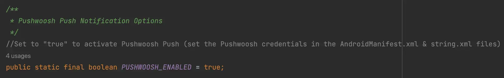
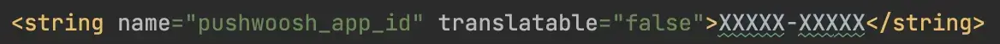
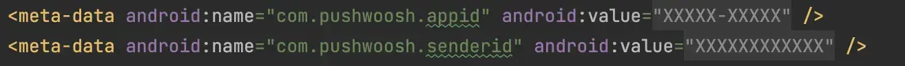
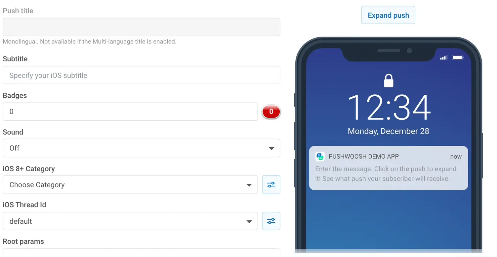
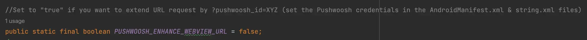
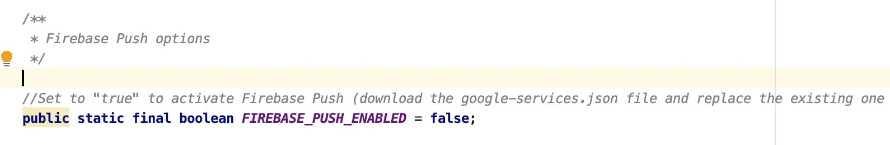
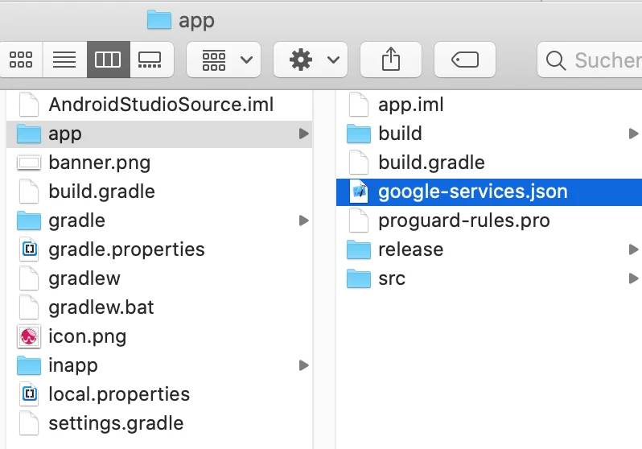
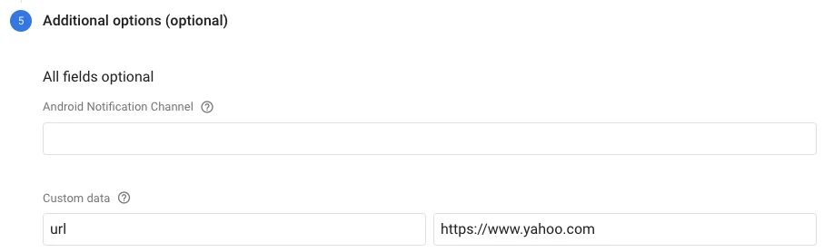

# Push Notifications API (OneSignal, Firebase, Pushwoosh) – WebViewGold for Android

> **Summary:** Send push notifications to your Android app users with OneSignal, Firebase, or Pushwoosh — setup, deep links, and per-user targeting explained.

[Documentation](../README.md) › [WebViewGold for Android](README.md) › Push Notifications API

**Platform:** Android · **Category:** APIs & Features · **Online version:** [www.webviewgold.com/docs/android/push-notifications/](https://www.webviewgold.com/docs/android/push-notifications/)

---

Push notifications are notifications that appear on your smartphone without opening the app. These types of messages allow fantastic interaction with customers and users of the app. Your app does not have to be open. This way, your customers do not miss any important news or messages. Push Notifications are suitable for many cases, e.g., for updates to orders, live tickers, or social media community. There must be an internet connection to allow app users to receive push messages. WebViewGold supports multiple ways of reaching your users via push notifications.

## Option 1: Use Local Push Notification JavaScript API

You can insert a piece of code (JavaScript) in your website, to define a push notification, which can be shown **after** your app was closed (while scheduling it during the app is open). This works without OneSignal configuration at all.

```html
<script>
var title = "Your cart is waiting!"; //notification title
var message = "You have left a cart full of dreams and deals behind. Dont leave it feeling abandoned"; //notification message
var seconds = 120; //seconds from now on
var url = "https://myshop.org/cart.php"; //deep-linking URL

window.location.href = "sendlocalpushmsg://push.send?s="+ seconds +"=msg!"+ message +"&!#"+ title +"&!#"+ url +"";
</script>
```

It could be used for different situations (countdowns, happy hours (like in the example code), reminders, ...).\
To cancel all scheduled local push notifications run:

```html
<script>
window.location.href = "sendlocalpushmsg://push.send.cancel";
</script>
```

## Option 2: Use Pushwoosh Remote Push Notifications

**WebViewGold users are eligible for two free months of Pushwoosh!**\
To claim this offer, please email your WebViewGold License to [pushwoosh-love@webviewgold.com](mailto:pushwoosh-love@webviewgold.com) and you will get a personal reply soon.

If you want to use [Pushwoosh](https://www.pushwoosh.com) (good choice!) for push notifications in your app, just activate the options in **Config.java** by setting **PUSHWOOSH_ENABLED** to **true** and ensure to also update the **Pushwoosh IDs** in the **string.xml** & **AndroidManifest.xml** files with your own Pushwoosh IDs:\
\
\


Congratulations, your setup is already completed. You're now ready to send push notifications:\
[](https://www.pushwoosh.com)\
Want to get **each individual user's device ID** for personalized push notifications or further processing? Simply set **WONDERPUSH_ENHANCE_WEBVIEW_URL** to **true** in **Config.java** to append ?pushwoosh_id=XYZ to your WebView URL:\
\
For example, if your WebView URL is https://www.example.org, WebViewGold will call https://www.example.org?pushwoosh_id=XYZ instead. Remember, only the initial URL request will receive this GET variable, so please save it in a session or a cookie for later use within your linked pages. Alternatively or additionally, you can **retrieve & process this information on any page using JavaScript**:

```html
<script>
window.location.href = "getpushwooshid://";
alert(pushwooshplayerid);
</script>
```

## Option 3: Use OneSignal Remote Push Notifications

If you want to use OneSignal for configuring Remote Push Notifications, this video tutorial will guide you step-by-step during this process.

[](https://www.youtube.com/watch?v=0cPNGqMQVm0)

After completing this video tutorial, you will be able to easily set up remote push notifications for your mobile application using OneSignal. This will allow you to send out important updates, reminders, or promotional content directly to your users' devices, even if they are not currently using your app.

In summary, the process for configuring OneSignal for push notifications is as follows:

1. Go to the Android Studio and find the OneSignal Options. By default PUSH_ENABLE, PUSH_ENHANCE_WEBVIEW_URL and PUSH_RELOAD_ON_USERID are shown as false, so set them to true.
2. Open your OneSignal account and select your organization and app name.

***If you have not created your app on the OneSignal project follow these steps first.***

[](https://www.youtube.com/watch?v=X9jepbGFw7A)

***Consider that for creating and configuring your OneSignal Account you will need a JSON file. To get this file you must have your Firebase account configured. If you do not have your Firebase configured to get the JSON file, check this additional tutorial.***

[](https://www.youtube.com/watch?v=qAqdhcd3ngs)

- Once you have created your OneSignal App, go to the settings section and select Native Android as your platform, then copy the App ID code you obtained.
- Open the Android Studio and go to the Gradle Scrip Section and select build,grade (Module:app).
- On the section ONE_SIGNAL_APP_ID paste the code you had copied from OneSignal.
- Then, generate your *APK* file and run on a physical device.
- Go to OneSignal and your app project select *New Message* and click on *New Push*.
- Fill out the information required and it's done! You have tested your OneSignal Push Messages.

Replace **ic_stat_onesignal_default.png** to replace the **default bell icon fallback** of OneSignal push notifications. \
Do you want to get **each individual subscription ID** on your server for further processing and **<a id="firebaseruntime"></a>individual user** push messages? Just activate the **PUSH_ENHANCE_WEBVIEW_URL** option in Config.java (by switching the value from false to true) in order to append ?onesignal_push_id=XYZ to your WebView URL. If your WebView URL is https://www.example.org, WebViewGold will call https://www.example.org?onesignal_push_id=XYZ instead. Only your FIRST URL request will get that GET variable, so save it in a session or in a cookie to access it on your linked pages. An alternative or additional way would be to **retrieve & process the information on any page via JavaScript**:

```html
<script>
window.location.href = "getonesignalplayerid://";
alert(onesignalplayerid);
</script>
```

**Alternatively, consider turning  `AUTO_INJECT_VARIABLES`  to `true` in Config.java to automatically inject this (and other) values into JavaScript without needing to call a URL upfront.**

## Option 4: Use Firebase Remote Push Notifications

If you want to use Firebase for configuring Remote Push Notifications, this video tutorial will guide you step-by-step during this process.

[](https://www.youtube.com/watch?v=X-02iJSBaAQ)

In summary, the process for configuring Firebase for push notifications is as follows:

### 1. Rename package name & create a Firebase project

Please [rename the package name](publish.md#renamepackagename) of your WebViewGold Android app. Then, you have to create a Firebase project in your [Firebase Console](https://console.firebase.google.com/).

### 2. Activate Firebase in WebViewGold

In Android Studio, go to Config.java file and turn the **FIREBASE_PUSH_ENABLED** variable to **true**.



### 3. Register your app with Firebase

After you created your Firebase project, you can add your WebViewGold app to it.

a. In the center of the Firebase console's project overview page, click the Android icon to launch the setup workflow.

b. If you've already added an app to your Firebase project, click **Add app** to display the platform options.
Enter your app's package name as changed/defined [in this step](publish.md).
Make sure that you enter the package name that your app is using. You cannot add or modify this value after you register your app with your Firebase project.\
**4. Click the *Register app* button.**
**5. Download google-services.json**
Click Download google-services.json to obtain your Firebase Android config file (google-services.json) and replace the sample file already included in the WebViewGold project by using the Mac Finder or the Windows Explorer:\
\
 **That's it!**\
If you want to use Firebase URL Deeplinking (opens a specific URL when clicking on your notification), please add the desired URL in a **Custom Data** field (in the **Additional options (optional)** section) with **Key** = "url" and **Value** = {the desired URL}.\
\
Do you want to get **each individual subscription ID** on your server for further processing and **individual user** push messages? Just activate the **FIREBASE_PUSH_ENHANCE_WEBVIEW_URL** option in Config.java (by switching the value from false to true) in order to append ?firebase_push_id=XYZ to your WebView URL. If your WebView URL is https://www.example.org, WebViewGold will call https://www.example.org?firebase_push_id=XYZ instead. Only your FIRST URL request will get that GET variable, so save it in a session or in a cookie to access it on your linked pages. An alternative or additional way would be to **retrieve & process the information on any page via JavaScript**:

```html
<script>
window.location.href = "getfirebaseplayerid://";
alert(firebaseplayerid);
</script>
```

**Alternatively, consider turning  `AUTO_INJECT_VARIABLES`  to `true` in Config.java to automatically inject this (and other) values into JavaScript without needing to call a URL upfront.**

## Option 5: Use bubble.io Push Notifications

[](https://www.youtube.com/watch?v=C0HBXlMSK2E)

1. Create a **bubble.io app**
2. Install the **[WebViewGold OneSignal Push](https://bubble.io/plugin/webviewgold-onesignal-push-1602240916803x713805488222896100)** plugin:

[](https://bubble.io/plugin/webviewgold-onesignal-push-1602240916803x713805488222896100)
3. Follow the **OneSignal instructions (see above)** and the **plugin instructions (see [here](https://bubble.io/plugin/webviewgold-onesignal-push-1602240916803x713805488222896100) and [here](https://www.youtube.com/watch?v=C0HBXlMSK2E))**.

---

## Push Permission APIs: Ask at the right moment & check the current status

### Request the push notification permission manually (`registerpush://`)

By default, WebViewGold asks the user for the push notification permission on the first run of the app (`requirePush = true` in **Config.java**). Permission prompts convert much better when they appear in the right context — so you can also set `requirePush` to `false` and trigger the native permission prompt from your web app at the perfect moment (e.g., after login or onboarding):

```html
<a href="registerpush://">Enable notifications</a>
```

```javascript
window.location.href = "registerpush://";
```

**Note:** This requires at least one push service to be activated in **Config.java** (`PUSH_ENABLED`, `FIREBASE_PUSH_ENABLED`, or `PUSHWOOSH_ENABLED`).

### Check the current push permission status (`checkNativePushPermissions://`)

To find out whether the user currently allows push notifications, call:

```javascript
window.location.href = "checkNativePushPermissions://";
```

WebViewGold then injects the JavaScript variable `nativePushEnabled` (`true` or `false`) into your page. On Android 13 and higher, both the system notification setting and the `POST_NOTIFICATIONS` runtime permission must be granted for the value to be `true`. Example:

```html
<script>
window.location.href = "checkNativePushPermissions://";
setTimeout(function () {
    if (typeof nativePushEnabled !== "undefined" && nativePushEnabled) {
        console.log("Push notifications are enabled");
    } else {
        // e.g., show your own hint and offer registerpush:// or settingsapp://
    }
}, 500);
</script>
```

If the permission was denied permanently, you can guide the user to the system settings via the [Open App Settings API](open-app-settings.md) (`settingsapp://`).

---

## Continue reading

- ← Previous: [Geolocation API](geolocation.md)
- Next →: [AdMob Ads API](admob.md)
- Same feature on other platforms: [iOS – Push Notifications API](../ios/push-notifications.md)
- Languages: **🇺🇸 English** · [🇩🇪 Deutsch](../de/android/push-notifications.md) · [🇫🇷 Français](../fr/android/push-notifications.md) · [🇪🇸 Español](../es/android/push-notifications.md) · [🇨🇳 中文](../zh/android/push-notifications.md)

> [!TIP]
> **Too busy? We set up your app for you.** Our team configures, builds & submits your WebViewGold app — done-for-you, fast turnaround, Made in Germany. [Get your app set up →](https://www.WeSetupYourWebViewApp.com?ref=webviewgold_android_doc_online)
>
> **Build in your browser:** No Mac, no IDE: the **WebViewGold Cloud Builder** configures, builds & uploads your app online. [Discover Cloud Builder →](https://www.webviewgold.com/cloud-builder?ref=android_docs)
