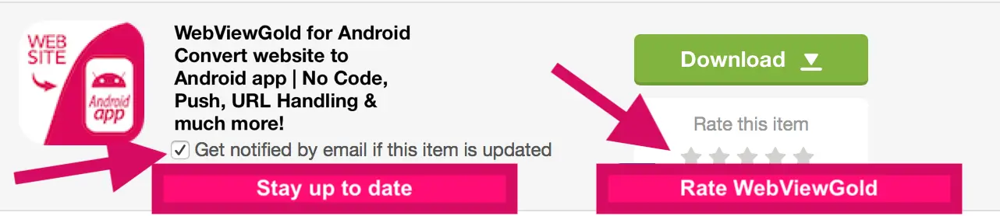

# Rate WebViewGold – WebViewGold for Android

> **Summary:** Enjoying WebViewGold? Rate it on CodeCanyon in seconds — it keeps updates coming.

[Documentation](../README.md) › [WebViewGold for Android](README.md) › Rate WebViewGold

**Platform:** Android · **Category:** More · **Online version:** [www.webviewgold.com/docs/android/rate/](https://www.webviewgold.com/docs/android/rate/)

---

If you have 10 seconds, please rate WebViewGold (it's a great motivation for future updates ^^):\
**1.** Go to [**CodeCanyon.net**](https://www.codecanyon.net?ref=onlineappcreator) and sign in\
**2.** Navigate to [**https://www.codecanyon.net/downloads**](https://www.codecanyon.net/downloads?ref=onlineappcreator)\
**3.** Click the stars, as shown in this picture:

\
Thank you very much!

---

## Continue reading

- ← Previous: [Credits & Licenses](credits.md)
- Next →: [iOS & macOS versions](more-platforms.md)
- Same feature on other platforms: [iOS – Rate WebViewGold](../ios/rate.md) · [macOS – Rate WebViewGold](../macos/rate.md)
- Languages: **🇺🇸 English** · [🇩🇪 Deutsch](../de/android/rate.md) · [🇫🇷 Français](../fr/android/rate.md) · [🇪🇸 Español](../es/android/rate.md) · [🇨🇳 中文](../zh/android/rate.md)

> [!TIP]
> **Too busy? We set up your app for you.** Our team configures, builds & submits your WebViewGold app — done-for-you, fast turnaround, Made in Germany. [Get your app set up →](https://www.WeSetupYourWebViewApp.com?ref=webviewgold_android_doc_online)
>
> **Build in your browser:** No Mac, no IDE: the **WebViewGold Cloud Builder** configures, builds & uploads your app online. [Discover Cloud Builder →](https://www.webviewgold.com/cloud-builder?ref=android_docs)
