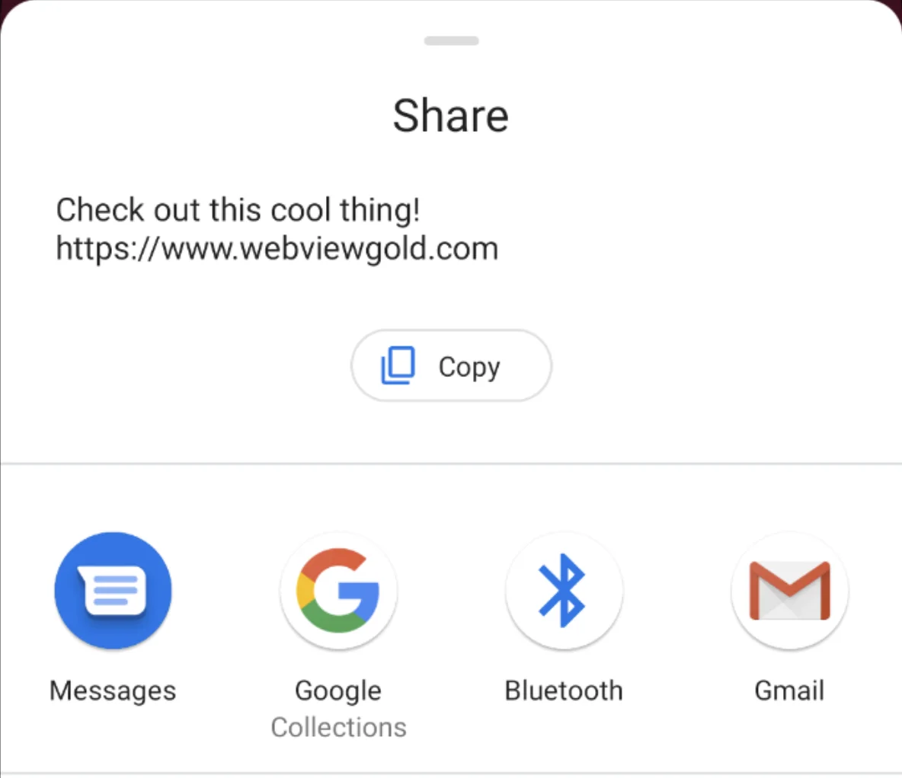

# App-Teilen-Dialog-API – WebViewGold für Android

> **Zusammenfassung:** Löse den nativen Android-Teilen-Dialog aus deiner Web-App aus, damit Nutzer deine App oder beliebige URLs teilen können.

[Dokumentation](../README.md) › [WebViewGold für Android](README.md) › App-Teilen-Dialog-API

**Plattform:** Android · **Kategorie:** APIs & Funktionen · **Online-Version:** [www.webviewgold.com/de/docs/android/app-sharing-dialog/](https://www.webviewgold.com/de/docs/android/app-sharing-dialog/)

---

Die App Sharing Dialog API in WebViewGold ermöglicht es deinen Nutzern, Inhalte aus deiner App – etwa den Download-Link oder benutzerdefinierte Nachrichten – über ihre bevorzugten Apps (z. B. WhatsApp, SMS, E-Mail) mit Freunden und Familie zu teilen. Dies kann eine wirksame Methode sein, um die Sichtbarkeit deiner App zu erhöhen und deine Nutzerbasis zu vergrößern.

## So verwendest du den App Sharing Dialog in deiner WebView-basierten Android-App

Du kannst einen nativen Teilen-Dialog auslösen, indem du das URL-Schema `shareapp://` mit anpassbaren Nachrichten- und URL-Parametern verwendest.

Nachfolgend findest du Beispiele für die verschiedenen Möglichkeiten, diese Funktion zu implementieren:

```html
<a href="shareapp://message?=Check out this cool thing!&url=https://www.webviewgold.com">Share (message, link)</a>

<a href="shareapp://message?=&url=https://www.webviewgold.com">Share (no message, link)</a>

<a href="shareapp://message?=Check out this cool thing!">Share (message, no link)</a>
```



---

## Weiterlesen

- ← Vorherige: [ShareIntent-API](share-intent.md)
- Weiter →: [In-App-Rating-API](in-app-rating.md)
- Dieselbe Funktion auf anderen Plattformen: [iOS – App-Teilen-Dialog-API](../ios/app-sharing-dialog.md)
- Sprachen: [🇺🇸 English](../../android/app-sharing-dialog.md) · **🇩🇪 Deutsch** · [🇫🇷 Français](../../fr/android/app-sharing-dialog.md) · [🇪🇸 Español](../../es/android/app-sharing-dialog.md) · [🇨🇳 中文](../../zh/android/app-sharing-dialog.md)

> [!TIP]
> **Zu wenig Zeit? Wir richten deine App für dich ein.** Unser Team konfiguriert, erstellt & reicht deine WebViewGold-App ein – schlüsselfertig, mit schneller Bearbeitung, Made in Germany. [App einrichten lassen →](https://www.WeSetupYourWebViewApp.com?ref=webviewgold_android_doc_online)
>
> **Im Browser erstellen:** Kein Mac, keine IDE: Der **WebViewGold Cloud Builder** konfiguriert, erstellt & lädt deine App online hoch. [Cloud Builder entdecken →](https://www.webviewgold.com/cloud-builder?ref=android_docs)
