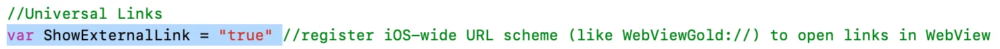
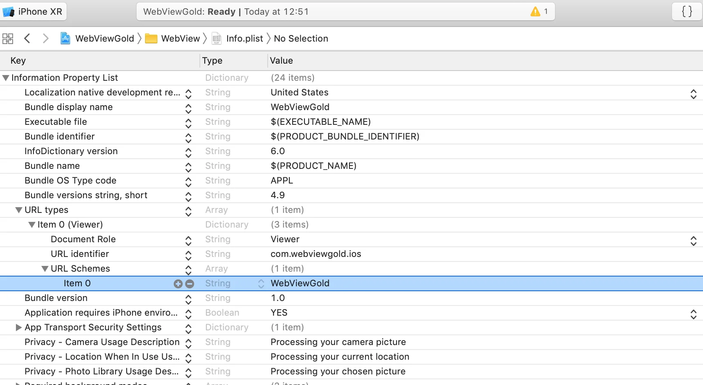

# Deep-Linking-API – WebViewGold für iOS

> **Zusammenfassung:** Starte deine iOS-App über benutzerdefinierte URL-Schemata und leite Nutzer per Deep Link zu bestimmten Seiten deiner Web-App.

[Dokumentation](../README.md) › [WebViewGold für iOS](README.md) › Deep-Linking-API

**Plattform:** iOS · **Kategorie:** APIs & Funktionen · **Online-Version:** [www.webviewgold.com/de/docs/iOS/deep-linking/](https://www.webviewgold.com/de/docs/iOS/deep-linking/)

---

Die **Deep-Linking-API** macht es einfach, Nutzer zu bestimmten Inhalten innerhalb deiner App zu leiten. WebViewGold ermöglicht die Konfiguration eines Custom URL Schemes (z. B. `webviewgold://`), das aus Apps wie **Mail, Safari und anderen** ausgelöst werden kann, um Links direkt in deiner WebView-App zu öffnen.

**Hinweis:** Damit diese Funktion funktioniert, muss die App zunächst installiert sein.

**Alternativ** kannst du unsere [**Universal-Links-API**](universal-links.md) verwenden. Sie funktioniert ähnlich, nutzt jedoch eine andere Syntax, die verbreiteter ist als die der Deep-Linking-API. Für die meisten Apps ist es sinnvoll, sich für eine der beiden Varianten zu entscheiden, nicht für beide.

Um **Deep Linking** in deiner iOS-App einzurichten, folge bitte den nachstehenden Schritten:

1. **Config.swift öffnen:**
   - Setze `ShowExternalLink` auf `true`.


2. **Info.plist öffnen:**
   - Ändere das URL Scheme auf deinen eigenen App-Namen (z. B. `your-app-name://` anstelle von `webviewgold://`).



**Fertig! :)** Das folgende Beispiel würde google.com in der WebView-App öffnen:

```
WebViewGold://url?link=https://www.google.com
```

[](https://www.youtube.com/watch?v=mW4H_gUKU28)

---

## Weiterlesen

- ← Vorherige: [Universal Links-API](universal-links.md)
- Weiter →: [App-Teilen-Dialog-API](app-sharing-dialog.md)
- Dieselbe Funktion auf anderen Plattformen: [macOS – Deeplinking API](../macos/deep-linking.md)
- Sprachen: [🇺🇸 English](../../ios/deep-linking.md) · **🇩🇪 Deutsch** · [🇫🇷 Français](../../fr/ios/deep-linking.md) · [🇪🇸 Español](../../es/ios/deep-linking.md) · [🇨🇳 中文](../../zh/ios/deep-linking.md)

> [!TIP]
> **Zu wenig Zeit? Wir richten deine App für dich ein.** Unser Team konfiguriert, erstellt & reicht deine WebViewGold-App ein – schlüsselfertig, mit schneller Bearbeitung, Made in Germany. [App einrichten lassen →](https://www.WeSetupYourWebViewApp.com?ref=webviewgold_ios_doc_online)
>
> **Im Browser erstellen:** Kein Mac, keine IDE: Der **WebViewGold Cloud Builder** konfiguriert, erstellt & lädt deine App online hoch. [Cloud Builder entdecken →](https://www.webviewgold.com/cloud-builder?ref=ios_docs)
