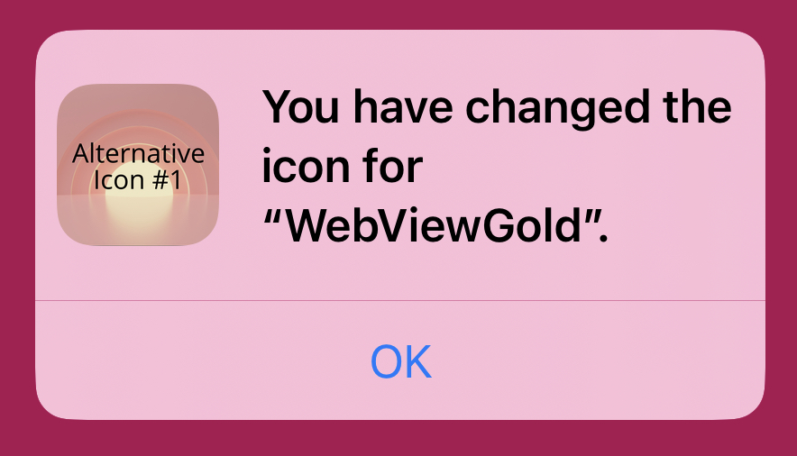
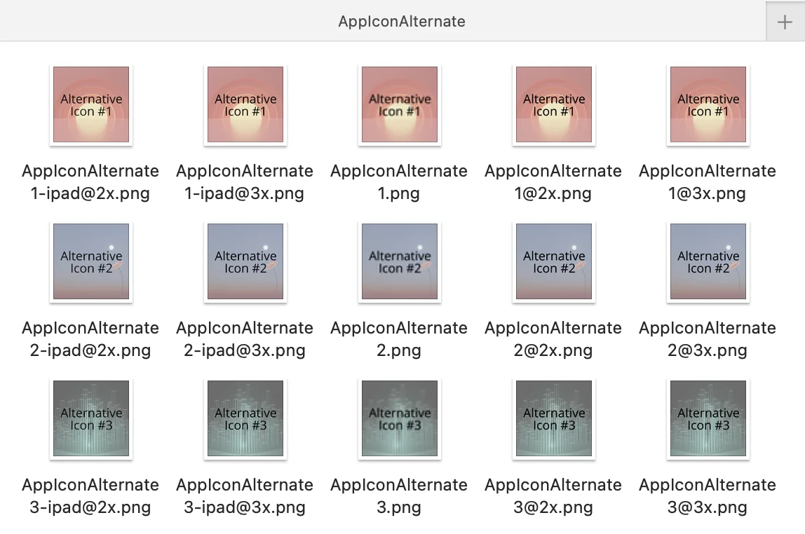
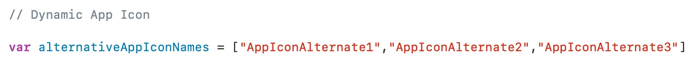

# Dynamisches-App-Icon-API – WebViewGold für iOS

> **Zusammenfassung:** Wechsle zur Laufzeit zwischen alternativen App-Icons in deiner iOS-WebView-App – ausgelöst aus deiner Web-App.

[Dokumentation](../README.md) › [WebViewGold für iOS](README.md) › Dynamisches-App-Icon-API

**Plattform:** iOS · **Kategorie:** APIs & Funktionen · **Online-Version:** [www.webviewgold.com/de/docs/iOS/dynamic-app-icon/](https://www.webviewgold.com/de/docs/iOS/dynamic-app-icon/)

---

Diese API **ermöglicht es den Nutzern deiner App, das App-Icon per Knopfdruck zu ändern**. WebViewGold erlaubt **bis zu drei alternative App-Icons** zusätzlich zu deinem Standard-App-Icon. Immer wenn das App-Icon dynamisch geändert wird, erhält der Nutzer nach erfolgreichem Abschluss eine Benachrichtigung:\
\
Wenn du das App-Icon deiner App im Namen deiner Nutzer ändern möchtest, kannst du dies tun, indem du eine neue Version deiner App mit dem neuen App-Icon veröffentlichst. Wie du dein App-Icon in WebViewGold änderst, erfährst du [hier](app-name-icon-splash.md).\
Um das App-Icon dynamisch zu ändern, verlinke einfach auf eines der folgenden URL-Formate:

```html
<script>
// Change to Alternative App Icon 1
window.location.href = "changeicon://icon1"

// Change to Alternative App Icon 2
window.location.href = "changeicon://icon2"

// Change to Alternative App Icon 3
window.location.href = "changeicon://icon3"

// Revert to the Default App Icon
window.location.href = "changeicon://default"

</script>
```

Eine Demo- und Testseite für diese API findest du [hier](https://webviewgoldtest.github.io/alticonsios.html).\
Um deine alternativen App-Icons festzulegen, öffne deine App-Dateien im Finder und navigiere zu **WebView-Swift/WebView/ApplicationIcon/AppIconAlternate**.\
In diesem Ordner findest du Vorlagen-App-Icons für alle in iOS erforderlichen App-Icon-Größen (iPhones und iPads), für jedes alternative Icon:\
\
Die Standardnamen der einzelnen alternativen App-Icons lauten: „AppIconAlternate1“, „AppIconAlternate2“ und „AppIconAlternate3“.\
Bei Bedarf kannst du die Standardnamen ändern, indem du die Variable **alternativeAppIconNames** in der **Config**-Datei bearbeitest:\
\
Jedes App-Icon (zum Beispiel „AppIconAlternateX“) erfordert fünf verschiedene Größen, die durch das Dateinamens-Suffix beschrieben werden:

- Für iPhones:

- AppIconAlternateX *(60x60 Pixel)*
- AppIconAlternateX**@2x** *(120x120 Pixel)*
- AppIconAlternateX**@3x** *(180x180 Pixel)*

- Für iPads:

- AppIconAlternateX**-ipad@2x** *(152x152 Pixel)*
- AppIconAlternateX**-ipad@3x** *(167x167 Pixel)*

Wenn du diese Vorlagen-App-Icons durch deine eigenen ersetzt, stelle sicher, dass sie demselben Dateinamensformat folgen (mit den oben aufgeführten Suffixen) und die korrekte Bildgröße aufweisen.\
Eine detailliertere Anleitung zu App-Icon-Spezifikationen findest du [hier](https://developer.apple.com/design/human-interface-guidelines/foundations/app-icons/).

Um diese API zu aktivieren (auch für das App Store Review), öffne bitte die Info.plist als Quellcode (Rechtsklick auf die Datei und im Kontextmenü „Open As“ -> „Source Code“ auswählen):
Suche innerhalb der Info.plist nach

```xml
<key>CFBundleIcons</key>
	<dict>
		<key>CFBundlePrimaryIcon</key>
		<dict>
			<key>CFBundleIconFiles</key>
			<array>
				<string></string>
			</array>
			<key>UIPrerenderedIcon</key>
			<false/>
		</dict>
	</dict>
```

und ersetze es durch

```xml
<key>CFBundleIcons</key>
<dict>
	<key>CFBundleAlternateIcons</key>
	<dict>
		<key>AppIconAlternate1</key>
		<dict>
			<key>CFBundleIconFiles</key>
			<array>
				<string>AppIconAlternate1</string>
			</array>
			<key>UIPrerenderedIcon</key>
			<false/>
		</dict>
		<key>AppIconAlternate2</key>
		<dict>
			<key>CFBundleIconFiles</key>
			<array>
				<string>AppIconAlternate2</string>
			</array>
			<key>UIPrerenderedIcon</key>
			<false/>
		</dict>
		<key>AppIconAlternate3</key>
		<dict>
			<key>CFBundleIconFiles</key>
			<array>
				<string>AppIconAlternate3</string>
			</array>
			<key>UIPrerenderedIcon</key>
			<false/>
		</dict>
	</dict>
	<key>CFBundlePrimaryIcon</key>
	<dict>
		<key>CFBundleIconFiles</key>
		<array>
			<string></string>
		</array>
		<key>UIPrerenderedIcon</key>
		<false/>
	</dict>
</dict>
```

Suche außerdem nach

```xml
<key>CFBundleIcons~ipad</key>
<dict>
    <key>CFBundlePrimaryIcon</key>
    <dict>
        <key>CFBundleIconFiles</key>
        <array>
            <string></string>
        </array>
        <key>UIPrerenderedIcon</key>
        <false/>
    </dict>
</dict>
```

und ersetze es durch

```xml
<key>CFBundleIcons~ipad</key>
<dict>
	<key>CFBundleAlternateIcons</key>
	<dict>
		<key>AppIconAlternate1</key>
		<dict>
			<key>CFBundleIconFiles</key>
			<array>
				<string>AppIconAlternate1-ipad</string>
			</array>
			<key>UIPrerenderedIcon</key>
			<false/>
		</dict>
		<key>AppIconAlternate2</key>
		<dict>
			<key>CFBundleIconFiles</key>
			<array>
				<string>AppIconAlternate2-ipad</string>
			</array>
			<key>UIPrerenderedIcon</key>
			<false/>
		</dict>
		<key>AppIconAlternate3</key>
		<dict>
			<key>CFBundleIconFiles</key>
			<array>
				<string>AppIconAlternate3-ipad</string>
			</array>
			<key>UIPrerenderedIcon</key>
			<false/>
		</dict>
	</dict>
	<key>CFBundlePrimaryIcon</key>
	<dict>
		<key>CFBundleIconFiles</key>
		<array>
			<string></string>
		</array>
		<key>UIPrerenderedIcon</key>
		<false/>
	</dict>
</dict>
```

Dies ist die Standardeinstellung hinsichtlich der Namen der alternativen App-Icons und der Anzahl der alternativen App-Icon-Dateien.

---

## Weiterlesen

- ← Vorherige: [Dynamische-UI-API](dynamic-ui.md)
- Weiter →: [Kontakte-API](contacts.md)
- Sprachen: [🇺🇸 English](../../ios/dynamic-app-icon.md) · **🇩🇪 Deutsch** · [🇫🇷 Français](../../fr/ios/dynamic-app-icon.md) · [🇪🇸 Español](../../es/ios/dynamic-app-icon.md) · [🇨🇳 中文](../../zh/ios/dynamic-app-icon.md)

> [!TIP]
> **Zu wenig Zeit? Wir richten deine App für dich ein.** Unser Team konfiguriert, erstellt & reicht deine WebViewGold-App ein – schlüsselfertig, mit schneller Bearbeitung, Made in Germany. [App einrichten lassen →](https://www.WeSetupYourWebViewApp.com?ref=webviewgold_ios_doc_online)
>
> **Im Browser erstellen:** Kein Mac, keine IDE: Der **WebViewGold Cloud Builder** konfiguriert, erstellt & lädt deine App online hoch. [Cloud Builder entdecken →](https://www.webviewgold.com/cloud-builder?ref=ios_docs)
