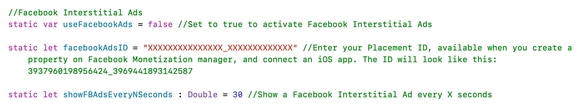

# Facebook Audience Network Ads-API – WebViewGold für iOS

> **Zusammenfassung:** Zeige Facebook-Audience-Network-Banner- und -Interstitial-Anzeigen in deiner WebViewGold-iOS-App an.

[Dokumentation](../README.md) › [WebViewGold für iOS](README.md) › Facebook-Ads-API

**Plattform:** iOS · **Kategorie:** APIs & Funktionen · **Online-Version:** [www.webviewgold.com/de/docs/iOS/facebook-ads/](https://www.webviewgold.com/de/docs/iOS/facebook-ads/)

---

Das [Facebook Audience Network](https://www.facebook.com/audiencenetwork/) ermöglicht es Entwicklern mobiler Apps, iOS- und Android-Anwendungen durch die Anzeige von Werbung zu monetarisieren. Über WebViewGold kannst du Facebook-Anzeigen einfach in deine WebView-basierten iOS-Anwendungen einbinden, um durch Klicks (CPC) und Impressions (CPM) Einnahmen zu erzielen.

## Schritt 1: Facebook-Audience-Network-Konto erstellen

Du musst ein [Facebook-Audience-Network](https://www.facebook.com/audiencenetwork/)-Konto anlegen und im Monetization Manager unter „Integration“ eine Property erstellen. Anschließend musst du eine iOS-App verknüpfen (zu Testzwecken musst du jedoch keine bereits veröffentlichte iOS-App verknüpfen).

Folge zur Orientierung dieser Anleitung: <https://www.facebook.com/business/help/191133327919314>

## Schritt 2: Erforderliche Konfigurationsvariablen setzen

- Öffne **Config.swift** und setze `useFacebookAds` auf `true`.
- Trage deine Facebook Placement ID unter `facebookAdsID` ein.

## Schritt 3: Anzeigeneinstellungen konfigurieren

- Um zeitgesteuerte Anzeigen zu verwenden, setze `useTimedAds` auf `true` und stelle `showFBAdsEveryNSeconds` auf die gewünschte Zeit zwischen den Anzeigen ein.
- Du kannst URL-Trigger-Wörter zu `fbadstriggerurls` hinzufügen, um Anzeigen gezielt zu initialisieren.

## Weitere Hinweise

- Zum Testen muss ein echtes iOS-Gerät verwendet werden (kein Simulator)
- Das Gerät muss als Testgerät hinzugefügt werden, siehe <https://developers.facebook.com/docs/audience-network/setting-up/testing/platform>
- Facebook muss auf dem Gerät installiert und angemeldet sein
- “Limit Ad Tracking” oder eine ähnliche Einstellung, die möglicherweise mit kommenden iOS-Versionen veröffentlicht wird, muss deaktiviert sein.

---

## Weiterlesen

- ← Vorherige: [AdMob-Ads-API](admob.md)
- Weiter →: [HTML-Audio-API](html-audio.md)
- Dieselbe Funktion auf anderen Plattformen: [Android – Facebook-Ads-API](../android/facebook-ads.md)
- Sprachen: [🇺🇸 English](../../ios/facebook-ads.md) · **🇩🇪 Deutsch** · [🇫🇷 Français](../../fr/ios/facebook-ads.md) · [🇪🇸 Español](../../es/ios/facebook-ads.md) · [🇨🇳 中文](../../zh/ios/facebook-ads.md)

> [!TIP]
> **Zu wenig Zeit? Wir richten deine App für dich ein.** Unser Team konfiguriert, erstellt & reicht deine WebViewGold-App ein – schlüsselfertig, mit schneller Bearbeitung, Made in Germany. [App einrichten lassen →](https://www.WeSetupYourWebViewApp.com?ref=webviewgold_ios_doc_online)
>
> **Im Browser erstellen:** Kein Mac, keine IDE: Der **WebViewGold Cloud Builder** konfiguriert, erstellt & lädt deine App online hoch. [Cloud Builder entdecken →](https://www.webviewgold.com/cloud-builder?ref=ios_docs)
