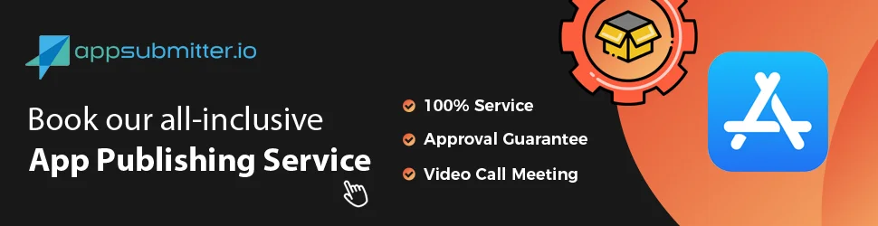
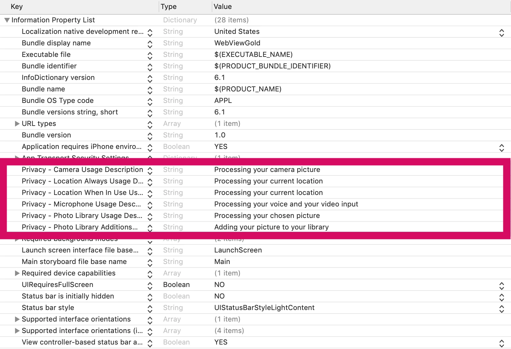

# App erstellen und im App Store veröffentlichen – WebViewGold für iOS

> **Zusammenfassung:** Veröffentliche deine WebView-App im Apple App Store: kompletter Veröffentlichungsservice, manueller Prozess und Ändern des Bundle Identifiers.

[Dokumentation](../README.md) › [WebViewGold für iOS](README.md) › Erstellen & Veröffentlichen

**Plattform:** iOS · **Kategorie:** Erstellen & Veröffentlichen · **Online-Version:** [www.webviewgold.com/de/docs/iOS/publish/](https://www.webviewgold.com/de/docs/iOS/publish/)

---

Deine App ist fertig und nun ist es an der Zeit, sie in den Apple App Store hochzuladen und ein Millionenpublikum zu erreichen? Aufregend! Der folgende Abschnitt zeigt dir, wie das geht – ganz gleich, ob du es selbst erledigst oder dir einen Teil der Arbeit abnehmen lassen möchtest.

> [!NOTE]
> Bevorzugst du einen browserbasierten Workflow? Der [**WebViewGold Cloud Builder**](https://www.webviewgold.com/cloud-builder?ref=ios_docs) (kostenpflichtiges Add-on) übernimmt Konfiguration, Erstellung und Upload direkt aus deinem Browser – ganz ohne Xcode.
>
> 

## Option A) Kompletter App-Veröffentlichungsservice

Deine App in den App Store zu bringen, sollte reibungslos und stressfrei sein. Gönn dir etwas Unterstützung – mit [appsubmitter.io](https://www.appsubmitter.io) profitierst du von einem **komfortablen, von Experten geführten Veröffentlichungsprozess** – so kannst du dich auf das Wesentliche konzentrieren, während wir uns um die Details kümmern.

**Warum appsubmitter.io wählen?**

- **Zeit sparen** – Wir kümmern uns um Zertifikate, Screenshots und Uploads.
- **Expertenbetreuung** – Deine App wird professionell und ohne Aufwand eingereicht.
- **Veröffentlichung unter deinem Account** – Du behältst die volle Kontrolle, ohne Einschränkungen.
- **Freigabegarantie** – Falls Apple deine App ablehnt, erhältst du eine vollständige Rückerstattung (siehe [Allgemeine Geschäftsbedingungen](https://www.onlineappcreator.com/terms.php)).

**Bereit zum Start?** [Vereinbare einen Videoanruf](https://www.appsubmitter.io/order-wizard/?platform=ios) und lass uns deine App live schalten!

## Option B) Manueller Veröffentlichungsprozess

Du möchtest unseren stressfreien Einreichungsservice nicht nutzen, sondern dich selbst darum kümmern? Kein Problem, folge dieser Anleitung:

Nutze dein **[Apple Developer Program-Abonnement](https://developer.apple.com)**, um deine App im App Store zu veröffentlichen. Bitte ändere vor dem Hochladen den **Bundle Identifier** (auch „Bundle ID“ genannt):

*Tipp:* Der [**WebViewGold Cloud Builder**](https://www.webviewgold.com/cloud-builder?ref=ios_docs) (kostenpflichtiges Add-on) verwaltet Bundle Identifier und App Store-Uploads automatisch, sodass du diesen Schritt überspringen kannst.

Wiederhole diesen Vorgang für jedes Target wie `OneSignalNotificationServiceExtension`, `AppClip` und andere Extensions. Der Bundle Identifier jedes Targets muss die Bundle ID deiner Haupt-App als Präfix verwenden. Wenn die Bundle ID deiner Haupt-App beispielsweise `com.my.app` lautet, sollte die Bundle ID der OneSignal-App-Extension `com.my.app.OneSignalNotificationServiceExtension` lauten.

*Bitte beachte, dass der **Bundle Identifier** und der angezeigte Name deiner App (der **Product Name**) die einzigen Identifikationskomponenten sind, die du im App-Template ändern musst. Bitte vermeide es, den Project Name (namens „WebViewGold“; das ist der Name, der oben im Projekt-Navigator im linken Bereich des Xcode-Fensters steht) zu ändern, da dies zu Problemen führen kann. Der Project Name ist für die Nutzer deiner App nicht sichtbar und im App-Einreichungsprozess nicht von Bedeutung.*

Füge anschließend individuelle Texte zu den Berechtigungsdetails hinsichtlich Standort, Foto-/Kamerazugriff und allen anderen API-Details hinzu. Lösche Berechtigungen, die von deiner App nicht benötigt werden – mit Ausnahme des Schlüssels **Privacy - Tracking Usage Description** (der von Apple für alle Apps vorausgesetzt wird; das Entfernen dieses Schlüssels führt zum Absturz deiner App). Die Details findest du in der Datei **Info.plist**: \
\
Ziehe anschließend ein professionelles User-Experience-/UX-Review auf [UXreviewer.io](https://www.uxreviewer.io) oder bei ähnlichen Diensten für die besten App Store-Freigabeergebnisse in Betracht. Ein solches UX-Review hilft dir zudem, mit Verbesserungsvorschlägen generell eine bessere Kundenbindung für dein Produkt zu erreichen.\
Großartig, jetzt bist du bereit für die App Store-Einreichung deiner Web-App. Die App Store-Freigabe funktioniert in den meisten Fällen problemlos, hängt aber stark von den Inhalten ab, die du in deiner App bereitstellst, da WebViewGold selbst keine Inhalte liefert. Bitte stelle sicher, dass du eine App einreichst, die eine Website/Web-App verwendet, die sich wie eine mobile App verhält (zum Beispiel durch **responsives Design**). Achte darauf, dass die Inhalte nicht den rechtlichen Anforderungen des Apple Developer Program widersprechen. Verwende für eine bessere Nutzererfahrung andere Linkfarben als die Standard-HTML-Farben.

Folge anschließend den Schritten dieses zweiten Videos:

**Eine Ergänzung zum Tutorial-Video:**
Aktiviere bei Zeitstempel 07:00, nach dem Erstellen des App Identifiers, unbedingt beide Capabilities „App Groups“ und „Push Notifications“ im Bereich „App Identifier“ des Apple Developer Portals (wähle die korrekte App ID [hier](https://developer.apple.com/account/resources/identifiers/list)). Sieh dir diese Screenshots an: <https://prnt.sc/xz4hg5> & <https://prnt.sc/xz4j01>. Starte Xcode anschließend neu.

**Der App Store-Upload fragt dich, ob du Verschlüsselung verwendest?**
Wir bieten keine rechtsverbindliche Beratung, aber in den meisten Fällen muss hier „Nein“ angegeben werden. Wird jedoch HTTPS verwendet, muss möglicherweise jährlich ein Sicherheitsbericht bei US-Behörden eingereicht werden. Weitere Informationen dazu findest du [hier](https://developer.apple.com/documentation/security/complying_with_encryption_export_regulations).

**Der App Store-Upload fragt dich, ob du die Ad ID / IDFA verwendest?**
Die Ad ID ist enthalten, weil AdMob integriert ist, aber standardmäßig nicht aktiv. Das Entfernen des AdMob SDK erzeugt zahlreiche Abhängigkeitsfehler, daher lautet der einfachste Vorschlag, bei der Frage „Verwendet Ihre App die Ad ID?“ „Ja“ zu wählen und nur das Kontrollkästchen „Diese App-Installation einer zuvor ausgelieferten Werbeanzeige zuordnen“ zu aktivieren (lass alle anderen Kontrollkästchen leer). Wenn du also AdMob-Banner-/Interstitial-Anzeigen in WebViewGold verwendest, konfiguriere diesen Bildschirm bitte wie [hier](https://prnt.sc/t8cj0a). Wenn du keine AdMob-Banner-/Interstitial-Anzeigen in WebViewGold verwendest, während das SDK noch eingebettet ist (was der typische Fall ist, wenn AdMob in WebViewGold nicht genutzt wird), wähle bitte [diese](https://prnt.sc/t8ci23) Optionen.

Falls Apple deine App ablehnt, nutze bitte das **Apple Resolution Center**, um die App-Funktion allgemein zu erläutern (etwa „Unsere App ermöglicht es unseren bestehenden Nutzern, sich auf ihrem mobilen Gerät anzumelden/unsere Produkte zu nutzen/…“). Sollte Apple deine App dennoch ablehnen, können wir dir eine **vollständige Rückerstattung** der WebViewGold-Lizenz anbieten (bei Geltendmachung innerhalb von 14 Tagen nach dem Kauf; siehe [Allgemeine Geschäftsbedingungen](https://www.onlineappcreator.com/terms.php)). Kontaktiere uns einfach per E-Mail.\
**Herzlichen Glückwunsch zu deiner eigenen veröffentlichten iOS-App! 🎉**\
Keine Zeit oder keine Lust, manuell zu signieren und hochzuladen? Ziehe den Service von [appsubmitter.io](https://www.appsubmitter.io) in Betracht:\

Natürlich sollte nach dem Release erst einmal gefeiert werden! Aber vielleicht steht danach schon das nächste Projekt an? Unsere App-Spezialisten helfen dir auch gerne mit [individuellen Entwicklungsdiensten](https://www.onlineappcreator.com/custom-development-services.php) für Web-Apps, iOS-Apps, Android-Apps, Chatbots, Marketingideen und vielem mehr. **[Mehr erfahren](https://www.onlineappcreator.com/custom-development-services.php)**

---

## Weiterlesen

- ← Vorherige: [HealthKit-Plugin](healthkit.md)
- Weiter →: [Credits & Lizenzen](credits.md)
- Dieselbe Funktion auf anderen Plattformen: [Android – Erstellen & Veröffentlichen](../android/publish.md)
- Sprachen: [🇺🇸 English](../../ios/publish.md) · **🇩🇪 Deutsch** · [🇫🇷 Français](../../fr/ios/publish.md) · [🇪🇸 Español](../../es/ios/publish.md) · [🇨🇳 中文](../../zh/ios/publish.md)

> [!TIP]
> **Zu wenig Zeit? Wir richten deine App für dich ein.** Unser Team konfiguriert, erstellt & reicht deine WebViewGold-App ein – schlüsselfertig, mit schneller Bearbeitung, Made in Germany. [App einrichten lassen →](https://www.WeSetupYourWebViewApp.com?ref=webviewgold_ios_doc_online)
>
> **Im Browser erstellen:** Kein Mac, keine IDE: Der **WebViewGold Cloud Builder** konfiguriert, erstellt & lädt deine App online hoch. [Cloud Builder entdecken →](https://www.webviewgold.com/cloud-builder?ref=ios_docs)
