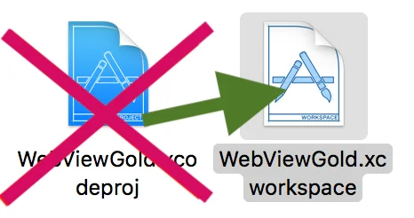
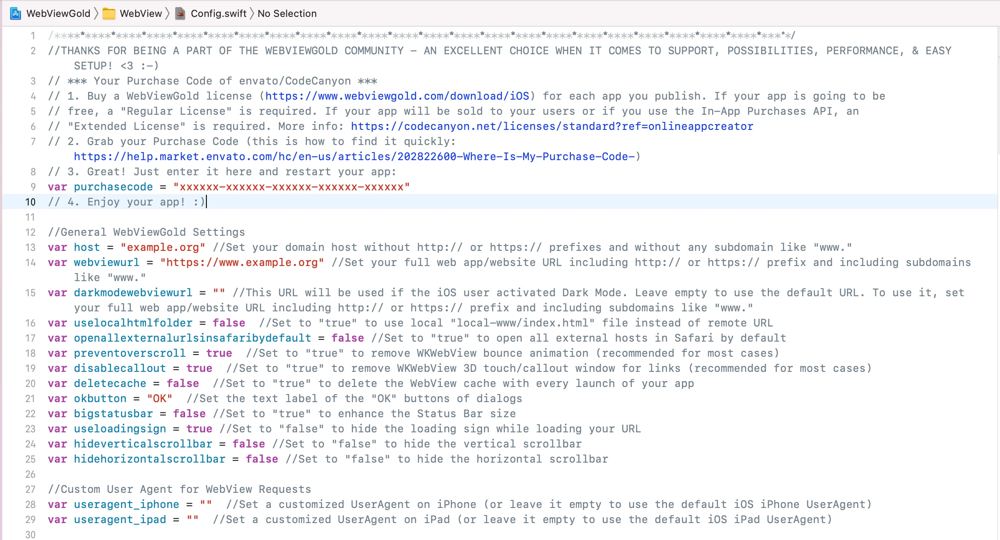

# WebViewGold für iOS einrichten und konfigurieren – WebViewGold für iOS

> **Zusammenfassung:** Lade das WebViewGold-Xcode-Template herunter, trage deine URL in Config.swift ein und entdecke alle integrierten Konfigurationsoptionen – ganz ohne Programmierkenntnisse.

[Dokumentation](../README.md) › [WebViewGold für iOS](README.md) › WebViewGold konfigurieren

**Plattform:** iOS · **Kategorie:** Erste Schritte · **Online-Version:** [www.webviewgold.com/de/docs/iOS/setup/](https://www.webviewgold.com/de/docs/iOS/setup/)

---

**Lade** die WebViewGold-App-Vorlage für iOS **[hier](https://www.webviewgold.com/download/ios)** herunter.\

> [!NOTE]
> Möchtest du es vermeiden, Software zu installieren? Mit dem [**WebViewGold Cloud Builder**](https://www.webviewgold.com/cloud-builder?ref=ios_docs) (kostenpflichtiges Add-on) kannst du deine App direkt im Browser konfigurieren, erstellen und hochladen, ohne Xcode öffnen zu müssen.
>
> 

Nachdem du die .zip-Datei von WebViewGold auf CodeCanyon heruntergeladen hast, gibt es **zwei Einrichtungsoptionen** für Xcode. Welche Einrichtungsoption du wählen solltest, hängt davon ab, ob du ein Mac-System besitzt:

**a) Du verwendest kein Mac-System:**\
Wenn du keinen Mac für die erforderliche Xcode-App besitzt, sieh dir [MacInCloud](https://www.macincloud.com) an. Dort kannst du einen virtuellen Mac online mieten (wir sind nicht mit dem Anbieter dieses Dienstes verbunden). Über diesen Dienst kannst du deine auf WebViewGold basierenden iOS-Apps auch ohne Mac erstellen. Zusätzlich ermöglicht dir der [**WebViewGold Cloud Builder**](https://www.webviewgold.com/cloud-builder?ref=ios_docs) (kostenpflichtiges Add-on), deine App direkt im Browser ohne Mac zu konfigurieren, zu erstellen und hochzuladen. \
**ODER**\
**b) Du verwendest ein Mac-System:**\
Lade die App **Xcode** aus dem [**Mac App Store**](https://apps.apple.com/de/app/xcode/id497799835?mt=12) herunter und installiere sie. WebViewGold läuft nativ auf Intel- und Apple-Silicon-Macs — du kannst deine App also direkt mit dem normalen iOS-Simulator erstellen und testen.

**Das war's, Xcode ist bereit für WebViewGold!**\
Falls Xcode bereits läuft, beende es bitte vollständig (*Befehl/CMD* + *Q*). Öffne anschließend **WebViewGold.xcworkspace** (nicht WebView.xcodeproj):\

Öffne in [Xcode](https://developer.apple.com/xcode/) die Datei **Config.swift**. Du siehst ein Dokument wie dieses:\
\
Hier kannst du deine App bequem einrichten. Die Einrichtung von Apps mit WebViewGold ist **sehr einfach** und erfordert keinerlei Programmierkenntnisse. Bitte vergiss nicht, deinen [Envato/CodeCanyon Purchase Code](https://help.market.envato.com/hc/en-us/articles/202822600-Where-Is-My-Purchase-Code-) im Feld **purchasecode** für jede von dir veröffentlichte App einzutragen. Pro individuell angepasstem Endprodukt ist eine Lizenz erforderlich. Lizenzinformationen zu deinem CodeCanyon-Kauf: [https://codecanyon.net/licenses/standard](https://codecanyon.net/licenses/standard?ref=onlineappcreator)

Bitte wirf einen Blick auf diese **Übersicht** aller integrierten Konfigurationsoptionen:

| Einstellung | Wert | Beschreibung |
| --- | --- | --- |
| purchasecode | **erforderlicher Wert** | Gib hier deinen Envato/CodeCanyon Purchase Code für diese App ein |
| app_admin_email | optional | E-Mail-Adresse zum Empfangen von Statusmeldungen (Standardwert beibehalten, um die Funktion zu deaktivieren) |
| host | **erforderlicher Wert** | Dein Domain-Host (z. B. "example.org"). Standardmäßig erlaubt WebViewGold für iOS sowohl HTTPS- als auch HTTP-Inhalte. Wenn du die Sicherheit deiner App erhöhen möchtest, indem du ausschließlich HTTPS-Inhalte zulässt, kannst du [diese Einstellung ändern](https://www.webviewgold.com/support-center/knowledgebase/how-to-prevent-non-https-connections-in-webviewgold-for-ios-removing-nsallowsarbitraryloadsinwebcontent-from-info-plist/) (und/oder die Option 'blockfaultyandselfsignedhttpscerts' in Betracht ziehen) |
| webviewurl | **erforderlicher Wert** | Deine vollständige WebView-URL (z. B. "example.org/app.html"), die in der WebView geladen werden soll. Standardmäßig erlaubt WebViewGold für iOS sowohl HTTPS- als auch HTTP-Inhalte. Wenn du die Sicherheit deiner App erhöhen möchtest, indem du ausschließlich HTTPS-Inhalte zulässt, kannst du [diese Einstellung ändern](https://www.webviewgold.com/support-center/knowledgebase/how-to-prevent-non-https-connections-in-webviewgold-for-ios-removing-nsallowsarbitraryloadsinwebcontent-from-info-plist/) (und/oder die Option 'blockfaultyandselfsignedhttpscerts' in Betracht ziehen) |
| uselocalhtmlfolder | **true** oder **false** | Auf *true* setzen, um die lokale HTML-Datei "local-www/index.html" anstelle der Remote-WebView-URL zu verwenden (achte darauf, innerhalb von local-www keine Unterordner anzulegen oder zu verwenden) |
| externalLinkHandlingOptions | **0**, **1** oder **2** | Auf *0* setzen, um externe Links standardmäßig in der App zu öffnen, oder auf *2*, um sie IMMER in einem anderen Browser (Safari) zu öffnen; siehe die [URL-Handling-API](url-handling.md) |
| specialLinkHandlingOptions | **0**, **1** oder **2** | Auf *0* setzen, um spezielle Links (z. B. target="_blank") in der App zu öffnen, auf *1*, um sie in einem neuen Tab (einem zusätzlichen In-App-Browser) zu öffnen, oder auf *2*, um sie in einem anderen Browser (Safari) zu öffnen |
| safariwhitelist | Liste | Füge hier Domains hinzu, die **immer** in Safari geöffnet werden sollen, unabhängig davon, worauf die Option **externalLinkHandlingOptions** gesetzt ist; um eine weitere Domain hinzuzufügen, trage einen weiteren Host wie folgt ein: ["alwaysopeninsafari.com", "google.com", "m.facebook.com"]. Bitte trage den Host genau so ein, wie du ihn verlinkst (mit oder ohne www, aber immer ohne http/https). |
| safariblacklist | Liste | Füge hier Domains hinzu, die **niemals** in Safari geöffnet werden sollen, unabhängig davon, worauf die Option **externalLinkHandlingOptions** gesetzt ist; um eine weitere Domain hinzuzufügen, trage einen weiteren Host wie folgt ein: ["alwaysopeninsafari.com", "google.com", "m.facebook.com"]. Bitte trage den Host genau so ein, wie du ihn verlinkst (mit oder ohne www, aber immer ohne http/https). |
| alwaysOpenInInAppTab | Liste | Füge hier Domains hinzu, die **immer** in einem In-App-Tab geöffnet werden sollen, unabhängig von der Einstellung **externalLinkHandlingOptions** |
| neverOpenInInAppTab | Liste | Füge hier Domains hinzu, die **nie** in einem In-App-Tab geöffnet werden sollen, unabhängig von der Einstellung **externalLinkHandlingOptions** |
| enableBioMetricAuth | **true** oder **false** | Auf *true* setzen, um unsere App-Sperren-Funktion zu aktivieren, die für die App eine Authentifizierung mit Face ID, Touch ID oder Code erfordert. Dies ist eine unabhängige und zusätzliche Option zu unserer auf JavaScript basierenden [Bio-Auth-API](biometric-authentication.md) |
| autoInjectVariable | **true** oder **false** | Auf *true* setzen, um JavaScript-Variablen (z. B. UUID, App-Version, OneSignal- und Firebase-Abonnement-IDs sowie App-Store-Standort) automatisch zu laden, ohne dass bestimmte URLs wie get-uuid:// aufgerufen werden müssen (aktuell werden App-Version, OneSignal- und Firebase-Abonnement-IDs, UUID und App-Store-Standort unterstützt) |
| disablecallout | **true** oder **false** | Auf *true* setzen, um das WKWebView-3D-Touch-Link-Vorschau-/Callout-Fenster für Links zu entfernen (in den meisten Fällen empfohlen) |
| deletecache | **true** oder **false** | Auf *true* setzen, um den WebView-Cache und Cookies bei jedem App-Start zu leeren und keine zwischengespeicherten Versionen deiner Web-App/Website zu verwenden |
| deletecacheonexit | **true** oder **false** | Auf *true* setzen, um den WebView-Cache und Cookies beim vollständigen Beenden der App zu leeren (du solltest eventuell auch *deletecache* aktivieren, da Unterschiede zwischen iOS-Versionen die Zuverlässigkeit beeinträchtigen können) |
| okbutton | optional | Lege die Textbeschriftung der "OK"-Schaltflächen fest (übersetzbar über *alternatelanguage1*/*alternatelanguage2*) |
| cancelbutton | optional | Lege die Textbeschriftung der "Cancel"-Schaltflächen fest (übersetzbar über *alternatelanguage1*/*alternatelanguage2*) |
| bigstatusbar | **true** oder **false** | Auf *true* setzen, um die Größe der Statusleiste zu vergrößern |
| hideverticalscrollbar | **true** oder **false** | Auf *true* setzen, um die vertikale Bildlaufleiste auszublenden |
| hidehorizontalscrollbar | **true** oder **false** | Auf *true* setzen, um die horizontale Bildlaufleiste auszublenden |
| enableswipenavigation | **true** oder **false** | Auf *false* setzen, um zu verhindern, dass Wischen nach links/rechts eine Rück-/Vorwärtsnavigation auslöst |
| orientationiphone | "portrait", "landscape" oder "auto" | Lege die Ausrichtung auf iPhones auf portrait, landscape oder auto fest |
| orientationipad | "portrait", "landscape" oder "auto" | Lege die Ausrichtung auf iPads auf portrait, landscape oder auto fest |
| preventsleep | **true** oder **false** | Auf *true* setzen, um zu verhindern, dass das Gerät in den Ruhemodus wechselt, während die App aktiv ist |
| preventZoom | **true** oder **false** | Auf *true* setzen, um das Zoomen durch den Nutzer zu deaktivieren, indem Code eingefügt wird, der das Zoomen auf der Website verhindert |
| preventoverscroll | **true** oder **false** | Auf *true* setzen, um die WKWebView-Bounce-Animation zu entfernen (in den meisten Fällen empfohlen). Auf *false* setzen, wenn du Pull-to-Refresh verwendest. |
| enhanceUrlUUID | **true** oder **false** | Auf *true* setzen, um der ersten URL-Anfrage den UUID-Parameter 'uuid=XYZ' hinzuzufügen |
| linkDragAndDrop | **true** oder **false** | Auf *false* setzen, um Drag-and-Drop von Links zu deaktivieren |
| useShortcuts | **true** oder **false** | Auf *true* setzen, um die in Shortcuts.json definierten dynamischen Shortcuts zu registrieren |
| pulltorefresh | **true** oder **false** | Auf *true* setzen, um Pull-to-Refresh in deiner App zu aktivieren. Beachte, dass **preventoverscroll** auf *false* gesetzt sein muss, damit diese Funktion aktiviert werden kann. Zusätzlich kannst du jederzeit `enablepulltorefresh://` oder `disablepulltorefresh://` von deiner Website aus aufrufen, um Pull-to-Refresh dynamisch zu aktivieren oder zu deaktivieren. |
| pulltorefresh_loadingsigncolour_lightmode | Farbe | Lege die Farbe der Pull-to-Refresh-Ladeanzeige im Hellmodus fest |
| pulltorefresh_backgroundcolour_lightmode | Farbe | Lege die Hintergrundfarbe von Pull-to-Refresh im Hellmodus fest |
| pulltorefresh_loadingsigncolour_darkmode | Farbe | Lege die Farbe der Pull-to-Refresh-Ladeanzeige im Dunkelmodus fest; erfordert iOS 13 oder höher |
| pulltorefresh_backgroundcolour_darkmode | Farbe | Lege die Hintergrundfarbe von Pull-to-Refresh im Dunkelmodus fest; erfordert iOS 13 oder höher |
| useragent_iphone | optional | Definiere einen benutzerdefinierten UserAgent auf dem iPhone (oder lass das Feld leer, um den Standard-iOS-UserAgent zu verwenden) |
| useragent_ipad | optional | Definiere einen benutzerdefinierten UserAgent auf dem iPad (oder lass das Feld leer, um den Standard-iOS-UserAgent zu verwenden) |
| google_login_helper_triggers | optional | Definiere die URL-Präfixe, die während der Google-Anmeldung für deine Website geladen werden; sie dienen als Auslöser für den Helfer; Beispiel: ["https://accounts.google.com", "https://accounts.youtube.com"] |
| facebook_login_helper_triggers | optional | Definiere die URL-Präfixe, die während der Facebook-Anmeldung für deine Website geladen werden; sie dienen als Auslöser für den Helfer; Beispiel: ["https://www.facebook.com", "https://m.facebook.com"] |
| activatefirstrundialog | **true** oder **false** | Auf *true* setzen, um den Dialog "Erster Start" zu aktivieren |
| firstrunmessagetitle | optional | Lege den Titel des Dialogs "Erster Start" fest (bei Bedarf kannst du diesen String in zwei weitere Sprachen übersetzen, indem du die Strings 'alternatelanguage1' und 'alternatelanguage2' am Ende der Datei Config.swift verwendest) |
| firstrunmessage | optional | Lege den Nachrichtentext des Dialogs "Erster Start" fest (bei Bedarf kannst du diesen String in zwei weitere Sprachen übersetzen, indem du die Strings 'alternatelanguage1' und 'alternatelanguage2' am Ende der Datei Config.swift verwendest) |
| askforpushpermissionatfirstrun | **true** oder **false** | Auf *true* setzen, um deine Nutzer beim ersten Start deiner Anwendung um die Erlaubnis für Push-Benachrichtigungen zu bitten. Auf "false" setzen, um niemals nachzufragen oder um die Anfrage später über einen *registerpush://*-Link/-Button/-Umleitung in deiner Web-App auszulösen |
| offlinetitle | optional | Lege den Titel des Offline-Dialogs fest (bei Bedarf kannst du diesen String in zwei weitere Sprachen übersetzen, indem du die Strings 'alternatelanguage1' und 'alternatelanguage2' am Ende der Datei Config.swift verwendest) |
| offlinemsg | optional | Lege den Text des Offline-Dialogs fest (bei Bedarf kannst du diesen String in zwei weitere Sprachen übersetzen, indem du die Strings 'alternatelanguage1' und 'alternatelanguage2' am Ende der Datei Config.swift verwendest) |
| screen1 | optional | Lege die Textbeschriftung 1 des Offline-Bildschirms fest (bei Bedarf kannst du diesen String in zwei weitere Sprachen übersetzen, indem du die Strings 'alternatelanguage1' und 'alternatelanguage2' am Ende der Datei Config.swift verwendest) |
| screen2 | optional | Lege die Textbeschriftung 2 des Offline-Bildschirms fest (bei Bedarf kannst du diesen String in zwei weitere Sprachen übersetzen, indem du die Strings 'alternatelanguage1' und 'alternatelanguage2' am Ende der Datei Config.swift verwendest) |
| offlinebuttontext | optional | Lege die Textbeschriftung der Schaltfläche "Erneut versuchen" fest (bei Bedarf kannst du diesen String in zwei weitere Sprachen übersetzen, indem du die Strings 'alternatelanguage1' und 'alternatelanguage2' am Ende der Datei Config.swift verwendest) |
| offlinescreenautoretry | **true** oder **false** | Auf *true* setzen, wenn die App automatisch jede Sekunde erneut versuchen soll, eine Verbindung herzustellen (auch ohne Klick auf eine Schaltfläche) |
| activateratemyappdialog | **true** oder **false** | Auf *true* setzen, um den Dialog "App im App Store bewerten" zu aktivieren |
| activatefacebookfriendsdialog | **true** oder **false** | Auf *true* setzen, um den Dialog "Auf Facebook folgen" zu aktivieren |
| becomefacebookfriendstitle | optional | Lege den Titel des Dialogs "Auf Facebook folgen" fest (bei Bedarf kannst du diesen String in zwei weitere Sprachen übersetzen, indem du die Strings 'alternatelanguage1' und 'alternatelanguage2' am Ende der Datei Config.swift verwendest) |
| becomefacebookfriendstext | optional | Lege den Text des Dialogs "Auf Facebook folgen" fest (bei Bedarf kannst du diesen String in zwei weitere Sprachen übersetzen, indem du die Strings 'alternatelanguage1' und 'alternatelanguage2' am Ende der Datei Config.swift verwendest) |
| becomefacebookfriendsyes | optional | Lege die Textbeschriftung der "Ja"-Schaltfläche des Dialogs "Auf Facebook folgen" fest (bei Bedarf kannst du diesen String in zwei weitere Sprachen übersetzen, indem du die Strings 'alternatelanguage1' und 'alternatelanguage2' am Ende der Datei Config.swift verwendest) |
| becomefacebookfriendsno | optional | Lege die Textbeschriftung der "Nein"-Schaltfläche des Dialogs "Auf Facebook folgen" fest (bei Bedarf kannst du diesen String in zwei weitere Sprachen übersetzen, indem du die Strings 'alternatelanguage1' und 'alternatelanguage2' am Ende der Datei Config.swift verwendest) |
| becomefacebookfriendsurl | optional | Lege die URL deiner Facebook/Instagram/YouTube/...-Seite fest (z. B. "https://facebook.com/OnlineAppCreator/") |
| imagedownloadedtitle | optional | Lege den Titel des Dialogfelds "Bild in Fotogalerie gespeichert" fest (bei Bedarf kannst du diesen String in zwei weitere Sprachen übersetzen, indem du die Strings 'alternatelanguage1' und 'alternatelanguage2' am Ende der Datei Config.swift verwendest) |
| imagenotfound | optional | Lege den Titel des Dialogfelds "Bild nicht gefunden" fest (bei Bedarf kannst du diesen String in zwei weitere Sprachen übersetzen, indem du die Strings 'alternatelanguage1' und 'alternatelanguage2' am Ende der Datei Config.swift verwendest) |
| transparentStatusBar | **true** oder **false** | Auf *true* setzen, um die Statusleiste transparent zu machen, sodass Webinhalte dahinter angezeigt werden können |
| autoAdjustSafeAreaInsets | **true** oder **false** | Auf *false* setzen, wenn deine Website die Safe-Area-Insets bereits selbst verwaltet (in Verbindung mit *transparentStatusBar* zu verwenden) |
| statusBarBackgroundColor | Farbe | Definiere eine benutzerdefinierte Hintergrundfarbe für die Statusleiste |
| darkModeStatusBarBackgroundColor | Farbe | Definiere eine benutzerdefinierte Hintergrundfarbe für die Statusleiste, wenn der Nutzer den iOS-Dunkelmodus verwendet |
| statusBarTextColor | **white** oder **black** | Definiere die Textfarbe der Statusleiste |
| darkModeStatusBarTextColor | **white** oder **black** | Definiere die Textfarbe der Statusleiste, wenn der Nutzer den iOS-Dunkelmodus verwendet |
| showNavFooter | **true** oder **false** | Auf *true* setzen, um die native Navigationsfußleiste zu aktivieren (konfiguriert über FooterBar.json) |
| bottombar | **true** oder **false** | Auf *true* setzen, um die Bottombar zu aktivieren, damit die Home-Leiste (auf iOS-Geräten ohne Home-Button, z. B. iPhone X) nicht mit App-Inhalten überlappt |
| iPadBottombar | **true** oder **false** | Auf *true* setzen, um die Bottombar AUCH auf iPads zu aktivieren (die aufgrund ihrer größeren Bildschirme möglicherweise ein anderes Layout haben, sodass die Home-Leiste keine Inhalte überlappt und die Bottombar dort nicht zwingend erforderlich ist) |
| bottombarBackgroundColor | Farbe | Definiere eine benutzerdefinierte Hintergrundfarbe für die Bottombar |
| darkmodeBottombarBackgroundColor | Farbe | Definiere eine benutzerdefinierte Hintergrundfarbe für die Bottombar, wenn der Nutzer den iOS-Dunkelmodus verwendet; erfordert iOS 13 oder höher |
| qrcodelinks | **0** oder **1** oder **2** oder **3** oder **4** | Auf (0) setzen, um eine gescannte QR-Code-URL in der App zu öffnen; (1) in einem In-App-Tab; (2) in einem neuen Browser; (3) in einem In-App-Tab, wenn extern; (4) in einem neuen Browser, wenn extern; zusätzlich kannst du die zulässigen QR-Code-Scanner-Präfixe optional im Array "allowedQRurls" der Datei SwiftQRScanner.swift einschränken |
| ShowExternalLink | optional | Auf *true* setzen, um Links zu öffnen, die über die [Universal-Links-API](universal-links.md) (Syntax: https://example.org) und die [Deep-Linking-API](deep-linking.md) (Syntax: example://url?link=https://example.org) übermittelt werden. |
| splashScreenEnabled | optional | Auf *false* setzen, um den Splash-Screen beim Start der App zu deaktivieren und stattdessen den Ladeindikator anzuzeigen |
| remainSplashOption | optional | Auf *true* setzen, um den Splash-Screen anzuzeigen, bis der erste Ladevorgang deiner Startseite abgeschlossen ist (anstelle des Ladeindikators) |
| splashTimeout | Zahlenwert (Millisekunden) | Lege das Timeout des Splash-Screens in *Millisekunden* fest (der Ladeindikator wird nach Ablauf dieser Zeit angezeigt, falls die Home-URL noch geladen wird) |
| splashMinTime | Zahlenwert (Millisekunden) | Mindestdauer (in Millisekunden), die der Splash Screen angezeigt werden soll; auf *0* setzen, um die Mindestdauer zu deaktivieren |
| splashFadeTime | Zahlenwert (Millisekunden) | Dauer (in Millisekunden) der Ausblendanimation des Splash Screens; auf *0* setzen, um das Ausblenden zu deaktivieren |
| scaleSplashImage | Prozentwert [0-100] | Lege die Größe des Splash-Screen-Bildes relativ zur kleinsten Bildschirmbreite/-höhe des Geräts fest; Bereich in Prozent [0-100]; Wert = 0 blendet das Bild vollständig aus, Wert = 100 zeigt das Bild im Vollbildmodus an |
| useLoadingSign | **true** oder **false** | Auf *false* setzen, um den Ladeindikator während des Ladens deiner URL auszublenden |
| useLoadingProgressBar | **true** oder **false** | Auf *true* setzen, um während des Ladens deiner URL die Ladefortschrittsleiste anstelle des Ladeindikators zu verwenden |
| loadingIndicatorColor | Farbe | Lege eine Farbe für den Ladeindikator fest |
| alternativeAppIconNames | Liste | Bearbeite diese Liste, um die Dateinamen deiner alternativen App-Icons zu ändern |
| backgroundlocation | **true** oder **false** | Auf *true* setzen, um Zugriff auf die Standortermittlung im Hintergrund zu erlauben (stelle außerdem sicher, dass die Fähigkeit "Background Modes" in den Xcode-Projekteinstellungen "Location updates" enthält. Je nach Web-App musst du möglicherweise zusätzlich "Background Processing" aktivieren; füge in diesem Fall auch der Info.plist ein Array mit dem Schlüssel "Permitted background task scheduler identifiers" hinzu – innerhalb dieses Arrays fügst du einen String mit deiner App-Bundle-ID ein, z. B. "com.onlineappcreator.webviewgold") |
| appendlanguage | **true** oder **false** | Auf *true* setzen, wenn du die URL-Anfrage um die Systemsprache erweitern möchtest, z. B. ?webview_language=LANGUAGE CODE (z. B. ?webview_language=EN für englischsprachige Nutzer) |
| blockfaultyandselfsignedhttpscerts | **true** oder **false** | Auf *true* setzen, um Inhalte zu blockieren, die mit selbstsignierten SSL-(Nutzer-)Zertifikaten oder fehlerhaften SSL-Zertifikaten signiert sind; ziehe außerdem in Betracht, [alle Nicht-HTTPS-Inhalte zu blockieren](https://www.webviewgold.com/support-center/knowledgebase/how-to-prevent-non-https-connections-in-webviewgold-for-ios-removing-nsallowsarbitraryloadsinwebcontent-from-info-plist/) |
| jailbreakBlock | **true** oder **false** | Auf *true* setzen, um die App auf Jailbreak-/gehackten Geräten zu blockieren. Hinweis: Die Erkennung ist nicht absolut zuverlässig, verwendet aber mehrere Methoden zur Identifizierung von Jailbreaks und Hacks |
| autoRefreshEnabled | **true** oder **false** | Auf *true* setzen, wenn die WebView ihren Inhalt automatisch aktualisieren soll, sobald die App aus dem Hintergrund in den Vordergrund zurückkehrt. |
| offlinelocalhtmlswitch | **true** oder **false** | Auf *true* setzen, wenn du den Ordner "local-html" verwenden möchtest, sobald der Nutzer offline ist, und die Remote-URL, wenn der Nutzer online ist. |
| extentionARY | Liste | Füge die Dateiformate hinzu, die die Download-Funktion auslösen sollen (z. B. .pdf, .docx, ...) |
| autodownloader | **true** oder **false** | Auf *true* setzen, wenn du die Downloader-Funktion basierend auf Content-Disposition-HTTP-Headern aktivieren möchtest, unabhängig von den in der Variable extentionARY oben aufgeführten Dateiformaten |
| splashscreencolor | Farbe | Lege eine Hintergrundfarbe für den Splash-Screen fest |
| extentionARY | Liste | Füge die Dateiformate hinzu, die die Download-Funktion auslösen sollen (z. B. .pdf, .docx, ...) |
| offlinelocalhtmlswitch | **true** oder **false** | Auf *true* setzen, wenn du den Ordner "local-html" verwenden möchtest, sobald der Nutzer offline ist, und die Remote-URL, wenn der Nutzer online ist. |
| zipfiledownloadfromserver | **true** oder **false** | Auf *true* setzen, um ein .zip-Archiv von einer Remote-URL herunterzuladen, das extrahiert und angezeigt werden soll, wenn der Nutzer offline ist (aktiviere außerdem die Variable turnofflinelocalhtmlswitch auf true); die Aktualisierung erfolgt bei jedem vollständigen Neustart der App |
| zipfileremoteurl | URL | Das .zip-Archiv von einer Remote-URL, das extrahiert und angezeigt werden soll, wenn der Nutzer offline ist |
| zipfilename | Dateiname | Der interne Dateiname der .zip-Datei auf dem Nutzergerät (Änderung nicht empfohlen) |
| zipfileextractpath | Ordnername | Der interne Ordnername des Extraktionspfads auf dem Nutzergerät (Änderung nicht empfohlen) |
| zipfileextractindexindex | Dateiname | Die Datei, die innerhalb des extrahierten .zip-Archivs zuerst geöffnet werden soll |
| zipfilepopuptitle | Text | Der Titel des Popups, das während des Downloads der .zip-Datei angezeigt wird (bei Bedarf kannst du diesen String in zwei weitere Sprachen übersetzen, indem du die Strings 'alternatelanguage1' und 'alternatelanguage2' am Ende der Datei Config.swift verwendest) |
| zipfilepopupmessage | Textstring | Die Nachricht des Popups, das während des Downloads der .zip-Datei angezeigt wird (bei Bedarf kannst du diesen String in zwei weitere Sprachen übersetzen, indem du die Strings 'alternatelanguage1' und 'alternatelanguage2' am Ende der Datei Config.swift verwendest) |
| InAppPurchAppBundleIdentifier | optional | Lege den Standard-App-Identifier fest, um die In-App-Purchase-API für das Standard-IAP-Produkt zu aktivieren (Details können in App Store Connect konfiguriert werden) |
| IAPSharedSecret | optional | Lege das App-Secret fest, um die In-App-Purchase-API zu aktivieren (weitere Informationen findest du [hier](in-app-purchases.md)) |
| iapsuccessurl | optional | Lege die Standard-URL fest, die nach einem erfolgreichen In-App-Kauf/In-App-Abonnement über den WebView-Wrapper geöffnet werden soll. Die URL könnte z. B. "https://www.example.org/thanks.php" lauten, wobei thanks.php das lebenslange Cookie für Premium-Inhalte setzen könnte. |
| iapexpiredurl | optional | Lege die Standard-URL fest, die geöffnet werden soll, nachdem ein In-App-Abonnement über den WebView-Wrapper abgelaufen ist. Die URL könnte z. B. "https://www.example.org/expired.php" lauten, wobei expired.php das Cookie für Premium-Inhalte entfernen könnte. |
| revenueCatAPIKey | optional | Dein RevenueCat-API-Schlüssel (registriere dich zunächst über [tinyurl.com/register-revenuecat](https://tinyurl.com/register-revenuecat) und folge dann [tinyurl.com/api-key-revenuecat](https://tinyurl.com/api-key-revenuecat), um ihn zu finden) |
| revenueCatProjectID | optional | Deine RevenueCat-Projekt-ID (registriere dich zunächst über [tinyurl.com/register-revenuecat](https://tinyurl.com/register-revenuecat) und folge dann [tinyurl.com/project-id-revenuecat](https://tinyurl.com/project-id-revenuecat), um sie zu finden) |
| oneSignalID | optional | Erforderlich für die OneSignal-Push-Funktionalität |
| kPushEnabled | **true** oder **false** | Auf *true* setzen, um die OneSignal-Push-Funktionalität zu aktivieren |
| kPushEnhanceUrl | **true** oder **false** | Auf *true* setzen, wenn du WebView-Haupt-URL-Anfragen um die OneSignal-Abonnement-ID im Format ?onesignal_push_id=XYZ erweitern möchtest (alternativ oder zusätzlich kannst du die OneSignal-Abonnement-ID jederzeit über [getonesignalplayerid://](push-notifications.md#onesignalruntime) anfordern oder sie automatisch abrufen, wenn du in der Config.swift "autoInjectVariable" auf "true" setzt) |
| kPushReloadOnUserId | **true** oder **false** | Auf *true* setzen, wenn die WebView nach Erhalt der UserID von OneSignal neu geladen werden soll |
| kPushOpenDeeplinkInBrowser | **true** oder **false** | Auf *true* setzen, um Deeplinking-URLs von OneSignal im Safari-Browser anstelle der Haupt-WebView zu öffnen; wichtig: Verwende zum Senden von Benachrichtigungen mit einem Link von OneSignal NICHT 'Launch URL'; du musst stattdessen ein 'Additional Data Field' mit dem Schlüssel: url und dem Wert: dem gewünschten Link verwenden |
| kFirebasePushEnabled | **true** oder **false** | Auf *true* setzen, um deine App mit den Firebase Push Services zu verbinden |
| kFirebaseEnhanceUrl | **true** oder **false** | Auf *true* setzen, wenn du WebView-Haupt-URL-Anfragen um ?firebase_push_id=XYZ erweitern möchtest (alternativ oder zusätzlich kannst du die OneSignal-Abonnement-ID jederzeit über [getfirebaseplayerid://](push-notifications.md#firebaseruntime) anfordern oder sie automatisch abrufen, wenn du in der Config.swift "autoInjectVariable" auf "true" setzt) |
| firebaseTopic | **optional** | Lege ein Firebase-Topic fest, das abonniert werden soll |
| kPushwooshEnable | **optional** | Auf *true* setzen, um die Pushwoosh-Push-Funktionalität zu aktivieren (setze die ID in der Info.plist in der Spalte Pushwoosh_APPID) |
| kPushwooshEnhanceUrl | **optional** | Auf *true* setzen, wenn du WebView-Haupt-URL-Anfragen um ?pushwoosh_id=XYZ erweitern möchtest |
| showBannerAd | **true** oder **false** | Auf *true* setzen, wenn du AdMob-Banner-Anzeigen anzeigen möchtest (setze außerdem die AdMob-IDs in Config.swift und Info.plist, siehe [hier](admob.md)) |
| showFullScreenAd | **true** oder **false** | Auf *true* setzen, wenn du AdMob-Interstitial-Anzeigen nach X Website-Klicks anzeigen möchtest (setze außerdem die AdMob-IDs in Config.swift und Info.plist, siehe [hier](admob.md)) |
| showadAfterX | optional | Definiere die Anzahl X, um AdMob-Interstitial-Anzeigen nach jeweils X (z. B. 10) Website-Klicks oder Bildschirmtipps anzuzeigen, je nachdem, worauf **incrementWithTaps** gesetzt ist (setze außerdem die AdMob-IDs in Config.swift und Info.plist, siehe [hier](admob.md)). |
| incrementWithTaps | **true** oder **false** | Auf *true* setzen, wenn du Interstitial-Anzeigen nach X Bildschirmtipps anzeigen möchtest, oder auf *false*, wenn du sie nach X Website-Weiterleitungen anzeigen möchtest. |
| enableRewardedAds | **true** oder **false** | Auf *true* setzen, um AdMob-Rewarded-Anzeigen zu aktivieren. Muss auch bei manueller Aktivierung von Anzeigen auf *true* gesetzt sein. |
| useRewardedAdsWherePossible | **true** oder **false** | Auf *true* setzen, um AdMob-Rewarded-Anzeigen anstelle von AdMob-Interstitial-Anzeigen anzuzeigen, z. B. nach X Tipps. Belasse den Wert bei *false*, wenn deren Aktivierung über den Code deiner Website erfolgen soll. Erfordert, dass showFullScreenAd ebenfalls auf *true* gesetzt ist, damit die Anzeigen überschrieben werden. |
| admobadstriggerurls | optional | Füge hier Trigger-Wörter für Seiten hinzu; das Vorhandensein in einer URL löst AdMob-Interstitial-Anzeigen aus (z. B. ["see-highscore.php", "/thank-you/", "/next-step.html"]) |
| useFacebookAds | **true** oder **false** | Auf *true* setzen, um Facebook-Interstitial-Anzeigen zu aktivieren |
| facebookAdsID | optional | Gib deine Placement-ID ein, die verfügbar ist, wenn du eine Property im Facebook Monetization Manager erstellst und eine iOS-App verbindest. Die ID sieht z. B. so aus: 3937960198956424_3969441893142587 |
| useTimedAds | **true** oder **false** | Verwende zeitgesteuerte Anzeigen für Facebook-Anzeigen (z. B. alle 60 Sekunden) anstelle von Anzeigen nach X Klicks |
| fbadstriggerurls | optional | Füge hier Trigger-Wörter für Seiten hinzu; das Vorhandensein in einer URL löst eine Facebook-Anzeige aus (z. B. ["see-highscore.php", "/thank-you/", "/next-step.html"]) |
| showFBAdsEveryNSeconds | optional | Zeige alle X Sekunden eine Facebook-Interstitial-Anzeige an; 120 Sekunden und mehr werden empfohlen |
| ATTDeniedShowAds | **true** oder **false** | Auf *false* setzen, um die Anzeige von Werbung vollständig zu stoppen, wenn der Nutzer die AppTrackingTransparency-(ATT-)Berechtigung ablehnt |
| useAdsenseAds | **true** oder **false** | Auf *true* setzen, um die Unterstützung für AdSense-Web-Anzeigen zu aktivieren (unabhängig von AdMob-Anzeigen) |
| askForAdConsent | **true** oder **false** | Auf *false* setzen, wenn du die Google-Einwilligungsverwaltung für AdMob deaktivieren möchtest (informiere dich vorab unter <https://support.google.com/admob/answer/13554116>) |
| showBarcodeScanner | **true** oder **false** | Auf *false* setzen, um Website-Anfragen zum Aktivieren des Barcode-Scanners mit `barcodescanner://` zu blockieren |
| kFlashLightEnabled | **true** oder **false** | Auf *false* setzen, um Website-Anfragen zum Einschalten der Taschenlampe mit `enableflashlight://` zu blockieren |
| widgetRefreshTime | Zahl | Aktualisierungsintervall für das Widget in Minuten |
| widgetfallbackURL | Zeichenfolge | Fallback-Bild-URL, die vom Widget verwendet wird |
| preventScreenCapture | **true** oder **false** | Auf *true* setzen, um bei Screenshots oder Bildschirmaufnahmen onScreenCaptureAttempt in deiner Web-App aufzurufen |
| kVisionKitEnable | **true** oder **false** | Auf *true* setzen, um dem Datei-Upload-Dialog eine Scan-Option über den [VisionKit-Dokumentenscanner](document-scanner.md) hinzuzufügen (erfordert iOS 18.4 oder höher) |
| enableSidebar | **true** oder **false** | Auf *true* setzen, um einen schwebenden Button zu aktivieren, der eine [native Sidebar](sidebar.md) öffnet, anpassbar in **Sidebar.json** |
| showcustomrateappdialog | **true** oder **false** | Auf *true* setzen, um beim Auslösen der [rateapp://-API](in-app-rating.md) einen eigenen Bewertungsdialog anzuzeigen, anstatt den nativen Review-Aufruf zu versuchen |
| ratemyappurl | URL | Die App-Store-URL deiner App, die vom eigenen Bewertungsdialog verwendet wird |
| cookieonlaunch | **true** oder **false** | Auf *true* setzen, um beim Start der WebView ein Cookie hinzuzufügen; konfigurierbar über die Variablen **cookieonlaunchname**, **cookieonlaunchvalue** und **cookieonlaunchissecure** |
| useCustomHeaders | **true** oder **false** | Auf *true* setzen, um die im Dictionary **customHeaders** definierten eigenen HTTP-Header mit jeder WebView-Anfrage zu senden |
| siriEnabled | Plugin-Token | Gib den Token ein, um die Siri-Plugin-Funktionalität zu aktivieren |
| NFCEnabled | Plugin-Token | Gib den Token ein, um die NFC-Plugin-Funktionalität zu aktivieren |
| HealthKitEnabled | Plugin-Token | Gib den Token ein, um die HealthKit-Plugin-Funktionalität zu aktivieren |
| alternatelanguage1_langcode (& _alternatelanguage1_ Zeichenfolgenliste) | **true** oder **false** (& Zeichenfolgenliste) | Lege den Sprachcode fest oder lass diesen String leer, um die Strings der alternativen Sprache #1 nicht zu verwenden (Zeichenfolgenliste am Ende der Datei Config.swift); wenn du diese alternative Sprache aktivieren möchtest, verwende bitte den zweibuchstabigen Code gemäß der Norm ISO 639-1 (z. B. "de" für Deutsch, "fr" für Französisch, "it" für Italienisch, "pt" für Portugiesisch, "ca" für Katalanisch, "es" für Spanisch, …) |
| alternatelanguage2_langcode (& _alternatelanguage2_ Zeichenfolgenliste) | **true** oder **false** (& Zeichenfolgenliste) | Lege den Sprachcode fest oder lass diesen String leer, um die Strings der alternativen Sprache #2 nicht zu verwenden (Zeichenfolgenliste am Ende der Datei Config.swift); wenn du diese alternative Sprache aktivieren möchtest, verwende bitte den zweibuchstabigen Code gemäß der Norm ISO 639-1 (z. B. "de" für Deutsch, "fr" für Französisch, "it" für Italienisch, "pt" für Portugiesisch, "ca" für Katalanisch, "es" für Spanisch, …) |

---

## Weiterlesen

- ← Vorherige: [Web-App einrichten](setup-website.md)
- Weiter →: [Name, Icon & Splash](app-name-icon-splash.md)
- Dieselbe Funktion auf anderen Plattformen: [Android – WebViewGold konfigurieren](../android/setup.md) · [macOS – WebViewGold einrichten](../macos/setup.md)
- Sprachen: [🇺🇸 English](../../ios/setup.md) · **🇩🇪 Deutsch** · [🇫🇷 Français](../../fr/ios/setup.md) · [🇪🇸 Español](../../es/ios/setup.md) · [🇨🇳 中文](../../zh/ios/setup.md)

> [!TIP]
> **Zu wenig Zeit? Wir richten deine App für dich ein.** Unser Team konfiguriert, erstellt & reicht deine WebViewGold-App ein – schlüsselfertig, mit schneller Bearbeitung, Made in Germany. [App einrichten lassen →](https://www.WeSetupYourWebViewApp.com?ref=webviewgold_ios_doc_online)
>
> **Im Browser erstellen:** Kein Mac, keine IDE: Der **WebViewGold Cloud Builder** konfiguriert, erstellt & lädt deine App online hoch. [Cloud Builder entdecken →](https://www.webviewgold.com/cloud-builder?ref=ios_docs)
