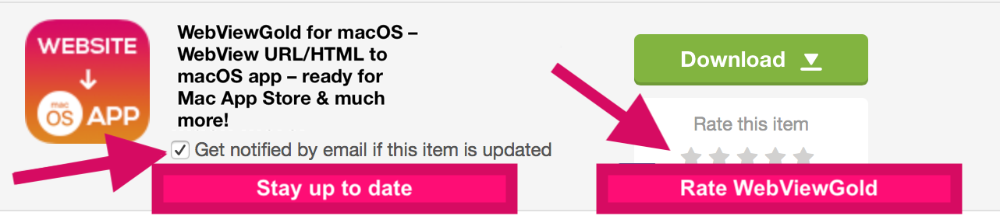

# WebViewGold bewerten – WebViewGold für macOS

> **Zusammenfassung:** Gefällt dir WebViewGold für macOS? Bewerte es in 10 Sekunden auf CodeCanyon – das hält die Updates am Laufen.

[Dokumentation](../README.md) › [WebViewGold für macOS](README.md) › WebViewGold bewerten

**Plattform:** macOS · **Kategorie:** Mehr · **Online-Version:** [www.webviewgold.com/de/docs/mac/#rate](https://www.webviewgold.com/de/docs/mac/#rate)

---

Wenn du 10 Sekunden Zeit hast, bewerte WebViewGold bitte (das ist eine großartige Motivation für zukünftige Updates ^^):\
**1.** Gehe zu [**CodeCanyon.net**](https://www.codecanyon.net?ref=onlineappcreator) und melde dich an\
**2.** Navigiere zu [**https://www.codecanyon.net/downloads**](https://www.codecanyon.net/downloads?ref=onlineappcreator)\
**3.** Klicke auf die Sterne, wie in diesem Bild gezeigt:

\
Vielen Dank!

---

## Weiterlesen

- ← Vorherige: [Danksagungen & Lizenzen](credits.md)
- Weiter →: [Weiter mit iOS & Android](more-platforms.md)
- Dieselbe Funktion auf anderen Plattformen: [iOS – WebViewGold bewerten](../ios/rate.md) · [Android – WebViewGold bewerten](../android/rate.md)
- Sprachen: [🇺🇸 English](../../macos/rate.md) · **🇩🇪 Deutsch** · [🇫🇷 Français](../../fr/macos/rate.md) · [🇪🇸 Español](../../es/macos/rate.md) · [🇨🇳 中文](../../zh/macos/rate.md)

