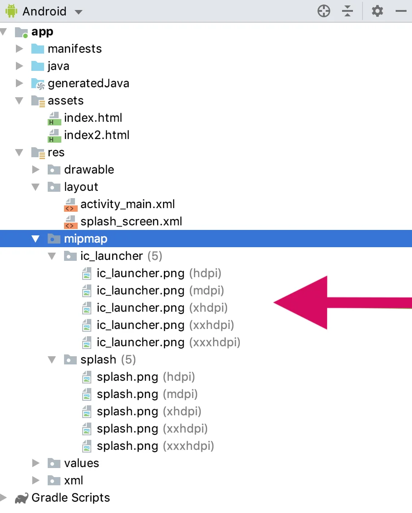
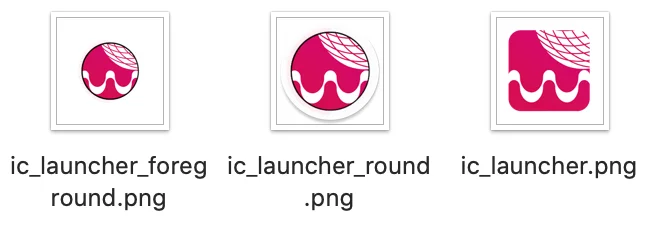

# Icono de la aplicación – WebViewGold para Android

> **Resumen:** Añada su icono de aplicación personalizado a su app de Android WebViewGold en Android Studio, paso a paso.

[Documentación](../README.md) › [WebViewGold para Android](README.md) › Icono de la app

**Plataforma:** Android · **Categoría:** Diseño de la app · **Versión en línea:** [www.webviewgold.com/es/docs/android/app-icon/](https://www.webviewgold.com/es/docs/android/app-icon/)

---

## Cláusula opcional sobre la app para su Política de Privacidad / Términos y Condiciones

Si ofrece apps móviles (basadas en WebViewGold) a sus usuarios, puede incluir opcionalmente la siguiente declaración en su Política de Privacidad o en sus Términos y Condiciones (esta nota se proporciona únicamente con fines informativos y no constituye asesoramiento legal. No asumimos ninguna responsabilidad por el uso que se haga de este texto. Consulte a un profesional del derecho para obtener orientación individual):

> ```
> Our mobile apps (iOS/Android) are developed using WebViewGold by jocapps GmbH (Germany). These apps display the content of our website using a WebView framework and enrich it with selected native features to improve usability and performance. Accordingly, the same privacy policy and terms of service that apply to our website also apply to our mobile apps. For more information, please visit
> https://www.webviewgold.com/#convert-website-to-app-privacy, or contact us directly.
> ```

---

## 3) Añadir un icono de app personalizado



A continuación se explica cómo añadir un icono de app personalizado a su app de Android basada en WebView:

### 1. Localice los iconos de app existentes

Para empezar, busque los archivos de icono de app existentes:

- Haga clic con el botón derecho en cada archivo 'ic_launcher.png' de su proyecto (tamaños desde hdpi hasta xxxhdpi).
- Seleccione Reveal in Finder (Mac) o Reveal in Explorer (Windows).

### 2. Sustitúyalos por su icono

Sustituya cada archivo ic_launcher.png por su nuevo archivo de icono, asegurándose de que los nuevos iconos cumplan los siguientes requisitos:

- Incluya iconos para cada resolución: hdpi, xhdpi, xxhdpi y xxxhdpi.
- Utilice una imagen de alta calidad (preferiblemente en formato PNG).

**Consejo:** También puede utilizar el [**Launcher Icon Generator**](https://jgilfelt.github.io/AndroidAssetStudio/icons-launcher.html) (nota: WebViewGold no está afiliado al desarrollador de esta herramienta).

Los distintos dispositivos mostrarán iconos cuadrados o redondos. Por lo tanto, debe incluir:

- 'ic_launcher.png': se utiliza en dispositivos con iconos cuadrados.
- 'ic_launcher_round.png' e 'ic_launcher_foreground.png': se utilizan en dispositivos con iconos redondos.



Coloque los tres archivos en las carpetas mipmap correspondientes a cada resolución (mipmap-hdpi, mipmap-xhdpi, mipmap-xxhdpi y mipmap-xxxhdpi).

El vídeo explica en detalle el proceso para cambiar el icono de su nueva app, junto con algunas recomendaciones para crearlo.

[](https://www.youtube.com/watch?v=TDDH_yaZxoI)

---

## Seguir leyendo

- ← Anterior: [Configurar WebViewGold](setup.md)
- Siguiente →: [Pantalla de bienvenida](splash-screen.md)
- La misma función en otras plataformas: [iOS – Nombre, icono y splash](../ios/app-name-icon-splash.md) · [macOS – Icono de la aplicación](../macos/app-icon.md)
- Idiomas: [🇺🇸 English](../../android/app-icon.md) · [🇩🇪 Deutsch](../../de/android/app-icon.md) · [🇫🇷 Français](../../fr/android/app-icon.md) · **🇪🇸 Español** · [🇨🇳 中文](../../zh/android/app-icon.md)

> [!TIP]
> **¿Sin tiempo? Configuramos su app por usted.** Nuestro equipo configura, compila & publica su app WebViewGold: llave en mano, entrega rápida, Made in Germany. [Configurar mi app →](https://www.WeSetupYourWebViewApp.com?ref=webviewgold_android_doc_online)
>
> **Compile en su navegador:** Sin Mac ni IDE: el **WebViewGold Cloud Builder** configura, compila & sube su app en línea. [Descubra Cloud Builder →](https://www.webviewgold.com/cloud-builder?ref=android_docs)
