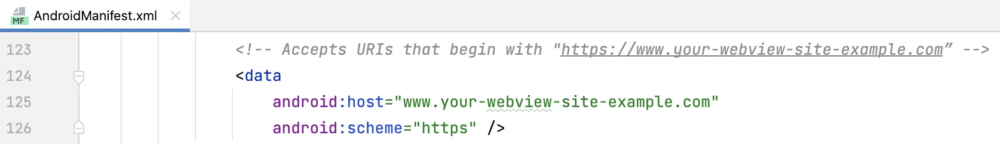
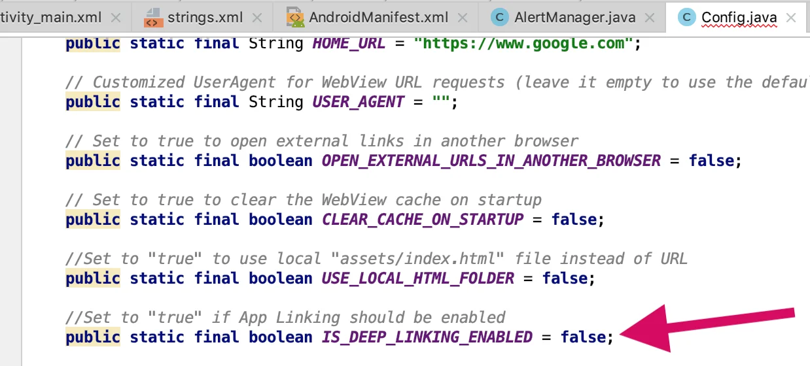

# API de App Links y deep linking – WebViewGold para Android

> **Resumen:** Abra los enlaces a su dominio directamente en su aplicación de Android con App Links y deep linking mediante un esquema de URL personalizado.

[Documentación](../README.md) › [WebViewGold para Android](README.md) › App Links / Deep Linking

**Plataforma:** Android · **Categoría:** API y funciones · **Versión en línea:** [www.webviewgold.com/es/docs/android/app-links/](https://www.webviewgold.com/es/docs/android/app-links/)

---

La API de App Links / Deeplinking de WebViewGold permite a los usuarios abrir páginas específicas de su app desde fuentes externas como el correo electrónico, las redes sociales o las apps de mensajería.

## WebViewGold para Android admite dos métodos de deep linking

- **Deep links estándar basados en URL:** p. ej. `https://www.example.org/subpages/example1`
- **Deep links con esquema personalizado:** p. ej. `webviewgold://https://www.example.org/subpages/example2`

## Paso 1: Configure el esquema de sus enlaces en AndroidManifest.xml

Para admitir el deep linking estándar, configure su **AndroidManifest.xml** para asociar su dominio con su app. Sustituya `www.webviewgold.com` por su dominio real (p. ej. `www.example.org`):



## Paso 2: Active el deep linking en Config.java

En su archivo **Config.java**, active las funciones de deep linking:

```java
// Enables standard deep linking (https:// links)
public static final boolean IS_DEEP_LINKING_ENABLED = true;

// Enables custom scheme deep linking (e.g., webviewgold://)
public static final boolean IS_CUSTOM_SCHEME_ENABLED = true;

// Set your desired scheme prefix (must match AndroidManifest.xml)
public static final String CUSTOM_DEEPLINK_SCHEME = "webviewgold";
```



## Paso 3: Verifique la propiedad del dominio (para deep links basados en URL)

Para activar el deep linking mediante URL HTTPS, debe verificar la propiedad del dominio con Google. Siga la [**guía de verificación de sitios de Google**](https://developer.android.com/training/app-links/verify-android-applinks).

## Cómo probar sus App Links

Puede probar ambos tipos de enlaces a través de Android Studio o de la terminal:

- **Con Android Studio:** abra el **App Links Assistant** desde el menú **Tools** para simular y solucionar problemas.
- **Con la Terminal o el Símbolo del sistema:**
  1. Ejecute el siguiente comando:

     ```bash
     adb shell am start -a android.intent.action.VIEW -d "webviewgold://https://www.example.org/subpages/example2" com.webviewgold.myappname
     ```

     - Sustituya `com.webviewgold.myappname` por el nombre de paquete real de su app.
     - También puede probar con un enlace URL como `https://www.example.org/subpages/example1`.

Una vez que todo esté configurado, los usuarios podrán abrir su app directamente en cualquier página concreta mediante deep links como:

- `https://www.example.org/subpages/example1`
- `webviewgold://https://www.example.org/subpages/example2`

**¿Preguntas?** ¡Escríbanos cuando quiera!

---

## Seguir leyendo

- ← Anterior: [API de linterna](flashlight.md)
- Siguiente →: [API ShareIntent](share-intent.md)
- La misma función en otras plataformas: [iOS – API de Universal Links](../ios/universal-links.md)
- Idiomas: [🇺🇸 English](../../android/app-links.md) · [🇩🇪 Deutsch](../../de/android/app-links.md) · [🇫🇷 Français](../../fr/android/app-links.md) · **🇪🇸 Español** · [🇨🇳 中文](../../zh/android/app-links.md)

> [!TIP]
> **¿Sin tiempo? Configuramos su app por usted.** Nuestro equipo configura, compila & publica su app WebViewGold: llave en mano, entrega rápida, Made in Germany. [Configurar mi app →](https://www.WeSetupYourWebViewApp.com?ref=webviewgold_android_doc_online)
>
> **Compile en su navegador:** Sin Mac ni IDE: el **WebViewGold Cloud Builder** configura, compila & sube su app en línea. [Descubra Cloud Builder →](https://www.webviewgold.com/cloud-builder?ref=android_docs)
