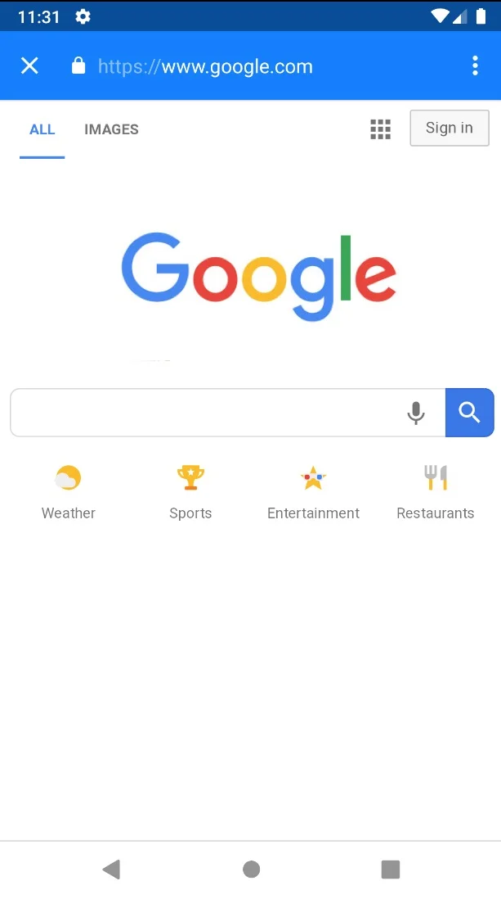

# API de gestión de URL – WebViewGold para Android

> **Resumen:** Decida qué enlaces se abren dentro de su aplicación de Android, en las Chrome Custom Tabs o en el navegador externo.

[Documentación](../README.md) › [WebViewGold para Android](README.md) › API de gestión de URL

**Plataforma:** Android · **Categoría:** API y funciones · **Versión en línea:** [www.webviewgold.com/es/docs/android/url-handling/](https://www.webviewgold.com/es/docs/android/url-handling/)

---

Para mejorar la experiencia del usuario, suele ser beneficioso personalizar la forma en que su aplicación maneja los diferentes tipos de enlaces web. Por ejemplo, los botones de redes sociales se pueden configurar para que se abran en el navegador del sistema o en la aplicación respectiva, en lugar de dentro de su aplicación. WebViewGold proporciona configuraciones flexibles para personalizar el manejo de URL para su aplicación de Android basada en WebView:

## Tipos de enlaces

1. **Enlaces externos:**Enlaces que conducen a un**dominio diferente**desde el dominio principal de su aplicación.
   - **Ejemplo:**Si el dominio de su aplicación es**midominio.com**, un enlace externo sería**google.com**.
2. **Enlaces internos:**Enlaces que permanecen dentro del**mismo dominio**que su aplicación.
   - **Ejemplo:**Si el dominio de su aplicación es**midominio.com**, un enlace interno sería**midominio.com/compra**.
3. **Enlaces especiales:**Enlaces que incluyen atributos especiales, como**target="_blank"**o enlaces que terminan en**#**.

## Opciones de manejo de enlaces

Puede configurar el comportamiento del enlace modificando la configuración en el archivo**Config.java**como se muestra a continuación.

## Manejo de enlaces externos

- **Opción predeterminada (0):**Para abrir enlaces externos en el WebView principal (igual que los enlaces internos), configure`EXTERNAL_LINK_HANDLING_OPTIONS`a`0`.
- **Opción 1:**Para abrir enlaces externos en una nueva pestaña en la aplicación, configure`EXTERNAL_LINK_HANDLING_OPTIONS`a`1`.
- **Opción 2:**Para abrir enlaces externos en el navegador del sistema predeterminado del dispositivo (por ejemplo, Chrome, Safari), configure`EXTERNAL_LINK_HANDLING_OPTIONS`a`2`.

## Manejo de enlaces especiales

- **Opción 0:**Para abrir enlaces especiales en el WebView principal de la aplicación, configure`SPECIAL_LINK_HANDLING_OPTIONS`a`0`.
- **Opción 1:**Para abrir enlaces especiales en una nueva pestaña en la aplicación, configure`SPECIAL_LINK_HANDLING_OPTIONS`a`1`.
- **Opción 2:**Para abrir enlaces especiales en el navegador del sistema predeterminado del dispositivo (por ejemplo, Chrome, Safari), configure`SPECIAL_LINK_HANDLING_OPTIONS`a`2`.

Nota: esta configuración anula`EXTERNAL_LINK_HANDLING_OPTIONS`para los enlaces que sean tanto externos como especiales.

## Personalización del acceso a enlaces: lista blanca y lista negra

Para crear excepciones para sitios o páginas específicas, abra**Config.java**y agregue el dominio a una de las siguientes matrices:

- **BROWSER_WHITELIST:**Enumera dominios específicos para abrir dentro del WebView de la aplicación.
- **BROWSER_BLACKLIST:**Enumera dominios específicos para abrir en el navegador externo.

Para obtener orientación detallada sobre la configuración de enlaces para su aplicación de Android, mire el video tutorial que se proporciona a continuación:

[](https://www.youtube.com/watch?v=lq7jgaB6TxY)

---

## Manejo de URL: uso del navegador de la aplicación para enlaces específicos

Es posible que algunos enlaces, como una página de Términos y condiciones, no sean lo suficientemente importantes como para abrirlos en un navegador de sistema externo, pero sí demasiado específicos para la vista web principal de su aplicación. WebViewGold proporciona una solución creativa para manejar estos enlaces:**una pestaña del navegador en la aplicación**que se abre sobre el WebView principal, proporcionando una experiencia híbrida de aplicación y navegador. Así es como se verá:\


### Características clave de la pestaña del navegador en la aplicación

- La pestaña del navegador de la aplicación incluye una**barra de direcciones**y**botones de navegación**, que ofrece una experiencia más parecida a la de un navegador que el WebView principal.
- Ideal para contenidos que requieren una navegación sencilla, como tutoriales, bases de conocimiento o páginas con información específica.

### Cómo utilizar la pestaña del navegador en la aplicación en su aplicación de Android basada en WebView

Para abrir un enlace en la pestaña del navegador de la aplicación, formatee la URL en su HTML de la siguiente manera:

```html
<a href='#' onClick="top.location.href='https://www.example.com';">Open Example Page</a>
```

**Ejemplo:**Para abrir Google, use:

```html
<a href='#' onClick="top.location.href='https://www.google.com';">Open Google</a>
```

**Comportamiento del enlace de prueba:**\
Para ver cómo su aplicación manejará diferentes tipos de enlaces, use la siguiente URL como URL de WebView durante la prueba:\
Enlace de prueba:<https://www.webviewgold.com/demo/testlinks.php>\
**Nota:**También puede abrir el mismo dominio en su navegador de escritorio para ver el código fuente y copiar el formato de sus enlaces.

---

## Forzar que un enlace concreto se abra en la pestaña in-app o en el navegador (prefijo `newtab:`)

A veces desea que **un único enlace específico** se abra en la pestaña del navegador in-app (o en el navegador externo) — independientemente de su configuración global de manejo de enlaces. Simplemente anteponga el prefijo `newtab:` a la URL:

```html
<a href="newtab:https://www.example.com">Abrir página de ejemplo</a>
```

El enlace con prefijo se trata entonces como un enlace especial: con `SPECIAL_LINK_HANDLING_OPTIONS` en `1` se abre en la pestaña del navegador in-app, y con `2` en el navegador externo del sistema. Para ello, `SPECIAL_LINK_HANDLING_OPTIONS` debe estar configurado en **Config.java** con un valor distinto de `0`.

## Abrir una URL de autenticación en una Chrome Custom Tab (`googlelogin://`)

Algunos proveedores de inicio de sesión (especialmente **Google Sign-In**) bloquean la autenticación dentro de WebViews simples. Si la [herramienta Social Media Login Helper](setup.md) no encaja con su flujo, puede abrir la URL de autenticación en una **Chrome Custom Tab** segura anteponiéndole el prefijo `googlelogin://`:

```javascript
window.location.href = "googlelogin://" + encodeURIComponent("https://accounts.google.com/o/oauth2/v2/auth?...");
```

La URL después del prefijo se decodifica y se abre en una Chrome Custom Tab dentro de la aplicación, donde se puede completar el inicio de sesión. Después, redirija al usuario de vuelta a su web app (p. ej., mediante su URL de redirección OAuth).

---

## Seguir leyendo

- ← Anterior: [Navigation Drawer & Footer](navigation-drawer.md)
- Siguiente →: [API de CSS y JS personalizados](custom-css-js.md)
- La misma función en otras plataformas: [iOS – API de gestión de URL](../ios/url-handling.md)
- Idiomas: [🇺🇸 English](../../android/url-handling.md) · [🇩🇪 Deutsch](../../de/android/url-handling.md) · [🇫🇷 Français](../../fr/android/url-handling.md) · **🇪🇸 Español** · [🇨🇳 中文](../../zh/android/url-handling.md)

> [!TIP]
> **¿Sin tiempo? Configuramos su app por usted.** Nuestro equipo configura, compila & publica su app WebViewGold: llave en mano, entrega rápida, Made in Germany. [Configurar mi app →](https://www.WeSetupYourWebViewApp.com?ref=webviewgold_android_doc_online)
>
> **Compile en su navegador:** Sin Mac ni IDE: el **WebViewGold Cloud Builder** configura, compila & sube su app en línea. [Descubra Cloud Builder →](https://www.webviewgold.com/cloud-builder?ref=android_docs)
