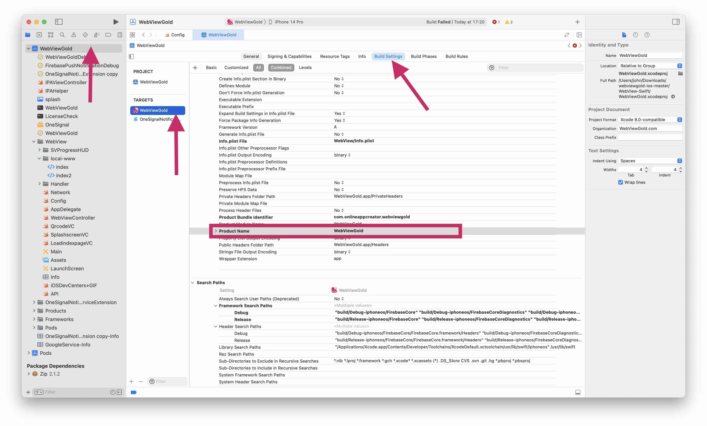
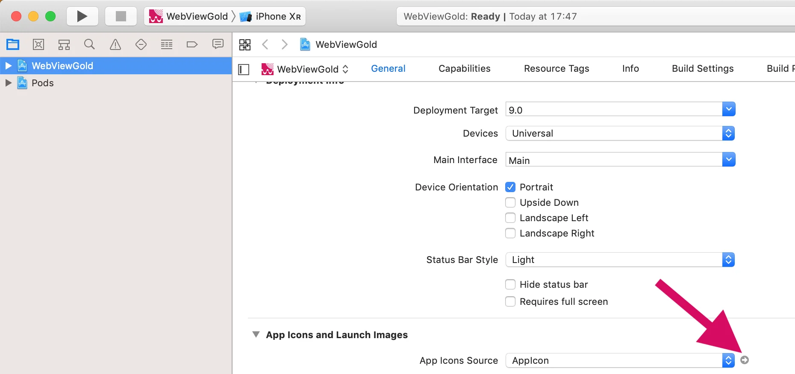

# Nombre de la app, icono y pantalla de bienvenida – WebViewGold para iOS

> **Resumen:** Cambie el nombre de su app iOS, añada un icono de app personalizado y configure gráficos de pantalla de bienvenida personalizados para su app WebViewGold.

[Documentación](../README.md) › [WebViewGold para iOS](README.md) › Nombre, icono y splash

**Plataforma:** iOS · **Categoría:** Diseño de la app · **Versión en línea:** [www.webviewgold.com/es/docs/iOS/app-name-icon-splash/](https://www.webviewgold.com/es/docs/iOS/app-name-icon-splash/)

---

## Cambiar el nombre de la aplicación mostrado

Navegue como se muestra en la captura de pantalla a través de **WebViewGold** → **WebViewGold** → **Build Settings** hasta **Product Name** y cambie el nombre como se muestra en la captura de pantalla siguiente:

- ***NOTA:*** Si el nombre de su aplicación contiene letras con acento (como 'à', por ejemplo), deberá sustituirlas por letras normales en **Product Name**. El **Product Name** también se utiliza para nombrar archivos en su aplicación, por lo que no admite letras con acento (la aplicación se bloqueará). Después, para asegurarse de que su aplicación muestre el nombre correcto a los usuarios en la pantalla de inicio de iOS, cambie también el **Bundle Display Name** (ubicado en el archivo **Info.plist**) de "$PRODUCT_NAME" al nombre de su aplicación con las letras acentuadas. Por ejemplo, si el nombre de su aplicación es "WebViewGold", el **Product Name** debería ser "WebViewGolda" y el **Bundle Display Name** debería ser "WebViewGold".



## Añadir un icono personalizado para la aplicación

Siga estos sencillos pasos para añadir un icono personalizado a su aplicación iOS basada en WebView:\
**1. Localizar la configuración del icono de la aplicación**\
Navegue a **WebViewGold** → **WebViewGold** → **General** → **App Icons and Launch Screen** → **App Icon Source**.\
\
**2. Sustituir por su icono**\
Simplemente sustituya los archivos de imagen incluidos por sus propios archivos de imagen redimensionados. Existen herramientas gratuitas en línea que le ayudarán a generar estos distintos tamaños de imagen, como [**App Icon Generator**](https://www.appicon.co/), por ejemplo (no estamos afiliados con la empresa desarrolladora). Como alternativa, puede buscar cualquier herramienta "iOS App Icon Generator" de su preferencia.

## Añadir una pantalla de bienvenida personalizada

Siga estos pasos para añadir gráficos de pantalla de bienvenida personalizados a su aplicación iOS basada en WebView:

### 1. Activar la pantalla de bienvenida

Para activar la pantalla de bienvenida de su aplicación:

- Abra el archivo **Config.swift** y busque `splashScreenEnabled`.
- Asegúrese de que esta variable esté establecida en `true`.

### 2. Sustituir la imagen de la pantalla de bienvenida

Para usar su propia marca como pantalla de bienvenida:

- Sustituya el archivo **splash.gif** existente en la carpeta principal del proyecto XCode por su propio archivo GIF.
- **Importante:** asegúrese de que su archivo de imagen sea cuadrado (ancho = alto) para una visualización óptima. Por ejemplo:
  - 128x128 px
  - 512x512 px
  - 1024x1024 px

### 3. Ajustar el tiempo de visualización

Para controlar cuánto tiempo se muestra la pantalla de bienvenida:

- Abra el archivo **Config.swift** y busque `splashTimeout`.
- Modifique el ajuste de tiempo de espera con la duración deseada (en milisegundos).

**Ejemplo:** establezca `2000` para una visualización de 2 segundos.

Establezca la opción `remainSplashOption` (se encuentra en el archivo **Config.swift**) en `true` si desea que la pantalla de bienvenida se muestre hasta que su página se haya cargado correctamente. De lo contrario, se mostrará solo durante un breve tiempo y comenzará el indicador de carga nativo de iOS.\
Utilice la opción `splashscreencolor` (se encuentra en el archivo **Config.swift**) para modificar el color de fondo de la pantalla de bienvenida. Las opciones de color se pueden encontrar [aquí](https://developer.apple.com/documentation/uikit/uicolor/standard_colors).

### 4. Aviso opcional de la aplicación para su Política de Privacidad / Términos y Condiciones

Si ofrece a sus usuarios aplicaciones móviles (basadas en WebViewGold), puede incluir opcionalmente la siguiente declaración en su Política de Privacidad o Términos y Condiciones (esta nota se proporciona únicamente con fines informativos y no constituye asesoramiento legal. No asumimos ninguna responsabilidad por el uso que se haga de este texto. Consulte a un profesional del derecho para obtener orientación individual):

> ```
> Our mobile apps (iOS/Android) are developed using WebViewGold by jocapps GmbH (Germany). These apps display the content of our website using a WebView framework and enrich it with selected native features to improve usability and performance. Accordingly, the same privacy policy and terms of service that apply to our website also apply to our mobile apps. For more information, please visit
> https://www.webviewgold.com/#convert-website-to-app-privacy, or contact us directly.
> ```

---

## Seguir leyendo

- ← Anterior: [Configurar WebViewGold](setup.md)
- Siguiente →: [Modificar la Safe Area](safe-area.md)
- La misma función en otras plataformas: [Android – Icono de la app](../android/app-icon.md) · [macOS – Icono de la aplicación](../macos/app-icon.md)
- Idiomas: [🇺🇸 English](../../ios/app-name-icon-splash.md) · [🇩🇪 Deutsch](../../de/ios/app-name-icon-splash.md) · [🇫🇷 Français](../../fr/ios/app-name-icon-splash.md) · **🇪🇸 Español** · [🇨🇳 中文](../../zh/ios/app-name-icon-splash.md)

> [!TIP]
> **¿Sin tiempo? Configuramos su app por usted.** Nuestro equipo configura, compila & publica su app WebViewGold: llave en mano, entrega rápida, Made in Germany. [Configurar mi app →](https://www.WeSetupYourWebViewApp.com?ref=webviewgold_ios_doc_online)
>
> **Compile en su navegador:** Sin Mac ni IDE: el **WebViewGold Cloud Builder** configura, compila & sube su app en línea. [Descubra Cloud Builder →](https://www.webviewgold.com/cloud-builder?ref=ios_docs)
