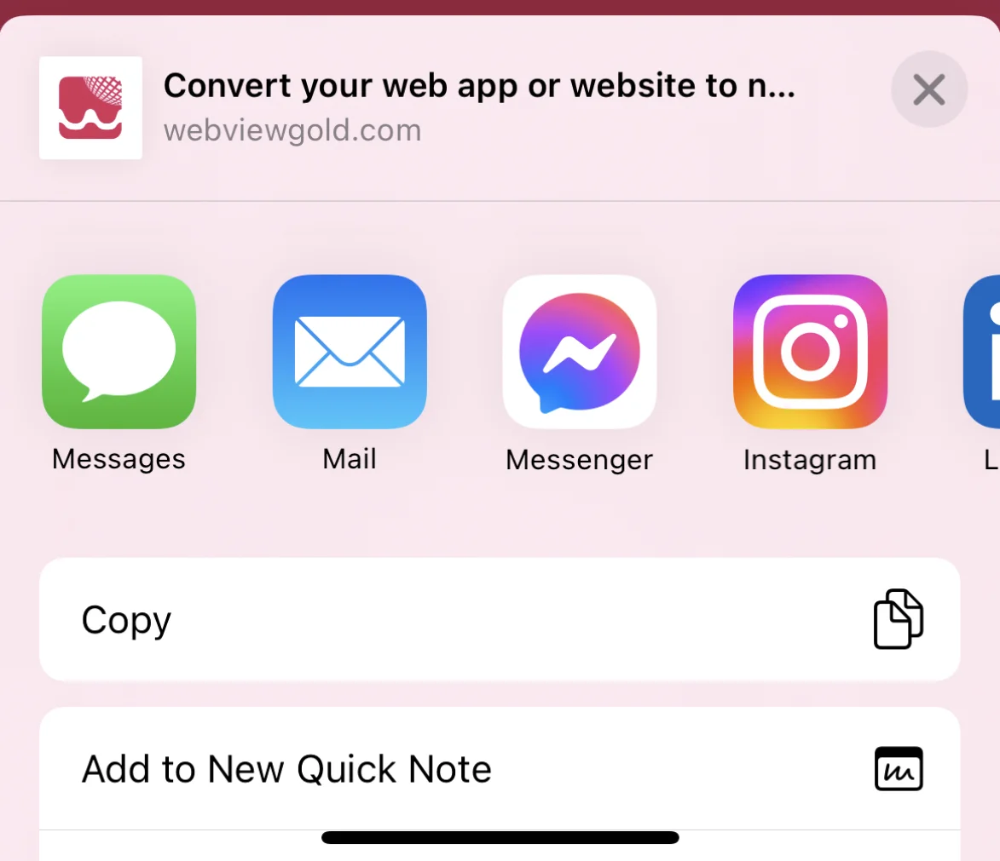
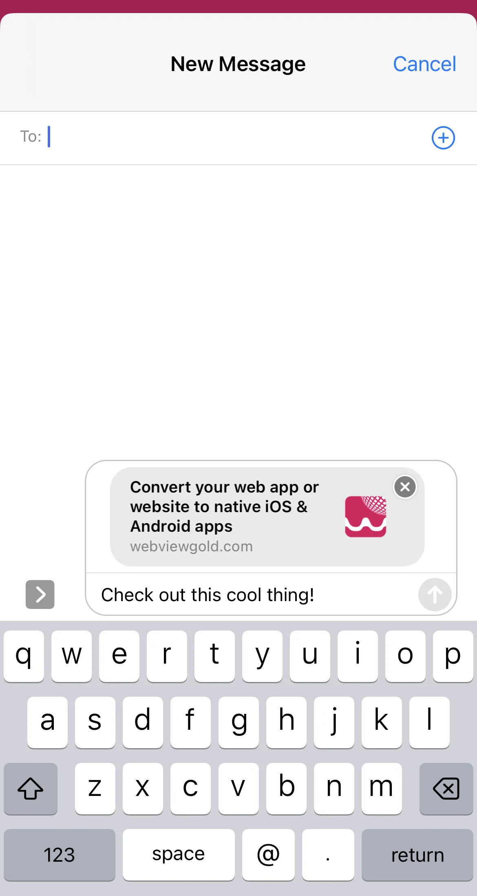

# API de diálogo para compartir la app – WebViewGold para iOS

> **Resumen:** Active la hoja de compartir nativa de iOS desde su aplicación web para que los usuarios compartan su app o cualquier URL.

[Documentación](../README.md) › [WebViewGold para iOS](README.md) › API de diálogo para compartir

**Plataforma:** iOS · **Categoría:** API y funciones · **Versión en línea:** [www.webviewgold.com/es/docs/iOS/app-sharing-dialog/](https://www.webviewgold.com/es/docs/iOS/app-sharing-dialog/)

---

La API de Diálogo de Compartir de la App en WebViewGold permite a sus usuarios compartir contenido de su aplicación, como el enlace de descarga o mensajes personalizados, con amigos y familiares a través de sus aplicaciones preferidas (por ejemplo, WhatsApp, SMS, correo electrónico). Esta puede ser una forma eficaz de aumentar la visibilidad de su aplicación y hacer crecer su base de usuarios.

## Cómo usar el diálogo de compartir de la app en su aplicación iOS basada en WebView

Puede activar un diálogo nativo de compartir utilizando el esquema de URL `shareapp://` con parámetros personalizables de mensaje y URL.

A continuación se muestran ejemplos de las diferentes formas de implementar esta función:

```html
<a href="shareapp://message?=Check out this cool thing!&url=https://www.webviewgold.com">Share (message, link)</a>

<a href="shareapp://message?=&url=https://www.webviewgold.com">Share (no message, link)</a>

<a href="shareapp://message?=Check out this cool thing!">Share (message, no link)</a>
```

\


---

## Seguir leyendo

- ← Anterior: [API de deep linking](deep-linking.md)
- Siguiente →: [API del diálogo de valoración](in-app-rating.md)
- La misma función en otras plataformas: [Android – API de diálogo para compartir](../android/app-sharing-dialog.md)
- Idiomas: [🇺🇸 English](../../ios/app-sharing-dialog.md) · [🇩🇪 Deutsch](../../de/ios/app-sharing-dialog.md) · [🇫🇷 Français](../../fr/ios/app-sharing-dialog.md) · **🇪🇸 Español** · [🇨🇳 中文](../../zh/ios/app-sharing-dialog.md)

> [!TIP]
> **¿Sin tiempo? Configuramos su app por usted.** Nuestro equipo configura, compila & publica su app WebViewGold: llave en mano, entrega rápida, Made in Germany. [Configurar mi app →](https://www.WeSetupYourWebViewApp.com?ref=webviewgold_ios_doc_online)
>
> **Compile en su navegador:** Sin Mac ni IDE: el **WebViewGold Cloud Builder** configura, compila & sube su app en línea. [Descubra Cloud Builder →](https://www.webviewgold.com/cloud-builder?ref=ios_docs)
