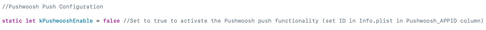
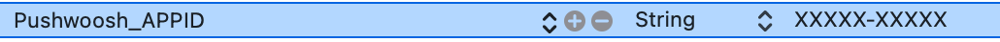
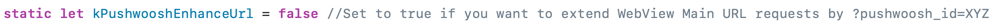
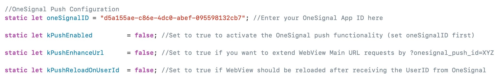
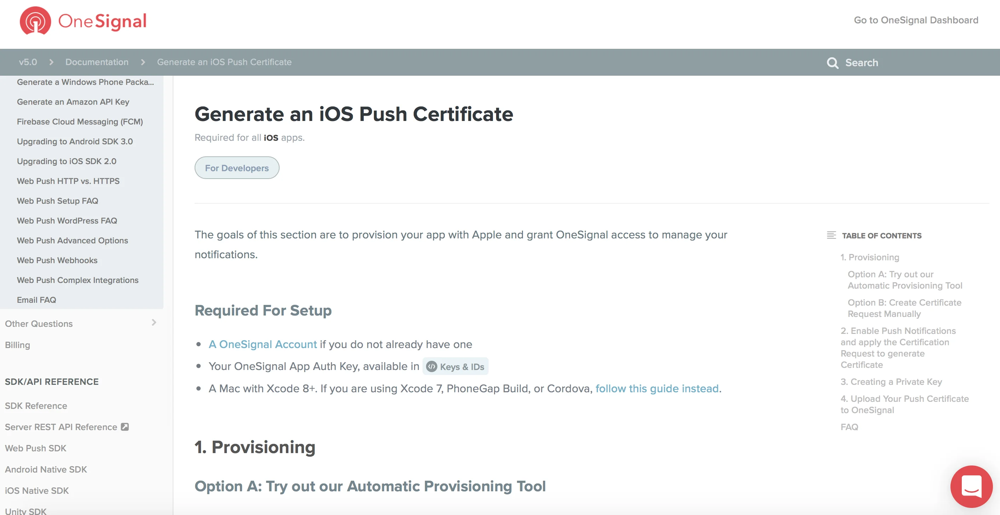
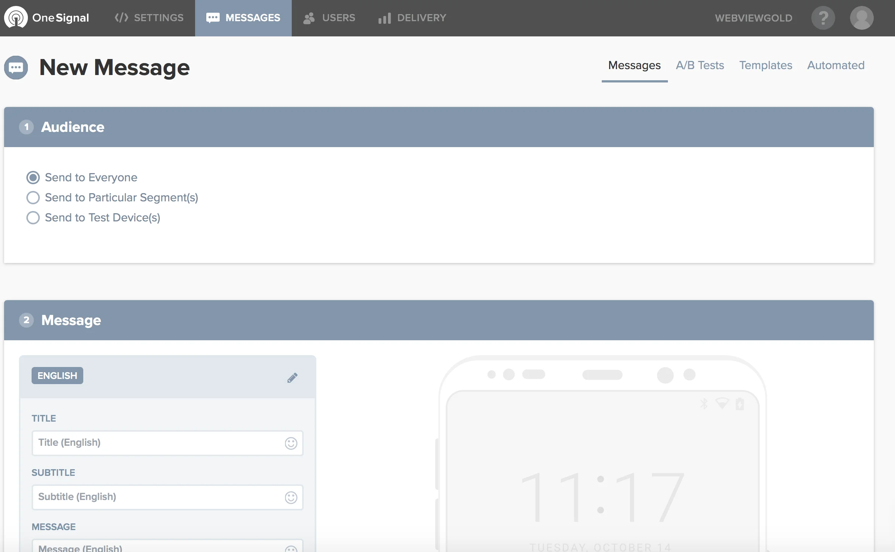
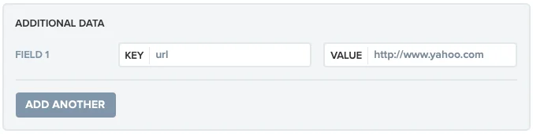
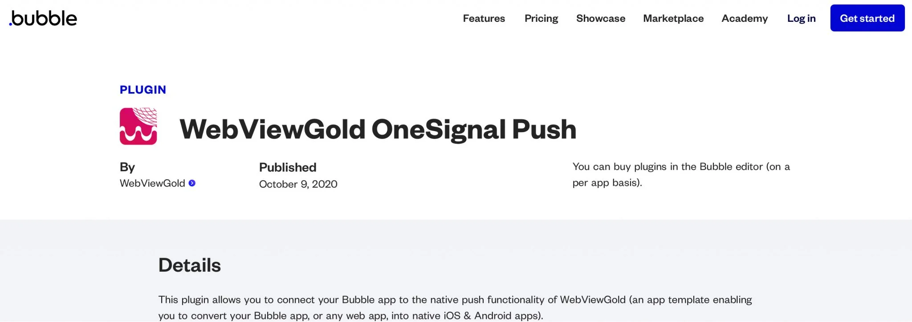

# API de notificaciones push (OneSignal, Firebase, Pushwoosh) – WebViewGold para iOS

> **Resumen:** Envíe notificaciones push a los usuarios de su app iOS con OneSignal, Firebase o Pushwoosh: configuración, deep links y segmentación por usuario explicados.

[Documentación](../README.md) › [WebViewGold para iOS](README.md) › API de notificaciones push

**Plataforma:** iOS · **Categoría:** API y funciones · **Versión en línea:** [www.webviewgold.com/es/docs/iOS/push-notifications/](https://www.webviewgold.com/es/docs/iOS/push-notifications/)

---

Las notificaciones push son notificaciones que aparecen en su smartphone sin necesidad de abrir la aplicación. Este tipo de mensajes permite una interacción excelente con los clientes y usuarios de la aplicación. Su aplicación no tiene que estar abierta para recibir este tipo de notificaciones. De este modo, sus clientes no se perderán ninguna noticia ni mensaje importante. Las notificaciones push son adecuadas para muchos casos, por ejemplo, para actualizaciones de pedidos, live tickers o comunidades de redes sociales. Debe haber conexión a Internet para que los usuarios de la aplicación puedan recibir mensajes push. WebViewGold admite varias formas de llegar a sus usuarios mediante notificaciones push. Si **NO** desea utilizar notificaciones push en absoluto, abra **Config.swift** y establezca **askforpushpermissionatfirstrun** en *false* para evitar que se solicite al usuario de la aplicación el permiso de notificaciones.

## Opción 1: Utilizar la API JavaScript de notificaciones push locales

Puede insertar un fragmento de código (JavaScript) en su sitio web para definir una notificación push que podrá mostrarse **después** de que su aplicación se haya cerrado (la programación se realiza mientras la aplicación está abierta). Esto funciona sin necesidad de configurar OneSignal.

```html
<script>
var title = "Your cart is waiting!"; //notification title
var message = "You have left a cart full of dreams and deals behind. Dont leave it feeling abandoned"; //notification message
var seconds = 120; //seconds from now on
var url = "https://myshop.org/cart.php"; //deep-linking URL

window.location.href = "sendlocalpushmsg://push.send?s="+ seconds +"=msg!"+ message +"&!#"+ title +"&!#"+ url +"";
</script>
```

Puede utilizarse para diferentes situaciones (cuentas atrás, happy hours, recordatorios específicos, ...).

Para **cancelar** todas las notificaciones push locales programadas, ejecute:

```html
<script>
window.location.href = "sendlocalpushmsg://push.send.cancel";
</script>
```

## Comprobar el estado del permiso de notificaciones nativo

Llame a `checkNativePushPermissions://` para comprobar si el usuario ha concedido el permiso de notificaciones nativo de iOS. El resultado se inyecta en su aplicación web como la variable de JavaScript `nativePushEnabled` (`true` o `false`), útil, por ejemplo, para mostrar su propio aviso con un enlace a los [ajustes de la aplicación](open-app-settings.md) si las notificaciones están desactivadas:

```html
<script>
window.location.href = "checkNativePushPermissions://";
setTimeout(function() {
  if (typeof nativePushEnabled !== "undefined" && !nativePushEnabled) {
    // p. ej., mostrar un aviso con enlace a settingsapp://
  }
}, 500);
</script>
```

## Opción 2: Utilizar notificaciones push remotas de Pushwoosh

**¡Los usuarios de WebViewGold pueden disfrutar de dos meses gratis de Pushwoosh!**\
Para acceder a esta oferta, envíe su licencia de WebViewGold por correo electrónico a [pushwoosh-love@webviewgold.com](mailto:pushwoosh-love@webviewgold.com) y recibirá una respuesta personal en breve.

Si desea utilizar [Pushwoosh](https://www.pushwoosh.com) (¡una gran elección!) para las notificaciones push en su aplicación, simplemente active las opciones en **Config.swift** estableciendo **kPushwooshEnable** en **true** y asegúrese también de actualizar el valor **Pushwoosh_APPID** en el archivo **Info.plist** con su propio Application ID de Pushwoosh.\
\


Asegúrese también de completar la configuración de Pushwoosh en su [sitio web](https://www.pushwoosh.com), incluyendo la importación del certificado.\
¡Enhorabuena! Su configuración ya está completa. Ahora está listo para enviar notificaciones push:\
[](https://www.pushwoosh.com)\
¿Desea obtener **el ID del dispositivo de cada usuario** para notificaciones push personalizadas o para su posterior procesamiento? Simplemente establezca **kPushwooshEnhanceUrl** en **true** en **Config.swift** para añadir ?pushwoosh_id=XYZ a la URL de su WebView:\
\
Por ejemplo, si la URL de su WebView es https://www.example.org, WebViewGold llamará en su lugar a https://www.example.org?pushwoosh_id=XYZ. Recuerde que solo la primera solicitud de URL recibirá esta variable GET, por lo que le rogamos que la guarde en una sesión o en una cookie para poder utilizarla más adelante en las páginas enlazadas. Alternativamente o de forma adicional, puede **recuperar y procesar esta información en cualquier página utilizando JavaScript**:

```html
<script>
window.location.href = "getpushwooshid://";
alert(pushwooshplayerid);
</script>
```

## Opción 3: Utilizar notificaciones push remotas de OneSignal

Si desea utilizar [OneSignal](https://www.onesignal.com) en su aplicación, active estas opciones en **Config.swift** (cambiando los valores de **false** a **true**) y asegúrese también de sustituir el marcador de posición **oneSignalID** por el suyo propio. \


Ahora [genere](https://documentation.onesignal.com/docs/generate-an-ios-push-certificate) un certificado de push para iOS e impórtelo:\
[](https://documentation.onesignal.com/docs/generate-an-ios-push-certificate)

¡Bien, ya ha **terminado**! Ahora puede enviar notificaciones push:\
[](https://www.onesignal.com)\
Si desea utilizar el deep linking de URL de OneSignal (abre una URL específica al pulsar su notificación), añada la URL deseada mediante un campo personalizado llamado **url**:\
<a id="getonesignalid"></a>

En el backend de OneSignal.com, puede rellenar esta ventana de par clave-valor después de hacer clic en «Advanced settings». Utilizando la API de OneSignal, puede añadir el campo «url» a la solicitud de la API (<https://documentation.onesignal.com/docs/onesignal-api>).\
¿Desea obtener **<a id="onesignalruntime"></a>el ID de suscripción individual de cada usuario** en su servidor para su posterior procesamiento y para enviar mensajes push a **usuarios individuales**? Simplemente active la opción **kPushEnhanceUrl** en Config.swift (cambiando el valor de *false* a *true*) para añadir ?onesignal_push_id=XYZ a la URL de su WebView. Si la URL de su WebView es https://www.example.org, WebViewGold llamará en su lugar a https://www.example.org?onesignal_push_id=XYZ. Solo la primera solicitud de URL recibirá esa variable GET, por lo que le rogamos que la guarde en una sesión o en una cookie para poder acceder a ella en las páginas enlazadas. Una forma alternativa o adicional sería **recuperar y procesar la información en cualquier página mediante JavaScript**:

```html
<script>
window.location.href = "getonesignalplayerid://";
alert(onesignalplayerid);
</script>
```

**Como alternativa, considere establecer `autoInjectVariable` en `true` en Config.swift para inyectar automáticamente este (y otros) valores en JavaScript sin necesidad de llamar previamente a una URL.**

## Opción 4: Utilizar notificaciones push remotas de Firebase

**Paso 1: Crear un proyecto de Firebase**\
Comience creando un proyecto de Firebase en su [Firebase Console](https://console.firebase.google.com/). Este es un requisito previo para integrar Firebase con su aplicación WebViewGold.\
**Paso 2: Registrar su aplicación en Firebase**\
Una vez que su proyecto de Firebase esté listo, puede añadir su aplicación WebViewGold siguiendo estos pasos:\
a. Vaya a la página general del proyecto en su consola de Firebase y seleccione el icono de iOS para iniciar el proceso de registro de la aplicación.\
b. Para añadir una nueva aplicación a su proyecto, haga clic en **Añadir aplicación** y seleccione las opciones de plataforma. Cuando se le solicite, introduzca el bundle ID de su aplicación en el campo iOS bundle ID. Este ID es crucial y puede encontrarlo así:
- Abriendo el proyecto de su aplicación en Xcode.
- Seleccionando el nombre del proyecto en la parte superior del navegador para acceder a la pestaña General.
- El bundle ID de su aplicación aparece en el campo Bundle Identifier (por ejemplo, com.onlineappcreator.webviewgold).\
Asegúrese de introducir el bundle ID exacto que utiliza su aplicación. Este valor es permanente una vez que la aplicación se ha registrado en Firebase.\
c. Complete la configuración proporcionando la información requerida de la aplicación, incluyendo:
- Alias de la aplicación: Un identificador de conveniencia para su referencia en la consola de Firebase.
- App Store ID: Necesario para la integración con Firebase Dynamic Links y Google Analytics. Puede añadirlo más adelante si su aplicación aún no lo tiene.\
**Paso 3: Registrar su aplicación**\
Haga clic en *Registrar aplicación* para completar el proceso de registro.\
**Paso 4: Descargar GoogleService-Info.plist**\
Descargue este archivo de configuración y sustituya el marcador de posición en su proyecto WebViewGold por el archivo GoogleService-Info.plist descargado.\
**Paso 5: Activar Firebase en WebViewGold**\
En el archivo Config.swift, establezca la variable **kFirebasePushEnabled** en **true** para habilitar las funcionalidades de Firebase.\
**Paso 6: Configurar APN y firmar su aplicación**\
Genere una clave APN para Firebase, súbala y, a continuación, firme su aplicación utilizando el perfil de aprovisionamiento de Firebase. Para una guía detallada, consulte la [documentación de Firebase sobre certificados de iOS](https://firebase.google.com/docs/cloud-messaging/ios/certs).\
**Paso 7: Implementar el deep linking de URL (opcional)**\
Para dar soporte al deep linking de URL de Firebase, añada la URL de destino en un campo **Custom Data** dentro de **Additional options (optional)**, con **Key** = «url» y **Value** = {URL deseada}.

\
Para suscribirse a un topic de Firebase, establezca **firebaseTopic** en Config.swift con el nombre del topic que desea.\
¿Desea obtener **el ID de suscripción individual de cada usuario** en su servidor para su posterior procesamiento y para enviar mensajes push a **<a id="firebaseruntime"></a>usuarios individuales**? Simplemente active la opción **kFirebaseEnhanceUrl** en Config.swift (cambiando el valor de *false* a *true*) para añadir ?firebase_push_id=XYZ a la URL de su WebView. Si la URL de su WebView es https://www.example.org, WebViewGold llamará en su lugar a https://www.example.org?firebase_push_id=XYZ. Solo su PRIMERA solicitud de URL recibirá esa variable GET, por lo que le rogamos que la guarde en una sesión o en una cookie para poder acceder a ella en las páginas enlazadas. Una forma alternativa o adicional sería **recuperar y procesar la información en cualquier página mediante JavaScript**:

```html
<script>
window.location.href = "getfirebaseplayerid://";
alert(firebaseplayerid);
</script>
```

**Como alternativa, considere establecer `autoInjectVariable` en `true` en Config.swift para inyectar automáticamente este (y otros) valores en JavaScript sin necesidad de llamar previamente a una URL.**

## Opción 5: Utilizar notificaciones push de bubble.io

[](https://www.youtube.com/watch?v=C0HBXlMSK2E)

1. Cree una **aplicación bubble.io**
2. Instale el plugin **[WebViewGold OneSignal Push](https://bubble.io/plugin/webviewgold-onesignal-push-1602240916803x713805488222896100)**:

[](https://bubble.io/plugin/webviewgold-onesignal-push-1602240916803x713805488222896100)
3. Siga las **instrucciones de OneSignal (véase arriba)** y las **instrucciones del plugin (véase [aquí](https://bubble.io/plugin/webviewgold-onesignal-push-1602240916803x713805488222896100) y [aquí](https://www.youtube.com/watch?v=C0HBXlMSK2E))**.

---

## Seguir leyendo

- ← Anterior: [API de geolocalización](geolocation.md)
- Siguiente →: [API de anuncios AdMob](admob.md)
- La misma función en otras plataformas: [Android – API de notificaciones push](../android/push-notifications.md)
- Idiomas: [🇺🇸 English](../../ios/push-notifications.md) · [🇩🇪 Deutsch](../../de/ios/push-notifications.md) · [🇫🇷 Français](../../fr/ios/push-notifications.md) · **🇪🇸 Español** · [🇨🇳 中文](../../zh/ios/push-notifications.md)

> [!TIP]
> **¿Sin tiempo? Configuramos su app por usted.** Nuestro equipo configura, compila & publica su app WebViewGold: llave en mano, entrega rápida, Made in Germany. [Configurar mi app →](https://www.WeSetupYourWebViewApp.com?ref=webviewgold_ios_doc_online)
>
> **Compile en su navegador:** Sin Mac ni IDE: el **WebViewGold Cloud Builder** configura, compila & sube su app en línea. [Descubra Cloud Builder →](https://www.webviewgold.com/cloud-builder?ref=ios_docs)
