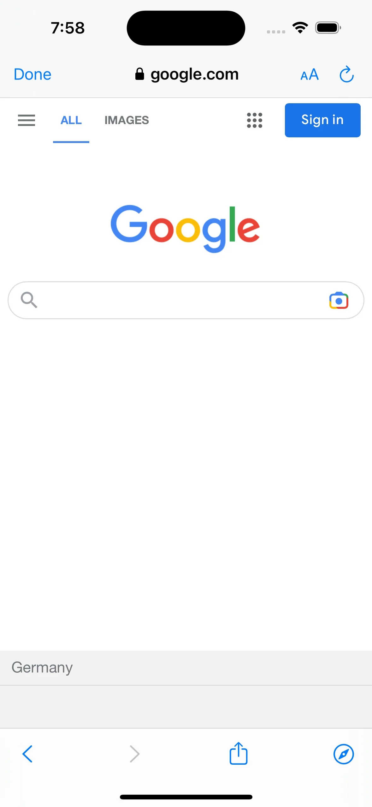

# API de gestión de URL – WebViewGold para iOS

> **Resumen:** Decida qué enlaces se abren dentro de su app, en una pestaña del navegador integrado o en Safari: control total de la gestión de URL para iOS.

[Documentación](../README.md) › [WebViewGold para iOS](README.md) › API de gestión de URL

**Plataforma:** iOS · **Categoría:** API y funciones · **Versión en línea:** [www.webviewgold.com/es/docs/iOS/url-handling/](https://www.webviewgold.com/es/docs/iOS/url-handling/)

---

Para mejorar la experiencia del usuario, a menudo resulta beneficioso personalizar cómo gestiona su aplicación los diferentes tipos de enlaces web. Por ejemplo, los botones de redes sociales pueden configurarse para abrirse en el navegador del sistema o en la aplicación correspondiente, en lugar de dentro de su aplicación. WebViewGold ofrece ajustes flexibles para personalizar la gestión de URL de su aplicación iOS basada en WebView.

## Tipos de enlaces

1. **Enlaces externos:** Enlaces que conducen a un **dominio diferente** del dominio principal de su aplicación.
   - **Ejemplo:** Si el dominio de su aplicación es **mydomain.com**, un enlace externo sería **google.com**.
2. **Enlaces internos:** Enlaces que permanecen dentro del **mismo dominio** que su aplicación.
   - **Ejemplo:** Si el dominio de su aplicación es **mydomain.com**, un enlace interno sería **mydomain.com/purchase**.
3. **Enlaces especiales:** Enlaces que incluyen atributos especiales, como **target="_blank"**.

## Para configurar la API de gestión de URL, abra Config.swift

1. Para definir el comportamiento predeterminado de los **enlaces externos**:
   - Establezca `externalLinkHandlingOptions` en `0` para abrir los enlaces externos dentro de la aplicación de forma predeterminada, o en `2` para abrirlos SIEMPRE en otro navegador (Safari).

2. Para definir el comportamiento predeterminado de los **enlaces especiales** (p. ej., **target="_blank"**):
   - Establezca `specialLinkHandlingOptions` en `0` para abrir los enlaces especiales dentro de la aplicación, en `1` para abrirlos en una pestaña nueva (un navegador integrado adicional) o en `2` para abrirlos en otro navegador (Safari).

3. Para definir dominios que ***siempre* se abran en Safari** (independientemente del ajuste `externalLinkHandlingOptions`):
   - Añada los dominios deseados a la lista `safariwhitelist`.
   - Inserte otro host de esta manera: ["alwaysopeninsafari.com", "google.com", "m.facebook.com"].
   - Introduzca el host exactamente como lo enlaza (con o sin www, pero siempre sin http/https).

4. Para definir dominios que ***nunca* se abran en Safari** (independientemente del ajuste `externalLinkHandlingOptions`):
   - Añada los dominios deseados a la lista `safariblacklist`.
   - Inserte otro host de esta manera: ["alwaysopeninsafari.com", "google.com", "m.facebook.com"].
   - Introduzca el host exactamente como lo enlaza (con o sin www, pero siempre sin http/https).

5. Para definir dominios que ***siempre*** o ***nunca* se abran en una pestaña integrada** (independientemente del ajuste `externalLinkHandlingOptions`):
   - Añada los dominios deseados a la lista `alwaysOpenInInAppTab` o `neverOpenInInAppTab`.

## Abrir enlaces en una pestaña/navegador integrado adicional

Algunos enlaces, como una página de Términos y Condiciones, pueden no ser lo bastante importantes como para abrirse en un navegador externo del sistema, pero sí demasiado específicos para el WebView principal de su aplicación. WebViewGold ofrece una solución creativa para gestionar estos enlaces: **una pestaña de navegador integrada** que se abre sobre el WebView principal, proporcionando una experiencia híbrida de aplicación y navegador. Este es su aspecto:



### Características principales de la pestaña de navegador integrada

- La pestaña de navegador integrada incluye una **barra de direcciones** y **botones de navegación**, ofreciendo una experiencia más parecida a la de un navegador que el WebView principal.
- Ideal para contenido que requiere una navegación sencilla, como tutoriales, bases de conocimiento o páginas con información específica.

### Cómo usar la pestaña de navegador integrada en su aplicación iOS basada en WebView

Para abrir un enlace en la pestaña de navegador integrada, establezca `specialLinkHandlingOptions` en `1` y dé formato a la URL en su HTML de la siguiente manera:

```html
<a href="https://www.example.com" target="_blank">Open link in an in-app tab</a>
```

En pocas palabras, un **enlace especial** se clasifica como un enlace que tiene añadido el target "_blank". En un navegador normal, esto haría que el enlace se abriera en una pestaña nueva. En la aplicación WebViewGold, puede hacer que se abra en la pestaña integrada en su lugar.

Tenga en cuenta que si el enlace que está usando es externo (tiene un dominio diferente al de su sitio web, como "www.google.com", por ejemplo), asegúrese también de que `externalLinkHandlingOptions` esté establecido en `0`, ya que abrir todos los enlaces externos en otro navegador anularía el enlace especial-externo para abrirlo en la aplicación Safari en su lugar.

**Prueba del comportamiento de los enlaces:**\
Para ver cómo gestionará su aplicación los diferentes tipos de enlaces, utilice la siguiente URL como URL del WebView durante las pruebas:\
Enlace de prueba: <https://www.webviewgold.com/demo/testlinks.php>\
**Nota:** También puede abrir el mismo dominio en el navegador de su escritorio para ver el código fuente y copiar el formato para sus enlaces.

---

## Seguir leyendo

- ← Anterior: [API Pull-to-Refresh](pull-to-refresh.md)
- Siguiente →: [Social Login Helper](social-login.md)
- La misma función en otras plataformas: [Android – API de gestión de URL](../android/url-handling.md)
- Idiomas: [🇺🇸 English](../../ios/url-handling.md) · [🇩🇪 Deutsch](../../de/ios/url-handling.md) · [🇫🇷 Français](../../fr/ios/url-handling.md) · **🇪🇸 Español** · [🇨🇳 中文](../../zh/ios/url-handling.md)

> [!TIP]
> **¿Sin tiempo? Configuramos su app por usted.** Nuestro equipo configura, compila & publica su app WebViewGold: llave en mano, entrega rápida, Made in Germany. [Configurar mi app →](https://www.WeSetupYourWebViewApp.com?ref=webviewgold_ios_doc_online)
>
> **Compile en su navegador:** Sin Mac ni IDE: el **WebViewGold Cloud Builder** configura, compila & sube su app en línea. [Descubra Cloud Builder →](https://www.webviewgold.com/cloud-builder?ref=ios_docs)
