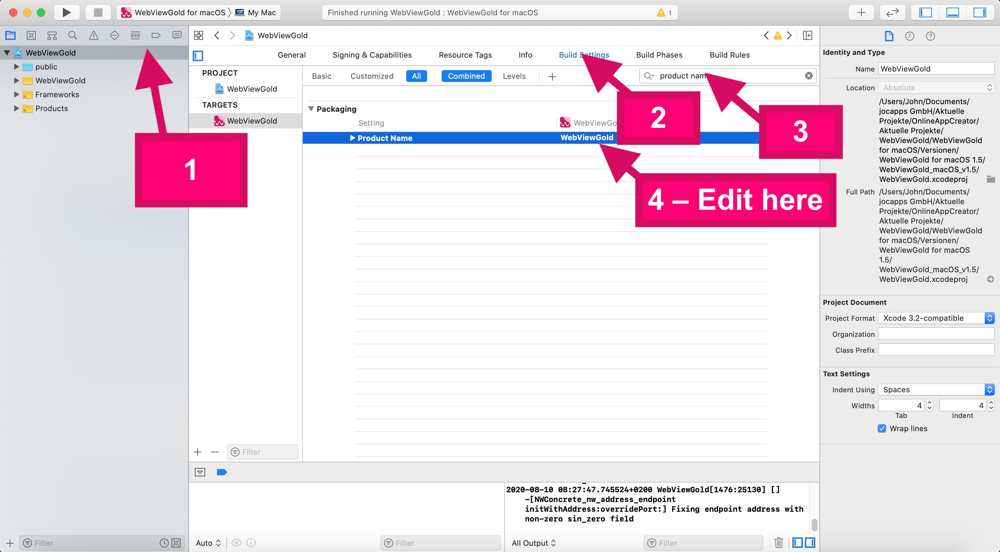

# Cambiar el nombre de la aplicación – WebViewGold para macOS

> **Resumen:** Cambie el nombre de su app de escritorio WebViewGold para macOS en Xcode.

[Documentación](../README.md) › [WebViewGold para macOS](README.md) › Nombre de la aplicación

**Plataforma:** macOS · **Categoría:** Diseño de la app · **Versión en línea:** [www.webviewgold.com/es/docs/mac/#appname](https://www.webviewgold.com/es/docs/mac/#appname)

---

---

## Seguir leyendo

- ← Anterior: [Icono de la aplicación](app-icon.md)
- Siguiente →: [Texto de la pantalla sin conexión](offline-screen.md)
- Idiomas: [🇺🇸 English](../../macos/app-name.md) · [🇩🇪 Deutsch](../../de/macos/app-name.md) · [🇫🇷 Français](../../fr/macos/app-name.md) · **🇪🇸 Español** · [🇨🇳 中文](../../zh/macos/app-name.md)

