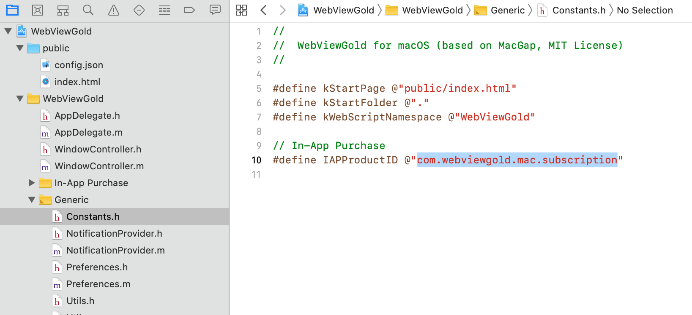

# API In-App Purchase & In-App Subscription – WebViewGold para macOS

> **Resumen:** Venda compras integradas y suscripciones de la Mac App Store desde su app web: añada el ID de producto en Constants.h y active la compra con un enlace inapppurchase://.

[Documentación](../README.md) › [WebViewGold para macOS](README.md) › API In-App Purchases

**Plataforma:** macOS · **Categoría:** API y funciones · **Versión en línea:** [www.webviewgold.com/es/docs/mac/#inapppurchases](https://www.webviewgold.com/es/docs/mac/#inapppurchases)

---

Dentro de algunas aplicaciones de macOS/Mac, es posible comprar contenido o servicios adicionales. Este tipo de compras se denominan «in-app purchases». Pueden constituir una fuente de ingresos atractiva para los desarrolladores y son muy cómodas para los clientes, ya que utilizan cuentas y medios de pago existentes para su liquidación. WebViewGold permite activar los In-App Purchases de la Mac App Store. Basta con añadir su In-App Purchase Product ID (obtenido en *App Store Connect*) al archivo *Constants.h*: \
\
A continuación, basta con enlazar a este tipo de URL:

```html
<a href="inapppurchase://?successful_url=https://www.google.com">Buy In-App Purchase</a>
```

Como alternativa, utilice este tipo de URL para los productos de suscripción:

```html
<a href="inappsubscription://?successful_url=https://www.google.com&expired_url=https://www.yahoo.com">Start In-App Subscription</a>
```

En este ejemplo de URL, se llamará a https://www.google.com tras la activación satisfactoria de la suscripción, y se llamará a https://www.yahoo.com en cuanto la suscripción caduque.

---

## Seguir leyendo

- ← Anterior: [Pantalla de inicio](splash-screen.md)
- Siguiente →: [API UUID](uuid.md)
- La misma función en otras plataformas: [iOS – API de compras integradas](../ios/in-app-purchases.md) · [Android – API de compras integradas](../android/in-app-purchases.md)
- Idiomas: [🇺🇸 English](../../macos/in-app-purchases.md) · [🇩🇪 Deutsch](../../de/macos/in-app-purchases.md) · [🇫🇷 Français](../../fr/macos/in-app-purchases.md) · **🇪🇸 Español** · [🇨🇳 中文](../../zh/macos/in-app-purchases.md)

