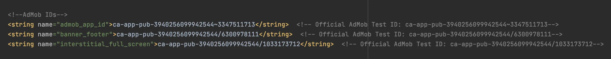

# API AdMob – WebViewGold pour Android

> **Résumé :** Monétisez votre application Android avec les annonces bannière et interstitielles Google AdMob — configuration et déclencheurs JavaScript.

[Documentation](../README.md) › [WebViewGold pour Android](README.md) › API AdMob

**Plateforme :** Android · **Catégorie :** API et fonctionnalités · **Version en ligne :** [www.webviewgold.com/fr/docs/android/admob/](https://www.webviewgold.com/fr/docs/android/admob/)

---

AdMob est un service Google permettant de monétiser les applications mobiles sur les plateformes iOS et Android. Il permet aux développeurs d'intégrer des publicités bannière, interstitielles et avec récompense, rémunérées au clic (CPC, coût par clic) ou à l'impression (CPM, coût pour mille). WebViewGold simplifie l'intégration d'AdMob et permet une configuration rapide pour afficher des publicités dans votre application Android basée sur WebView.

## Étape 1 : Ouvrir le fichier Config.java

Pour commencer, ouvrez le fichier **Config.java** de votre application afin de définir les préférences publicitaires et d'activer les fonctionnalités AdMob.

## Étape 2 : Monétisez votre application avec le SDK natif AdMob

Dans **Config.java**, vous pouvez :

- **Activez ou désactivez** les publicités bannière et/ou interstitielles en réglant `SHOW_BANNER_AD` sur true pour les bannières et `SHOW_FULL_SCREEN_AD` sur true pour les interstitielles.
- **Définissez des intervalles** d'affichage des publicités interstitielles en modifiant `SHOW_AD_AFTER_X` pour indiquer le nombre d'interactions avec le site web souhaité avant la diffusion d'une publicité interstitielle.

**Remarque :** Avant de lancer votre application, assurez-vous que vos identifiants AdMob uniques sont correctement renseignés dans le fichier **strings.xml** :\


## Étape 3 : Activer les publicités avec récompense

- Configuration des publicités avec récompense :
  - Pour activer les publicités avec récompense, réglez `ENABLE_REWARDED_ADS` sur `true`.
  - Utilisez le lien suivant pour afficher une publicité avec récompense

    ```html
    <a href="displayrewardedad://">Display Rewarded Advertisement</a>
    ```

  - Une fois que l'utilisateur a fini de regarder la publicité, WebViewGold déclenche la fonction JavaScript `updateRewardedStatus('true');` pour vous permettre de gérer les récompenses dans le code de votre application.
- Publicités avec récompense par défaut :
  - Si vous préférez que les publicités avec récompense s'affichent par défaut, réglez à la fois `USE_REWARDED_ADS_WHERE_POSSIBLE` et `SHOW_FULL_SCREEN_AD` sur `true`. Les publicités avec récompense seront ainsi prioritaires sur les publicités interstitielles.

## Ressources supplémentaires

Pour des options plus détaillées, consultez la [documentation officielle du SDK AdMob](https://developers.google.com/admob/), mais ignorez les instructions d'installation, car WebViewGold inclut déjà le framework nécessaire.

[](https://www.youtube.com/watch?v=vq5FM7n0Syg)

Vous pouvez également contrôler **dynamiquement** la visibilité des publicités pour un utilisateur en appelant les schémas d'URL personnalisés suivants depuis votre site web ou votre application :

- `enableads://` – Réactive l'affichage des publicités pour l'utilisateur actuel
- `disableads://` – Désactive définitivement les publicités pour l'utilisateur actuel

## <a id="appopenads"></a>Étape 4 : Activer les annonces App Open

Les **annonces app open** sont des annonces plein écran qui s'affichent lorsque l'utilisateur ouvre l'application (démarrage à froid depuis le splash du launcher) ou y revient depuis l'arrière-plan. Pour les activer :

- Définissez `SHOW_APP_OPEN_AD` sur `true` dans **Config.java**.
- Remplacez la valeur `admob_app_open_id` dans **strings.xml** par l'ID de votre propre bloc d'annonces app open AdMob (le modèle contient l'ID de test officiel d'AdMob — remplacez-le avant la publication !).

**Remarque :** Les annonces app open respectent la gestion du consentement Google (`ASK_FOR_AD_CONSENT`) tout comme les autres formats AdMob.

---

## Continuer la lecture

- ← Précédent : [API de notifications push](push-notifications.md)
- Suivant → : [API Facebook Ads](facebook-ads.md)
- Même fonctionnalité sur les autres plateformes : [iOS – API AdMob Ads](../ios/admob.md)
- Langues : [🇺🇸 English](../../android/admob.md) · [🇩🇪 Deutsch](../../de/android/admob.md) · **🇫🇷 Français** · [🇪🇸 Español](../../es/android/admob.md) · [🇨🇳 中文](../../zh/android/admob.md)

> [!TIP]
> **Trop occupé ? Nous configurons votre app pour vous.** Notre équipe configure, compile & soumet votre app WebViewGold — clé en main, délai rapide, Made in Germany. [Faire configurer mon app →](https://www.WeSetupYourWebViewApp.com?ref=webviewgold_android_doc_online)
>
> **Compilez dans votre navigateur :** Pas de Mac, pas d’IDE : le **WebViewGold Cloud Builder** configure, compile & met en ligne votre app. [Découvrir Cloud Builder →](https://www.webviewgold.com/cloud-builder?ref=android_docs)
