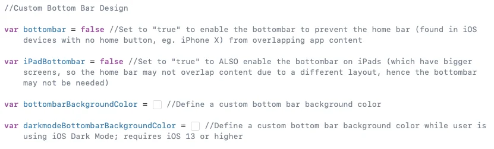
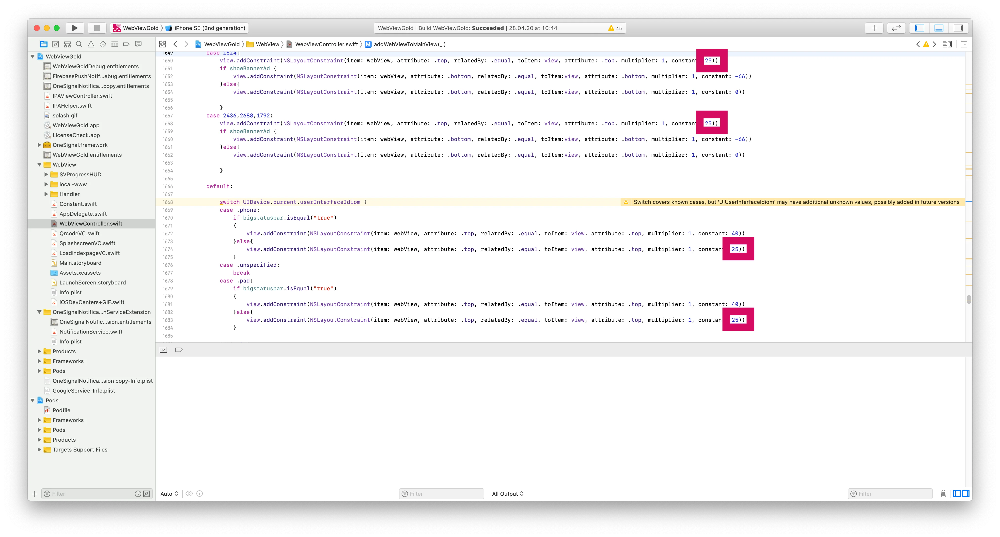

# Modifier la taille de la Safe Area – WebViewGold pour iOS

> **Résumé :** Ajustez la Safe Area et activez la barre inférieure personnalisée pour que votre application web s'affiche parfaitement sur les iPhone dotés d'une barre d'accueil.

[Documentation](../README.md) › [WebViewGold pour iOS](README.md) › Modifier la Safe Area

**Plateforme :** iOS · **Catégorie :** Design de l’app · **Version en ligne :** [www.webviewgold.com/fr/docs/iOS/safe-area/](https://www.webviewgold.com/fr/docs/iOS/safe-area/)

---

Le passage de l'iPhone 8 à l'iPhone X et aux modèles suivants a beaucoup changé l'interface utilisateur du secteur mobile en supprimant le bouton d'accueil et en introduisant la barre d'accueil. Selon la conception de votre application web, la barre de menu inférieure peut être mal positionnée sur les appareils dotés de la barre d'accueil (chevauchant le contenu) en raison du changement de la zone sûre par défaut.\
La bonne nouvelle, c'est que WebViewGold propose une fonctionnalité qui vous permet d'activer une **bottombar** et de choisir sa couleur pour l'accorder au thème de votre application. Comme le problème de chevauchement de la barre d'accueil avec le contenu de l'app peut ne pas apparaître sur les iPad (en raison de l'écran plus grand et d'une mise en page potentiellement différente), il existe également une option pour désactiver la fonctionnalité sur les iPad.\
Pour implémenter cette fonctionnalité, utilisez les variables suivantes dans **Config.swift** sous la rubrique « Custom Bottom Bar Design ». Assurez-vous de définir **bottombar** sur **true**.\
\
**Avancé :** Au lieu d'utiliser la fonctionnalité bottombar, vous pouvez rechercher ce fragment de code *(appuyez sur **CMD+F** puis saisissez «*`switch UIDevice.current.userInterfaceIdiom`*»)* dans le fichier **WebViewController.swift** où vous pouvez remplacer la valeur de bordure 20 par la valeur souhaitée, comme 10, 30, etc., comme illustré ci-dessous :\

---

## Continuer la lecture

- ← Précédent : [Nom, icône et splash](app-name-icon-splash.md)
- Suivant → : [API de géolocalisation](geolocation.md)
- Langues : [🇺🇸 English](../../ios/safe-area.md) · [🇩🇪 Deutsch](../../de/ios/safe-area.md) · **🇫🇷 Français** · [🇪🇸 Español](../../es/ios/safe-area.md) · [🇨🇳 中文](../../zh/ios/safe-area.md)

> [!TIP]
> **Trop occupé ? Nous configurons votre app pour vous.** Notre équipe configure, compile & soumet votre app WebViewGold — clé en main, délai rapide, Made in Germany. [Faire configurer mon app →](https://www.WeSetupYourWebViewApp.com?ref=webviewgold_ios_doc_online)
>
> **Compilez dans votre navigateur :** Pas de Mac, pas d’IDE : le **WebViewGold Cloud Builder** configure, compile & met en ligne votre app. [Découvrir Cloud Builder →](https://www.webviewgold.com/cloud-builder?ref=ios_docs)
