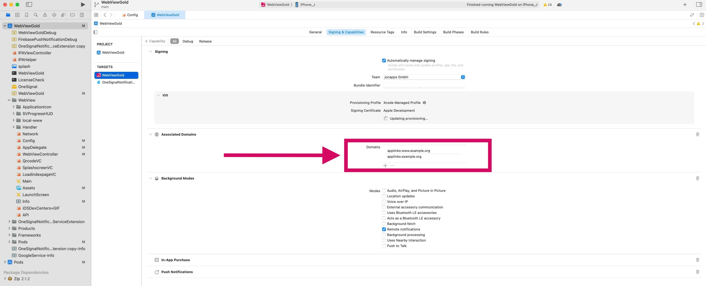

# API Universal Links – WebViewGold pour iOS

> **Résumé :** Ouvrez les liens vers votre domaine directement dans votre application iOS grâce aux Apple Universal Links : configuration, fichier AASA et dépannage.

[Documentation](../README.md) › [WebViewGold pour iOS](README.md) › API Universal Links

**Plateforme :** iOS · **Catégorie :** API et fonctionnalités · **Version en ligne :** [www.webviewgold.com/fr/docs/iOS/universal-links/](https://www.webviewgold.com/fr/docs/iOS/universal-links/)

---

L'**API Universal Links** simplifie l'accès aux contenus au sein de votre application, offrant une expérience utilisateur plus fluide et plus native. WebViewGold vous permet de configurer votre domaine afin que les liens provenant d'applications telles que **Mail, Safari et d'autres** s'ouvrent automatiquement dans votre application basée sur WebViewGold — sans invite supplémentaire.

**Remarque :** l'application doit d'abord être installée sur l'appareil de l'utilisateur pour que cette fonctionnalité fonctionne.

**Vous pouvez également** utiliser notre [**API Deep Linking**](deep-linking.md). Bien qu'elle fonctionne de manière similaire, elle utilise une syntaxe différente. Cependant, il convient de noter que la syntaxe de l'[**API Universal Links**](universal-links.md) est plus courante que celle de l'API Deep Linking. Pour la plupart des applications, il est judicieux de choisir l'une ou l'autre, mais pas les deux.

Pour configurer les **Universal Links** dans votre application iOS, veuillez suivre les étapes ci-dessous :

1. **Configuration dans l'Apple Developer Center :**

1. Connectez-vous à votre compte sur l'[Apple Developer Center](https://developer.apple.com/account/).
2. Cliquez sur « Certificates, Identifiers & Profiles ».
3. Sous « Identifiers », sélectionnez « App IDs », puis choisissez l'identifiant de votre application dans la liste.
4. Dans la section « App Services », cochez l'option « Associated Domains » et enregistrez vos modifications.

2. **Configuration dans Xcode :**

1. Ouvrez votre projet d'application dans Xcode.
2. Sélectionnez la cible (dans la plupart des cas « WebViewGold »). Dans l'onglet « Signing & Capabilities », rendez-vous dans la section « Associated Domains ». Cliquez sur « + » pour ajouter un domaine. Votre domaine doit être préfixé par « applinks: », comme ceci : `applinks:example.org` & `applinks:www.example.org` :\
   
3. Dans Config.swift, définissez **ShowExternalLink** sur **true**.
4. Soyez attentif aux sous-domaines. Il existe une distinction entre les domaines « www.\* » et non-« www » (envisagez d'ajouter les deux). Assurez-vous de disposer du bon provisioning profile avec la capability « Associated Domains ». Sinon, Xcode devrait vous inviter à le corriger.

3. **Configuration du serveur :**

1. Sur le serveur de votre site web, vous devez héberger un fichier Apple App Site Association (AASA) à la racine de votre serveur ou en utilisant le préfixe `/.well-known/`. Par exemple, `https://example.org/.well-known/apple-app-site-association`
2. Le fichier AASA doit contenir des détails sur l'application et les domaines associés. Reportez-vous à la [documentation officielle](https://developer.apple.com/documentation/safariservices/supporting_associated_domains) pour la structure exacte. Assurez-vous que le fichier apple-app-site-association est hébergé sur un serveur qui prend en charge HTTPS, et non uniquement HTTP.

**Terminé ! :-)** Les tests dans le Simulator ne sont pas aussi efficaces que sur un vrai appareil. Pour de meilleurs résultats, utilisez un iPhone ou iPad réel.

---

## Continuer la lecture

- ← Précédent : [API CSS et JS personnalisés](custom-css-js.md)
- Suivant → : [API de deep linking](deep-linking.md)
- Même fonctionnalité sur les autres plateformes : [Android – App Links / Deep Linking](../android/app-links.md)
- Langues : [🇺🇸 English](../../ios/universal-links.md) · [🇩🇪 Deutsch](../../de/ios/universal-links.md) · **🇫🇷 Français** · [🇪🇸 Español](../../es/ios/universal-links.md) · [🇨🇳 中文](../../zh/ios/universal-links.md)

> [!TIP]
> **Trop occupé ? Nous configurons votre app pour vous.** Notre équipe configure, compile & soumet votre app WebViewGold — clé en main, délai rapide, Made in Germany. [Faire configurer mon app →](https://www.WeSetupYourWebViewApp.com?ref=webviewgold_ios_doc_online)
>
> **Compilez dans votre navigateur :** Pas de Mac, pas d’IDE : le **WebViewGold Cloud Builder** configure, compile & met en ligne votre app. [Découvrir Cloud Builder →](https://www.webviewgold.com/cloud-builder?ref=ios_docs)
