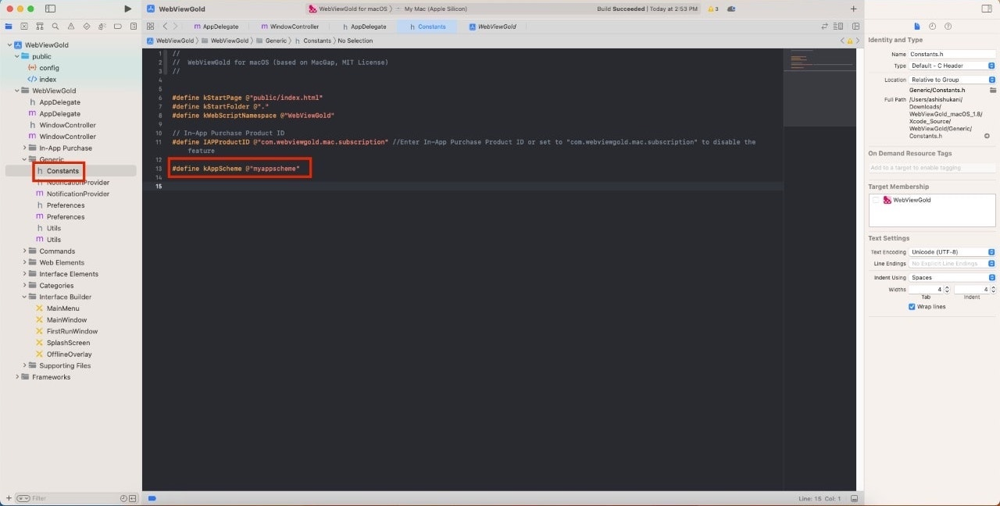
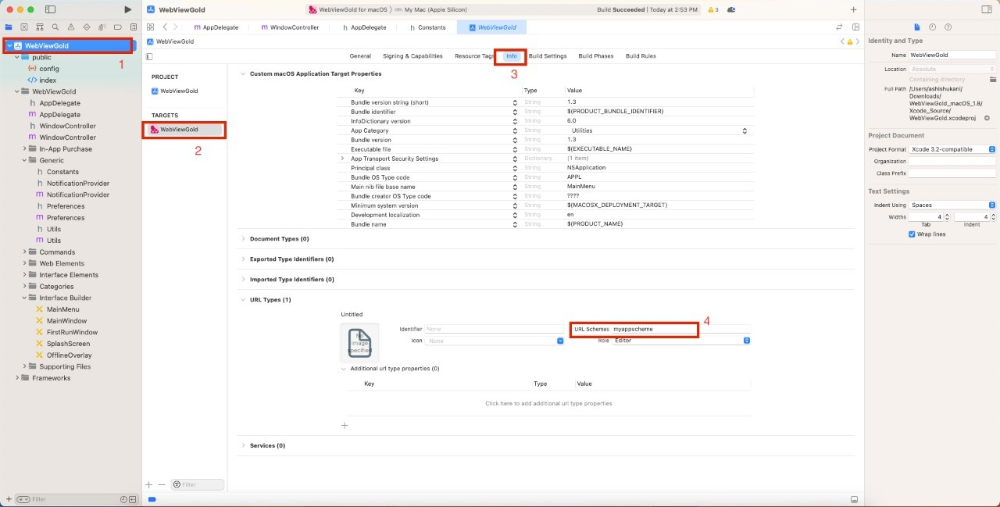

# API Deeplinking – WebViewGold pour macOS

> **Résumé :** Lancez votre app WebViewGold pour macOS via un schéma d'URL personnalisé et ouvrez directement une page précise — le deeplinking expliqué étape par étape.

[Documentation](../README.md) › [WebViewGold pour macOS](README.md) › API Deeplinking

**Plateforme :** macOS · **Catégorie :** API et fonctionnalités · **Version en ligne :** [www.webviewgold.com/fr/docs/mac/#deeplinking](https://www.webviewgold.com/fr/docs/mac/#deeplinking)

---

Le deeplinking (« Custom URL Scheme ») est une approche puissante qui permet aux utilisateurs de naviguer directement vers une page ou une section spécifique d'une application depuis une source externe telle qu'un site web, un e-mail ou une autre application. Dans le contexte du modèle d'application macOS de WebViewGold, le deeplinking permet aux développeurs de créer des liens qui lancent l'application et amènent les utilisateurs à une page spécifique de celle-ci.\
Le processus d'implémentation du deeplinking dans le modèle d'application WebViewGold pour macOS est relativement simple. Voici comment il fonctionne :\
   

---

## Continuer la lecture

- ← Précédent : [API UUID](uuid.md)
- Suivant → : [Crédits & licences](credits.md)
- Même fonctionnalité sur les autres plateformes : [iOS – API de deep linking](../ios/deep-linking.md)
- Langues : [🇺🇸 English](../../macos/deep-linking.md) · [🇩🇪 Deutsch](../../de/macos/deep-linking.md) · **🇫🇷 Français** · [🇪🇸 Español](../../es/macos/deep-linking.md) · [🇨🇳 中文](../../zh/macos/deep-linking.md)

