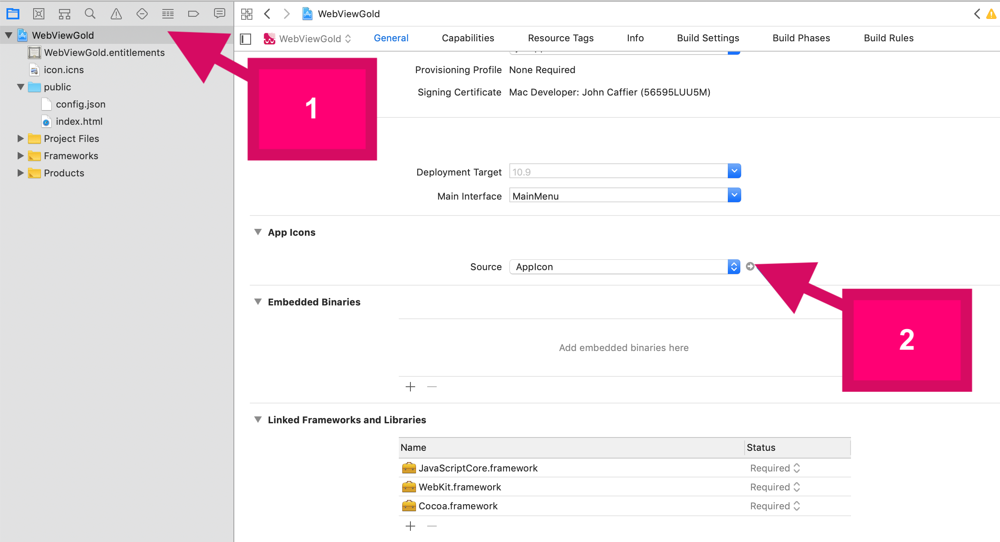
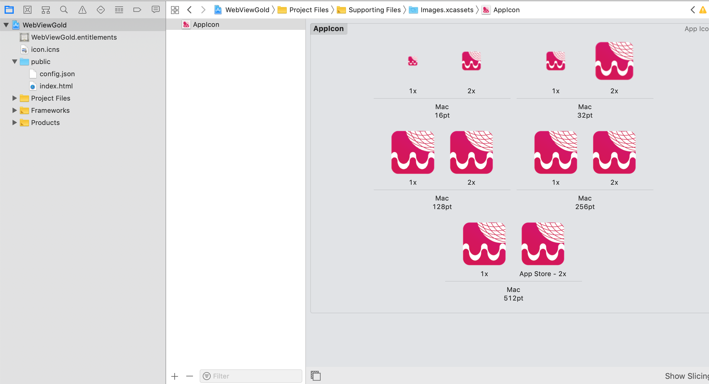

# Change the app icon – WebViewGold for macOS

> **Summary:** Replace the app icon of your WebViewGold for macOS desktop app with your own resized image files.

[Documentation](../README.md) › [WebViewGold for macOS](README.md) › App Icon

**Platform:** macOS · **Category:** App Design · **Online version:** [www.webviewgold.com/docs/mac/#icon](https://www.webviewgold.com/docs/mac/#icon)

---

\
\
Just replace the included image files with your own resized image files. Alternatively, use this helpful tool: [**Asset Catalog Creator - App Icon, Image Set & Launch Screen Generator for iOS & OS X**](https://itunes.apple.com/us/app/asset-catalog-creator-app/id809625456?mt=12&uo=4&at=1l3vvZe) by *Bridge Technologies Limited* (we are not affiliated with the developer company).

---

## Continue reading

- ← Previous: [Setting up WebViewGold](setup.md)
- Next →: [App Name](app-name.md)
- Same feature on other platforms: [iOS – Name, Icon & Splash](../ios/app-name-icon-splash.md) · [Android – App Icon](../android/app-icon.md)
- Languages: **🇺🇸 English** · [🇩🇪 Deutsch](../de/macos/app-icon.md) · [🇫🇷 Français](../fr/macos/app-icon.md) · [🇪🇸 Español](../es/macos/app-icon.md) · [🇨🇳 中文](../zh/macos/app-icon.md)

