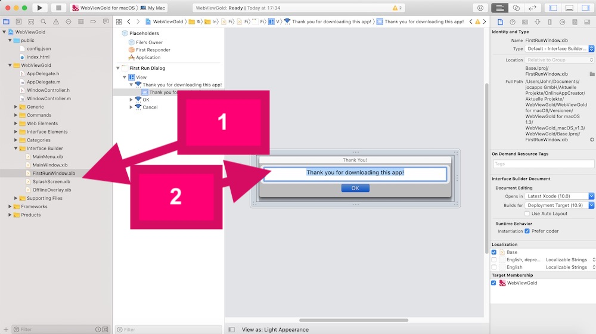

# Change the First Run Dialog text (optional) – WebViewGold for macOS

> **Summary:** Edit the First Run Dialog text of your Mac WebView app in FirstRunWindow.xib (Interface Builder).

[Documentation](../README.md) › [WebViewGold for macOS](README.md) › First Run Dialog

**Platform:** macOS · **Category:** App Design · **Online version:** [www.webviewgold.com/docs/mac/#firstrun](https://www.webviewgold.com/docs/mac/#firstrun)

---

Open the **FirstRunWindow.xib** file in *Interface Builder* subfolder. Afterward, double click on the text to edit the text: \

---

## Continue reading

- ← Previous: [Offline Screen Text](offline-screen.md)
- Next →: [Splash Screen](splash-screen.md)
- Languages: **🇺🇸 English** · [🇩🇪 Deutsch](../de/macos/first-run-dialog.md) · [🇫🇷 Français](../fr/macos/first-run-dialog.md) · [🇪🇸 Español](../es/macos/first-run-dialog.md) · [🇨🇳 中文](../zh/macos/first-run-dialog.md)

