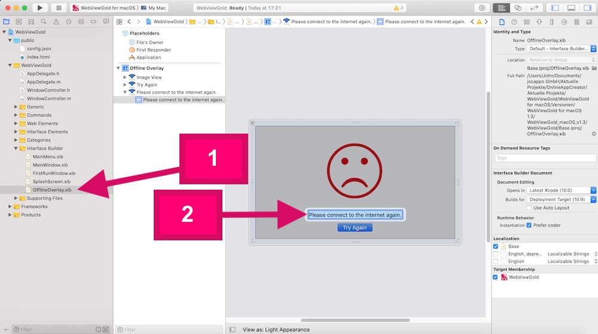

# Change the Offline Screen text (optional) – WebViewGold for macOS

> **Summary:** Customize the offline screen text of your Mac WebView app by editing OfflineOverlay.xib in Interface Builder.

[Documentation](../README.md) › [WebViewGold for macOS](README.md) › Offline Screen Text

**Platform:** macOS · **Category:** App Design · **Online version:** [www.webviewgold.com/docs/mac/#offlinescreen](https://www.webviewgold.com/docs/mac/#offlinescreen)

---

Open the **OfflineOverlay.xib** file in *Interface Builder* subfolder. Afterward, double click on the text to edit the text: \

---

## Continue reading

- ← Previous: [App Name](app-name.md)
- Next →: [First Run Dialog](first-run-dialog.md)
- Languages: **🇺🇸 English** · [🇩🇪 Deutsch](../de/macos/offline-screen.md) · [🇫🇷 Français](../fr/macos/offline-screen.md) · [🇪🇸 Español](../es/macos/offline-screen.md) · [🇨🇳 中文](../zh/macos/offline-screen.md)

