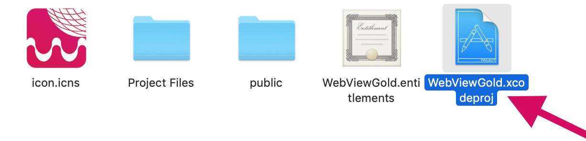
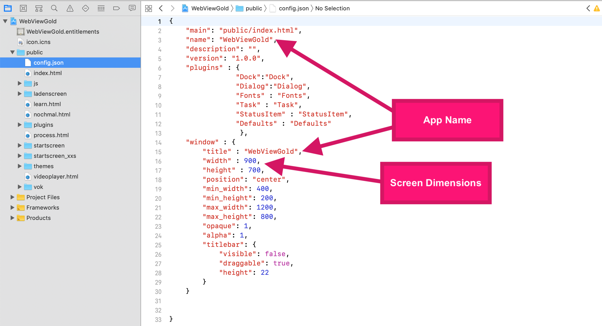
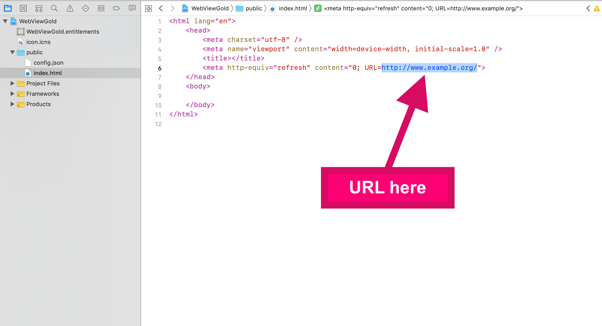

# Setting up WebViewGold for macOS Desktop apps – WebViewGold for macOS

> **Summary:** Install Xcode, open the WebViewGold for macOS project, enter your URL in index.html and configure config.json — or bundle your own local HTML content.

[Documentation](../README.md) › [WebViewGold for macOS](README.md) › Setting up WebViewGold

**Platform:** macOS · **Category:** Get Started · **Online version:** [www.webviewgold.com/docs/mac/#setup](https://www.webviewgold.com/docs/mac/#setup)

---

Xcode is required to set up apps using WebViewGold for macOS. Xcode is a powerful integrated development environment (IDE) that is used to create apps for Apple devices such as iPhones, iPads, and Macs. It's important to note that Xcode is a large program and can take up a significant amount of storage space on your Mac. Also, Xcode is only available for Macs and is not compatible with Windows or Linux. Here's a step-by-step guide on how to download and install Xcode on your Mac:

- Click here: [**Download Xcode in Mac App Store**](https://apps.apple.com/us/app/xcode/id497799835)
- Click on the "Get" or "Download" button to begin the download process.
- Once the download is complete, the Xcode installer will automatically launch.
- Follow the instructions in the installer to complete the installation process.
- Once the installation is complete, open Xcode from the Applications folder or from Spotlight search.
- The first time you open Xcode, you may be prompted to install additional components or agree to the terms and conditions. Follow the prompts to complete the setup process.

In the next step, **[download WebViewGold for macOS](https://www.webviewgold.com/download/mac/)** in order to create macOS desktop apps. Afterward, open the **Xcode project file**:\

Choose the **public folder** and configure the **config.json** file:\

Open **index.html** file to edit the URL:\

If you want to use **local HTML content** (instead of a remote URL), just replace the index.html file with your own content.

---

## Continue reading

- ← Previous: [Setting up your web app](setup-website.md)
- Next →: [App Icon](app-icon.md)
- Same feature on other platforms: [iOS – Configure WebViewGold](../ios/setup.md) · [Android – Configure WebViewGold](../android/setup.md)
- Languages: **🇺🇸 English** · [🇩🇪 Deutsch](../de/macos/setup.md) · [🇫🇷 Français](../fr/macos/setup.md) · [🇪🇸 Español](../es/macos/setup.md) · [🇨🇳 中文](../zh/macos/setup.md)

