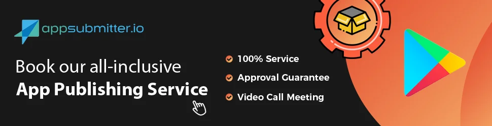

# 构建并将您的应用发布到 Google Play – WebViewGold for Android

> **摘要：** 将您的 WebView 应用发布到 Google Play 商店：完整的发布服务、手动流程以及更改包名。

[文档](../README.md) › [WebViewGold for Android](README.md) › 构建并发布

**平台：** Android · **类别：** 构建与发布 · **在线版本：** [www.webviewgold.com/zh/docs/android/publish/](https://www.webviewgold.com/zh/docs/android/publish/)

---

您的应用已准备就绪，现在是时候将其上传到 Google Play Store 并触及数百万用户了？令人兴奋！以下部分将向您展示如何操作 — 无论您希望自己完成，还是让我们代为处理部分工作。

> [!NOTE]
> 更喜欢基于浏览器的工作流程？[**WebViewGold Cloud Builder**](https://www.webviewgold.com/cloud-builder?ref=android_docs)（付费附加组件）可直接从浏览器编译并上传您的应用，无需 Android Studio。
>
> 

## 选项 A) 完整的应用发布服务

将您的应用发布到 Google Play Store 应当顺畅且无压力。让自己享受一些支持 — 借助 [appsubmitter.io](https://www.appsubmitter.io)，您可以享受**便捷、由专家主导的发布流程** — 这样您就能专注于最重要的事情，而我们来处理细节。

### 为什么选择 appsubmitter.io？

- **节省时间** – 我们负责证书、截图和上传。
- **专家处理** – 您的应用将由专业人员提交，毫无麻烦。
- **在您的账户下发布** – 您拥有完全的控制权，没有限制。
- **审核通过保证** – 如果 Google 拒绝您的应用，您将获得全额退款（请参阅[条款与条件](https://www.onlineappcreator.com/terms.php)）。

**准备好发布了吗？** [预约视频通话](https://www.appsubmitter.io/order-wizard/?platform=android)，让我们一起把您的应用上线吧！

## 选项 B) 手动发布流程

 **我们更新了默认的包名，以便您更轻松地使用标准化的包名格式。现在，WebViewGold for Android 的默认包名为 com.webviewgold.myappname。您可以在应用中轻松地将其自定义为您自己的个性化包名。**

那么，如果您不想使用我们省心的提交服务，而是希望自行处理，没问题，请按照本指南操作：

第一步，请将**包名**更改为任意唯一的包名。\
**在重命名包名之前，请对您的源代码文件夹进行完整备份。**

*提示：*[**WebViewGold Cloud Builder**](https://www.webviewgold.com/cloud-builder?ref=android_docs)（付费附加组件）会自动处理包名命名和 Play Store 上传，因此您可以跳过手动步骤。

之后，为了获得最佳的 Play Store 审核结果，请考虑在 [UXreviewer.io](https://www.uxreviewer.io) 或类似服务上进行专业的用户体验/UX 评审。这样的 UX 评审还可以通过改进建议帮助您在整体上提高产品的用户留存率。\
很好，现在您可以开始按照第二个视频的步骤进行操作：

请确保内容不违反 Google Play Store 的法律要求。如果 Google 拒绝了您的应用，我们将为您提供 WebViewGold 许可证的**全额退款**（在购买后 14 天内提出申请；请参阅[条款与条件](https://www.onlineappcreator.com/terms.php)）。只需通过邮件与我们联系。\
**恭喜您成功发布了自己的 Android 应用！🎉**

## 如何缩短包名

该视频详细说明了缩短包名的流程以及一些相关建议。因此您可以将应用名称从  ***com.webviewgold.myappname***  更改为 ***com.myappname***

没时间或者不想手动签名和上传？请考虑 [appsubmitter.io](https://www.appsubmitter.io) 服务：\

当然，发布之后应该先庆祝一下！但也许下一个项目已经提上日程？我们的应用专家也很乐意为您提供 Web 应用、iOS 应用、Android 应用、聊天机器人、营销创意等的[个性化开发服务](https://www.onlineappcreator.com/custom-development-services.php)。**[了解更多](https://www.onlineappcreator.com/custom-development-services.php)**

---

## 继续阅读

- ← 上一页： [Firebase Crashlytics](crashlytics.md)
- 下一页 →： [鸣谢与许可](credits.md)
- 其他平台上的相同功能： [iOS – 构建与发布](../ios/publish.md)
- 语言： [🇺🇸 English](../../android/publish.md) · [🇩🇪 Deutsch](../../de/android/publish.md) · [🇫🇷 Français](../../fr/android/publish.md) · [🇪🇸 Español](../../es/android/publish.md) · **🇨🇳 中文**

> [!TIP]
> **太忙了？我们替您搭建应用。** 我们的团队为您配置、构建并提交 WebViewGold 应用——全程代劳、交付迅速、德国制造。 [让我们搭建应用 →](https://www.WeSetupYourWebViewApp.com?ref=webviewgold_android_doc_online)
>
> **在浏览器中构建：** 无需 Mac、无需 IDE：**WebViewGold Cloud Builder** 在线为您配置、构建并上传应用。 [了解 Cloud Builder →](https://www.webviewgold.com/cloud-builder?ref=android_docs)
