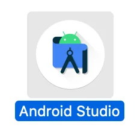
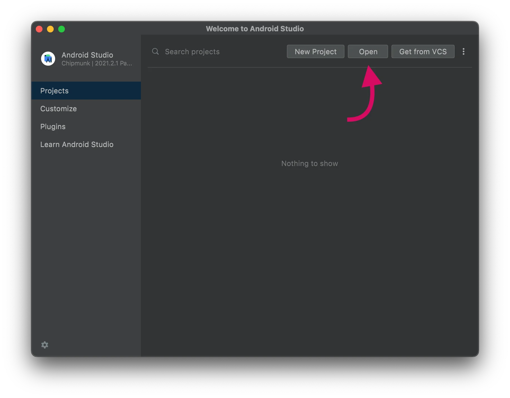
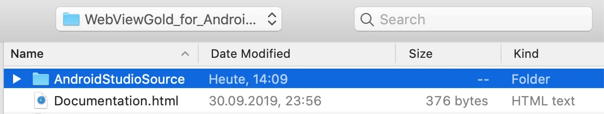
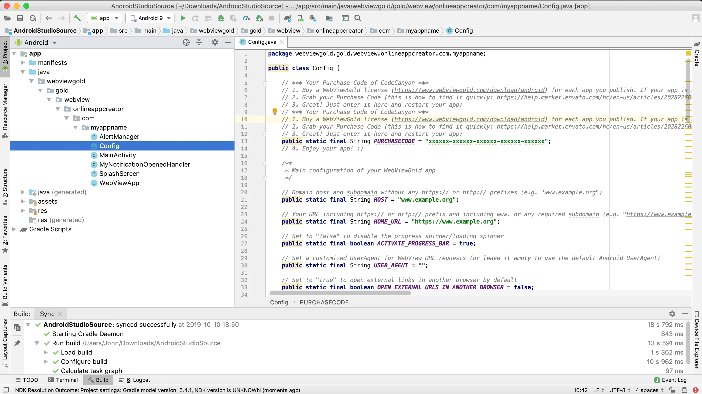
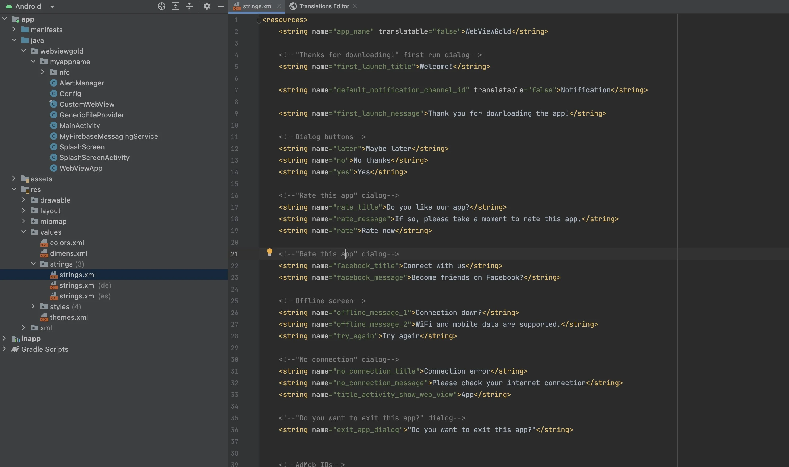
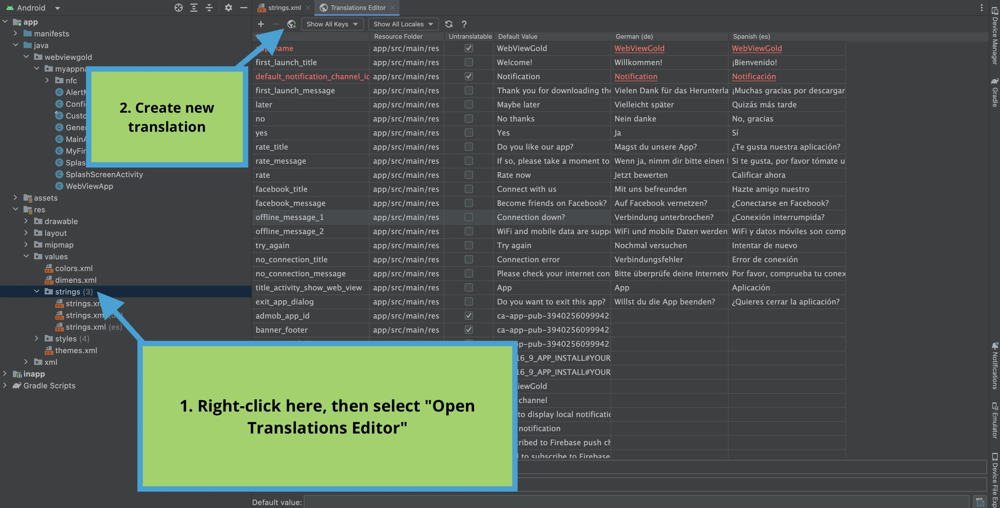
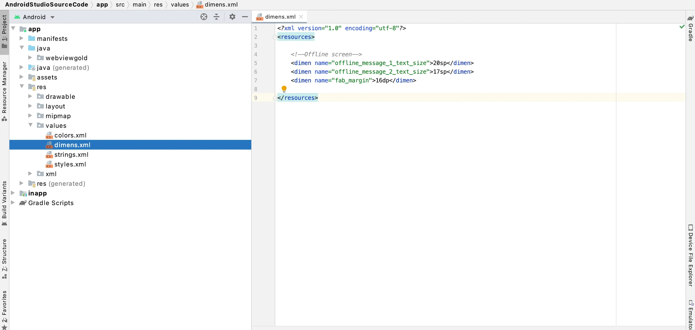

# 为 Android 设置并配置 WebViewGold – WebViewGold for Android

> **摘要：** 下载 WebViewGold 的 Android Studio 模板，填入您的 URL，探索所有内置配置选项——无需任何编程技能。

[文档](../README.md) › [WebViewGold for Android](README.md) › 配置 WebViewGold

**平台：** Android · **类别：** 快速开始 · **在线版本：** [www.webviewgold.com/zh/docs/android/setup/](https://www.webviewgold.com/zh/docs/android/setup/)

---

**下载**
适用于 Android Studio 的 WebViewGold 应用模板
**[点此下载](https://www.webviewgold.com/download/android)。**

> [!NOTE]
> 不想安装 Android Studio 就能完成构建吗？[**WebViewGold Cloud Builder**](https://www.webviewgold.com/cloud-builder?ref=android_docs)（付费附加组件）让您可以直接在浏览器中配置、构建应用并将其上传到 Play Store。
>
> 

如果您尚未安装 Android Studio，请下载 [**Android Studio**](https://developer.android.com/studio)。\
然后，打开 **Android Studio**：\

选择 **Open**：\
\
选择您的 **AndroidStudioSource** 文件夹，并等待项目完全加载：\
\
随后，打开 **Config.java** 文件以编辑主要配置项（URL、URL 处理、UserAgent、对话框）。请查看我们的 [YouTube 频道](https://www.youtube.com/channel/UChuOoCMcXP_8SQPbZyXTPjA?sub_confirmation=1) 以获取具体的设置教程。请务必在您发布的每个应用中，在 **PURCHASECODE** 字段填写您的 [Envato/CodeCanyon 购买代码](https://help.market.envato.com/hc/en-us/articles/202822600-Where-Is-My-Purchase-Code-)。每个定制后的最终产品需要一份许可证。请查看您在 CodeCanyon 购买的许可证信息：[https://codecanyon.net/licenses/standard](https://codecanyon.net/licenses/standard?ref=onlineappcreator)\
主配置文档 **Config.java** 如下所示：\

使用 WebViewGold 设置应用**非常简单**，无需任何编程知识。请查看下面对 **Config.java** 文件中内置配置选项的**概览**：

| 设置项 | 值 | 说明 |
| --- | --- | --- |
| HOST | **必填值** | 您的域名主机，不含 https:// 或 http:// 前缀（例如 "www.example.org"）。默认情况下，WebViewGold for Android 允许 HTTPS 和 HTTP 内容。但是，如果您希望通过仅启用 HTTPS 内容来增强应用安全性，可以选择[修改此设置](https://www.webviewgold.com/support-center/knowledgebase/how-to-prevent-non-https-connections-in-webviewgold-for-android-switching-usescleartexttraffic-from-true-to-false/)（也可以考虑使用 'BLOCK_SELF_SIGNED_AND_FAULTY_SSL_CERTS' 选项）。 |
| HOME_URL | **必填值** | 您完整的 WebView URL（例如 "https://www.example.org/app.html"），将被加载到 WebView 中。默认情况下，WebViewGold for Android 允许 HTTPS 和 HTTP 内容。但是，如果您希望通过仅启用 HTTPS 内容来增强应用安全性，可以选择[修改此设置](https://www.webviewgold.com/support-center/knowledgebase/how-to-prevent-non-https-connections-in-webviewgold-for-android-switching-usescleartexttraffic-from-true-to-false/)（也可以考虑使用 'BLOCK_SELF_SIGNED_AND_FAULTY_SSL_CERTS' 选项）。 |
| USE_LOCAL_HTML_FOLDER | **true** 或 **false** | 设置为 *true* 以使用本地 "index.html" HTML 文件，而非远程 WebView URL |
| FALLBACK_USE_LOCAL_HTML_FOLDER_IF_OFFLINE | **true** 或 **false** | 设置为 *true*，当用户离线时使用 "local-html" 文件夹，当用户在线时使用远程 URL |
| ACTIVATE_PROGRESS_BAR | **true** 或 **false** | 设置为 *false* 以禁用进度指示器/加载指示器 |
| PHONE_ORIENTATION | 值（方向） | 将手机方向设置为 "portrait"、"landscape" 或 "auto" |
| TABLET_ORIENTATION | 值（方向） | 将平板方向设置为 "portrait"、"landscape" 或 "auto" |
| USER_AGENT | 可选 | 为网络请求定义自定义 UserAgent（或留空以使用默认的 Android UserAgent） |
| HARDWARE_ACCELERATION | **true** 或 **false** | 设置为 *true* 以启用硬件加速；这可以提升渲染性能，但也会增加内存占用，并可能与某些内容出现兼容性问题 |
| APPEND_LANG_CODE | **true** 或 **false** | 设置为 *true*，如果您希望在 URL 请求中附加系统语言，例如 ?webview_language=LANGUAGE CODE（如 ?webview_language=EN 对应英语用户） |
| AUTO_REFRESH_ENABLED | **true** 或 **false** | 设置为 *true*，当应用从后台返回前台时，WebView 会自动刷新其内容。 |
| EXTERNAL_LINK_HANDLING_OPTIONS | **0** 或 **1** 或 **2** | 设置为 (0) 默认在应用内打开外部链接；(1) 始终在新标签页（附加的应用内浏览器）中打开；(2) 始终在其他浏览器中打开 |
| BROWSER_WHITELIST | 列表 | 在此添加应当**始终**在外部浏览器中打开的域名，无论 **EXTERNAL_LINK_HANDLING_OPTIONS** 选项设置为何。要添加另一个域名，请按以下方式插入另一个主机：["www.alwaysopeninchrome.com", "www.google.com"]。请按您使用链接的方式准确输入主机（但绝不要包含 http/https）。 |
| BROWSER_BLACKLIST | 列表 | 在此添加**永远不应**在外部浏览器中打开的域名，无论 **EXTERNAL_LINK_HANDLING_OPTIONS** 选项设置为何。要添加另一个域名，请按以下方式插入另一个主机：["www.neveropeninchrome.com", "www.google.com"]。请按您使用链接的方式准确输入主机（但绝不要包含 http/https）。 |
| SPECIAL_LINK_HANDLING_OPTIONS | **0** 或 **1** 或 **2** | 设置为 (0) 在应用内打开特殊链接；(1) 在新标签页（附加的应用内浏览器）中打开；(2) 在其他浏览器中打开；注意：特殊链接具有 "_blank" 目标或以 "#" 结尾；如果该链接同时也是外部链接，则会覆盖 *EXTERNAL_LINK_HANDLING_OPTIONS* |
| ALWAYS_OPEN_IN_INAPP_TAB | 列表 | 添加您希望始终在应用内标签页中打开的 URL 前缀（例如 {"https://www.google.com", "https://www.example.com/page"}），无论 **EXTERNAL_LINK_HANDLING_OPTIONS** 设置为何。 |
| NEVER_OPEN_IN_INAPP_TAB | 列表 | 添加您永远不希望在应用内标签页中打开的 URL 前缀（例如 {"https://www.google.com", "https://www.example.com/page"}），无论 **EXTERNAL_LINK_HANDLING_OPTIONS** 设置为何。 |
| QR_CODE_URL_OPTIONS | **0** 或 **1** 或 **2** 或 **3** 或 **4** | 设置为 (0) 在应用中打开扫描到的二维码 URL；(1) 在应用内标签页中打开；(2) 在新浏览器中打开；(3) 如为外部链接则在应用内标签页中打开；(4) 如为外部链接则在新浏览器中打开 |
| AUTO_INJECT_VARIABLES | **true** 或 **false** | 设置为 *true* 以自动设置 JavaScript 变量；无需再手动调用类似 get-uuid:// 的方法。目前支持加载应用版本、OneSignal 和 Firebase 订阅 ID 以及 UUID |
| CLEAR_CACHE_ON_STARTUP | **true** 或 **false** | 设置为 *true*，每次应用启动时清除 WebView 缓存和 Cookie，不使用您 Web 应用/网站的缓存版本 |
| CLEAR_CACHE_ON_EXIT | **true** 或 **false** | 设置为 *true*，在完全退出应用时清除 WebView 缓存和 Cookie（您可能还需要激活 *CLEAR_CACHE_ON_STARTUP*，因为系统差异可能会影响可靠性） |
| COOKIE_ON_LAUNCH | **true** 或 **false** | 设置为 *true* 可在应用启动时向 WebView 添加自定义 Cookie |
| COOKIE_ON_LAUNCH_NAME | 文本值 | 自定义启动时添加的 Cookie 名称（需要将 COOKIE_ON_LAUNCH 设置为 *true*） |
| COOKIE_ON_LAUNCH_VALUE | 文本值 | 自定义启动时添加的 Cookie 值（需要将 COOKIE_ON_LAUNCH 设置为 *true*） |
| COOKIE_ON_LAUNCH_IS_SECURE | **true** 或 **false** | 设置为 *true* 可将启动 Cookie 标记为安全（仅 HTTPS） |
| IS_DEEP_LINKING_ENABLED | **true** 或 **false** | 设置为 *true* 以启用深度链接 |
| IS_CUSTOM_SCHEME_ENABLED | **true** 或 **false** | 设置为 *true*，如果您希望接受诸如 `webviewgold://` 这样的自定义方案深度链接 |
| CUSTOM_DEEPLINK_SCHEME | **true** 或 **false** | 在此处和 AndroidManifest.xml 中自定义深度链接方案前缀 |
| OPEN_NOTIFICATION_URLS_IN_SYSTEM_BROWSER | **true** 或 **false** | 设置为 *true*，在系统浏览器中打开通知深度链接 URL，而非在您的应用中打开 |
| SPLASH_SCREEN_ACTIVATED | **true** 或 **false** | 设置为 *true* 以激活启动画面 |
| SPLASH_TIMEOUT | 数值（毫秒） | 以*毫秒*为单位设置启动画面超时时间（如果主页 URL 仍在加载中，加载指示界面将在此时间过后显示） |
| SPLASH_FADE_OUT | 数值（毫秒） | 启动画面淡出动画的时长（毫秒）。该动画在所有其他延迟计时结束后开始。设置为 0 可禁用淡出效果。 |
| SPLASH_MIN_TIME | 数值（毫秒） | 启动画面显示的最短时长（毫秒），仅当 *REMAIN_SPLASH_OPTION* 设置为 *true* 时才生效；如果 *SPLASH_MIN_TIME* 超过该值，启动画面将改为持续 *SPLASH_MIN_TIME*。在此情况下，本值将被忽略，转而使用较长的时长。 |
| REMAIN_SPLASH_OPTION | **true** 或 **false** | 设置为 *true*，让启动画面持续显示直到主页 URL 加载完成（会覆盖 *SPLASH_TIMEOUT*） |
| SCALE_SPLASH_IMAGE | 百分比值 [0-100] | 按设备的最小宽度/高度设置启动画面图片的尺寸；百分比范围 [0-100]；注意：值 = 0 将完全隐藏该图片 |
| blackStatusBarText | **true** 或 **false** | 设置为 *true* 使用黑色状态栏文字；设置为 *false* 使用白色状态栏文字；在 style.xml 中使用 'colorPrimaryDark' 选择状态栏背景色 |
| TRANSPARENT_STATUS_BAR | **true** 或 **false** | 设置为 *true* 使状态栏透明；设置为 *false* 使状态栏不透明；在 style.xml 中使用 'colorPrimaryDark' 选择状态栏背景色 |
| enableBioMetricAuth | **true** 或 **false** | 设置为 *true* 以为应用启用应用锁（生物识别身份验证） |
| PREVENT_SLEEP | **true** 或 **false** | 设置为 *true*，在应用处于活动状态时防止设备进入睡眠状态 |
| ENABLE_SWIPE_NAVIGATE | **true** 或 **false** | 设置为 *true*，通过左右滑动实现返回或前进一页的导航 |
| ENABLE_PULL_REFRESH | **true** 或 **false** | 设置为 *true*，启用下拉刷新页面的功能。此外，您可以随时从网站调用 `enablepulltorefresh://` 或 `disablepulltorefresh://` 来动态激活或停用下拉刷新。 |
| HIDE_VERTICAL_SCROLLBAR | **true** 或 **false** | 设置为 *true* 以隐藏垂直滚动条 |
| HIDE_HORIZONTAL_SCROLLBAR | **true** 或 **false** | 设置为 *true* 以隐藏水平滚动条 |
| ENABLE_ZOOM | **true** 或 **false** | 设置为 *false* 以阻止用户在应用中进行缩放（通过额外的脚本注入实现） |
| DISABLE_DARK_MODE | **true** 或 **false** | 设置为 *true* 以禁用深色模式（并非在所有启动器上都有效） |
| HIDE_NAVIGATION_BAR_IN_LANDSCAPE | **true** 或 **false** | 设置为 *true*，在横屏模式下隐藏导航栏 |
| MAX_TEXT_ZOOM | 数值 | 设置一个大于 0 的值以定义文本的最大缩放；设置为 (0) 以禁用此功能。   *提示：小 = 85，默认 = 100，大 = 115，最大 = 130* |
| INPUT_SCROLL_HELPER | **true** 或 **false** | 设置为 *true*，通过 JS 注入强制输入框保持一致的滚动行为 |
| EXIT_APP_BY_BACK_BUTTON_ALWAYS | **true** 或 **false** | 设置为 *true*，通过按硬件返回按钮关闭应用（而不是返回上一页） |
| EXIT_APP_BY_BACK_BUTTON_HOMEPAGE | **true** 或 **false** | 设置为 *true*，当用户位于主页时（不允许返回上一页），按硬件返回按钮即可关闭应用 |
| EXIT_APP_DIALOG | **true** 或 **false** | 设置为 *true*，在退出应用前询问用户是否确认退出 |
| OFFLINE_SCREEN_BACKGROUND_COLOR | 十六进制颜色代码 | 使用十六进制颜色代码设置离线界面的背景色（例如 "#ffffff" = 白色） |
| PREVENT_SCREEN_CAPTURE | **true** 或 **false** | 设置为 *true*，阻止用户在应用中截屏或录屏。系统将在 Web 应用中调用 `onScreenCaptureAttempt()` 进行处理（例如显示自定义模态框）。 |
| UUID_ENHANCE_WEBVIEW_URL | **true** 或 **false** | 设置为 *true*，在首个 URL 请求中附加 UUID 参数 'uuid=XYZ' |
| BLOCK_SELF_SIGNED_AND_FAULTY_SSL_CERTS | **true** 或 **false** | 设置为 *true*，阻止使用自签名 SSL（用户）证书和有问题的 SSL 证书签名的内容；也可以考虑[阻止所有非 HTTPS 内容](https://www.webviewgold.com/support-center/knowledgebase/how-to-prevent-non-https-connections-in-webviewgold-for-android-switching-usescleartexttraffic-from-true-to-false/) |
| BLOCK_ROOTED_DEVICES | **true** 或 **false** | 设置为 *true*，启用应用检测已 Root 设备并在其上禁用应用的功能（注意：Root 检测并非始终可靠，可能无法在所有设备上生效） |
| LINK_DRAG_AND_DROP | **true** 或 **false** | 设置为 *false* 以禁用链接的拖放 |
| LANDSCAPE_FULLSCREEN_VIDEO | **true** 或 **false** | 设置为 *true*，始终以横屏模式播放全屏视频 |
| SHOW_FIRSTRUN_DIALOG | **true** 或 **false** | 设置为 *false* 以禁用首次运行对话框 |
| SHOW_FACEBOOK_DIALOG | **true** 或 **false** | 设置为 *false* 以禁用 "在 Facebook 上关注" 对话框 |
| SHOW_RATE_DIALOG | **true** 或 **false** | 设置为 *false* 以禁用 "为该应用评分" 对话框 |
| RATE_DAYS_UNTIL_PROMPT | 数值（天数） | 设置在应用安装后显示 "为该应用评分" 对话框之前需要经过的最少天数 |
| RATE_LAUNCHES_UNTIL_PROMPT | 数值（启动次数） | 设置在显示 "为该应用评分" 对话框之前的最少应用启动次数 |
| FACEBOOK_DAYS_UNTIL_PROMPT | 数值（天数） | 设置在应用安装后显示 "在 Facebook 上关注" 对话框之前需要经过的最少天数 |
| FACEBOOK_LAUNCHES_UNTIL_PROMPT | 数值（启动次数） | 设置在显示 "为该应用评分" 对话框之前的最少应用启动次数 |
| FACEBOOK_URL | 值 (URL) | 设置您 Facebook 页面的 URL |
| ALLOW_IMAGE_DOWNLOAD | **true** 或 **false** | 设置为 *false*，防止长按图片时出现 "下载图片" 弹窗 |
| PUSH_ENABLED | **true** 或 **false** | 设置为 *true* 以启用 OneSignal 推送（在 build.gradle 文件中设置 OneSignal ID） |
| PUSH_ENHANCE_WEBVIEW_URL | **true** 或 **false** | 设置为 *true*，如果您希望在 WebView 主 URL 请求中以 ?onesignal_push_id=XYZ 的形式附加 OneSignal 订阅 ID（此外，您也可以随时通过调用 [getonesignalplayerid://](push-notifications.md) 获取 OneSignal 订阅 ID，或将 Config.java 中的 "AUTO_INJECT_VARIABLES" 设为 "true" 自动获取） |
| PUSH_RELOAD_ON_USERID | **true** 或 **false** | 设置为 *true*，当应用从 OneSignal 获取到 UserID 时重新加载 WebView（在 build.gradle 文件中设置 OneSignal ID） |
| FIREBASE_PUSH_ENABLED | **true** 或 **false** | 设置为 *true* 以启用 Firebase 推送（在此之前请替换 google-services.json） |
| FIREBASE_PUSH_ENHANCE_WEBVIEW_URL | **true** 或 **false** | 设置为 *true*，如果您希望在 URL 请求中附加 ?firebase_push_id=XYZ（此外，您也可以随时通过调用 [getfirebaseplayerid://](push-notifications.md#firebaseruntime) 获取 Firebase 订阅 ID，或将 Config.java 中的 "AUTO_INJECT_VARIABLES" 设为 "true" 自动获取） |
| PUSHWOOSH_ENABLED | **true** 或 **false** | 设置为 *true* 以启用 Pushwoosh 推送（在 AndroidManifest.xml 和 string.xml 文件中设置 Pushwoosh 凭据） |
| PUSHWOOSH_ENHANCE_WEBVIEW_URL | **true** 或 **false** | 设置为 *true*，如果您希望在 URL 请求中附加 ?pushwoosh_id=XYZ（在 AndroidManifest.xml 和 string.xml 文件中设置 Pushwoosh 凭据） |
| SHOW_ADSENSE_AD | **true** 或 **false** | 设置为 *true* 以启用对 AdSense 网页广告的支持（独立于 AdMob 广告） |
| SHOW_BANNER_AD | **true** 或 **false** | 设置为 *true*，如果您希望展示 AdMob 横幅广告（在 strings.xml 文件中设置 AdMob ID） |
| SHOW_FULL_SCREEN_AD | **true** 或 **false** | 设置为 *true*，如果您希望在网站被点击 X 次后展示 AdMob 全屏插页广告（在 strings.xml 文件中设置 AdMob ID） |
| SHOW_APP_OPEN_AD | **true** 或 **false** | 设置为 *true* 可在冷启动（从启动器闪屏）和从后台返回时显示 [AdMob App Open 广告](admob.md#appopenads)（请在 strings.xml 文件中设置 admob_app_open_id） |
| ASK_FOR_AD_CONSENT | **true** 或 **false** | 设置为 *false*，如果您希望停用 AdMob 的 Google 同意管理（请事先查阅 <https://support.google.com/admob/answer/13554116>） |
| SHOW_AD_AFTER_X | 值（网站重新加载次数） | 设置触发 AdMob 插页广告的网站点击次数 X（在 strings.xml 文件中设置 AdMob ID） |
| INCREMENT_WITH_TAPS | **true** 或 **false** | 设置为 *true*，允许普通屏幕点击也计入 SHOW_AD_AFTER_X 的次数 |
| USE_FACEBOOK_ADS | **true** 或 **false** | 设置为 *true*，使用 Facebook Audience Network 广告替代 AdMob 广告（在 strings.xml 文件中设置广告 ID） |
| ENABLE_REWARDED_ADS | **true** 或 **false** | 设置为 *true* 以启用 AdMob 激励广告。即使是手动激活广告，也需要将此项设置为 *true*。（在 strings.xml 文件中设置广告 ID。） |
| USE_REWARDED_ADS_WHERE_POSSIBLE | **true** 或 **false** | 设置为 *true*，在原本应播放 AdMob 插页广告的场景（例如 X 次点击后）改为播放 AdMob 激励广告。如果希望通过您网站的代码来控制其激活，请保持为 *false*。请注意，为了覆盖插页广告，SHOW_FULL_SCREEN_AD 也必须设置为 *true*。 |
| AD_TRIGGER_URLS | 可选 | 在此添加页面触发词，URL 中出现这些词时将触发插页广告（例如，"thanks.html"、"welcome.html"、"/thank-you/"、"next-step.php"） |
| REVENUECAT_API_KEY | 可选 | 您的 RevenueCat API 密钥（请先通过 [tinyurl.com/register-revenuecat](https://tinyurl.com/register-revenuecat) 注册，然后按照 [tinyurl.com/api-key-revenuecat](https://tinyurl.com/api-key-revenuecat) 的说明查找） |
| REVENUECAT_PROJECT_ID | 可选 | 您的 RevenueCat 项目 ID（请先通过 [tinyurl.com/register-revenuecat](https://tinyurl.com/register-revenuecat) 注册，然后按照 [tinyurl.com/project-id-revenuecat](https://tinyurl.com/project-id-revenuecat) 的说明查找） |
| downloadableExtension | 列表 | 添加应触发文件下载功能的文件格式（例如 .pdf、.docx 等） |
| AUTO_DOWNLOAD_FILES | **true** 或 **false** | 设置为 *true*，无论上面 downloadableExtension 变量中列出何种文件格式，都启用基于 Content-Disposition HTTP 头的下载功能 |
| GOOGLE_LOGIN_HELPER_TRIGGERS | 列表 | 定义在网站进行 Google 登录时会加载的 URL 前缀；这些前缀将作为登录辅助工具的触发条件 |
| FACEBOOK_LOGIN_HELPER_TRIGGERS | 列表 | 定义在网站进行 Facebook 登录时会加载的 URL 前缀；这些前缀将作为登录辅助工具的触发条件 |
| HOME_URL_LOGOUT | 值 (URL) | 定义用于清除登录 Cookie 的登出 URL（可选） |
| MANUAL_COOKIE_SYNC | **true** 或 **false** | 设置为 *true* 以启用手动 Cookie 同步工具。若您需要 Cookie 以*低于* 30 秒的间隔同步，或与 Cookie 相关的功能在其他情况下无法正常工作时，可使用此工具。有关 Cookie 的更多提示，另请[参见此处](https://www.webviewgold.com/support-center/knowledgebase/will-cookies-work-will-the-login-of-my-website-web-app-still-work/)。 |
| COOKIE_SYNC_TIME | 数值（毫秒） | 以毫秒 (ms) 为单位定义 Cookie 与应用同步的频率 |
| MANUAL_COOKIE_SYNC_TRIGGERS | 列表 | 定义希望使用手动 Cookie 同步工具的 URL 前缀。如果 MANUAL_COOKIE_SYNC_TRIGGERS 为空，则将自动对每个页面进行检查。示例：{"https://example.com/login", "https://example.com/data"} |
| USE_CUSTOM_HEADERS | **true** 或 **false** | 设置为 *true* 可在每次 URL 导航中注入自定义 HTTP 标头；请在 Config.java 中此选项正下方的 *customHeaders* 映射中定义标头名称和值 |
| requireLocation | **true** 或 **false** | 设置为 *false*，如果您**不**需要定位服务/GPS 坐标；如果希望完全移除应用中该项权限，请不要忘记同时在 *AndroidManifest.xml* 中移除相关条目；另请参见[后台(!)定位的使用](geolocation.md) |
| requireBackgroundLocation | **true** 或 **false** | 如果需要后台定位服务，则设置为 *false*。 当此选项设为 *false* 时，请确保同时取消 `AndroidManifest.xml` 中 `android.permission.FOREGROUND_SERVICE_LOCATION` 和 `.GPSService` 代码块的注释（在文件中搜索这些关键词）。仅当 `requireLocation` 也设置为 *true* 时，此设置才会生效。 |
| requireStorage | **true** 或 **false** | 设置为 *false*，如果您**不**需要与下载或上传相关的 API；如果希望完全移除应用中该项权限，请不要忘记同时在 *AndroidManifest.xml* 中移除相关条目 |
| requireCamera | **true** 或 **false** | 设置为 *false*，如果您**不**需要与相机图片/相机视频相关的 API；如果希望完全移除应用中该项权限，请不要忘记同时在 *AndroidManifest.xml* 中移除相关条目 |
| requireRecordAudio | **true** 或 **false** | 设置为 *false*，如果您**不**需要与录音相关的 API；如果希望完全移除应用中该项权限，请不要忘记同时在 *AndroidManifest.xml* 中移除相关条目 |
| filePickerMode | 数值 | 文件上传选项：(0) 相机和图库；(1) 仅相机；(2) 仅图库。 |

打开 **strings.xml** 文件以编辑应用名称和文字字符串：\

**多语言应用：**要编辑翻译——包括默认的德语和西班牙语翻译——或为这些字符串创建新的额外翻译，请在 Android Studio 中右键点击 "strings" 文件夹并选择 "Open Translations Editor"：\

打开 **dimens.xml** 文件以修改文本格式：\

---

## 继续阅读

- ← 上一页： [设置 Web 应用](setup-website.md)
- 下一页 →： [应用图标](app-icon.md)
- 其他平台上的相同功能： [iOS – 配置 WebViewGold](../ios/setup.md) · [macOS – 设置 WebViewGold](../macos/setup.md)
- 语言： [🇺🇸 English](../../android/setup.md) · [🇩🇪 Deutsch](../../de/android/setup.md) · [🇫🇷 Français](../../fr/android/setup.md) · [🇪🇸 Español](../../es/android/setup.md) · **🇨🇳 中文**

> [!TIP]
> **太忙了？我们替您搭建应用。** 我们的团队为您配置、构建并提交 WebViewGold 应用——全程代劳、交付迅速、德国制造。 [让我们搭建应用 →](https://www.WeSetupYourWebViewApp.com?ref=webviewgold_android_doc_online)
>
> **在浏览器中构建：** 无需 Mac、无需 IDE：**WebViewGold Cloud Builder** 在线为您配置、构建并上传应用。 [了解 Cloud Builder →](https://www.webviewgold.com/cloud-builder?ref=android_docs)
