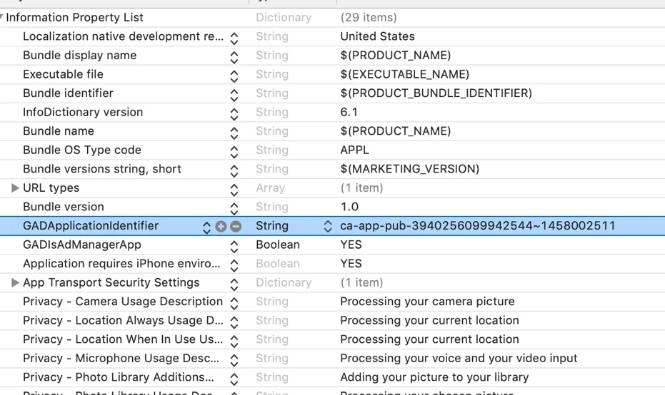
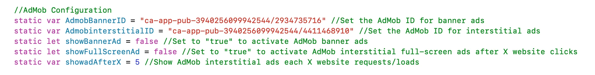

# AdMob 广告 API – WebViewGold for iOS

> **摘要：** 通过 Google AdMob 横幅、插屏和激励广告为您的 iOS 应用变现——配置与 JavaScript 触发器。

[文档](../README.md) › [WebViewGold for iOS](README.md) › AdMob 广告 API

**平台：** iOS · **类别：** API 与功能 · **在线版本：** [www.webviewgold.com/zh/docs/iOS/admob/](https://www.webviewgold.com/zh/docs/iOS/admob/)

---

AdMob 是 Google 提供的一项服务，用于在 iOS 和 Android 平台上实现移动应用的变现。它允许开发者集成横幅广告、插页广告和激励广告，并按点击（CPC，即每次点击费用）或展示（CPM，即每千次展示费用）付费。WebViewGold 简化了 AdMob 的集成，让您能够快速完成设置，在基于 WebView 的 iOS 应用中展示广告。

[](https://www.youtube.com/watch?v=7j7NW5CTwqo)

**第 1 步：**打开 **Info.plist** 文件，在 *GADApplicationIdentifier* 字段中设置您的 AdMob 全局账户 ID：\


**第 2 步：**请在 **Config.swift** 中为 `AdmobBannerID`、`AdmobinterstitialID` 和 `AdmobRewardedID` 填入您的 AdMob ID：\


**第 3 步：**在 **Config.swift** 中，您可以：

- **启用或禁用**横幅广告和/或插页广告：将 `showBannerAd` 设置为 `true` 以启用横幅广告，将 `showFullScreenAd` 设置为 `true` 以启用插页广告。
- **定义间隔**，用于控制插页广告的展示：将 `showadAfterX` 修改为播放插页广告前所需的网站交互次数。

**要启用激励广告** *（仅适用于高于 13.0 的 iOS 版本）***：**将 `enableRewardedAds` 设置为 `true`。

要播放激励广告，请调用我们的激励广告 API 功能。

```html
<a href="displayrewardedad://>Display Rewarded Advertisement</a>
```

当广告完整观看结束后，您的网站将收到一次对 JavaScript 函数 **updateRewardedStatus('true');** 的调用。该函数需由您在自己的 JavaScript 代码中实现，因为如何奖励用户由您自行决定。

WebViewGold 支持将激励广告作为默认广告选项显示，从而覆盖插页广告选项。要实现这一点，请将 `useRewardedAdsWherePossible` 和 `showFullScreenAd` 均设置为 `true`。

**提示：**如果您在 X 次点按后显示插页广告（`incrementWithTaps` 设置为 `true`），您还可以通过调用 `increasetapcounter://` 从您的 Web 应用手动增加点按计数器——适用于只将特定交互计入广告间隔。

*如需了解更多信息，也请参阅 [AdMob SDK 官方文档](https://developers.google.com/admob/)（但请跳过其中的设置部分，因为 WebViewGold 已包含该框架）。*

---

## 继续阅读

- ← 上一页： [推送通知 API](push-notifications.md)
- 下一页 →： [Facebook 广告 API](facebook-ads.md)
- 其他平台上的相同功能： [Android – AdMob 广告 API](../android/admob.md)
- 语言： [🇺🇸 English](../../ios/admob.md) · [🇩🇪 Deutsch](../../de/ios/admob.md) · [🇫🇷 Français](../../fr/ios/admob.md) · [🇪🇸 Español](../../es/ios/admob.md) · **🇨🇳 中文**

> [!TIP]
> **太忙了？我们替您搭建应用。** 我们的团队为您配置、构建并提交 WebViewGold 应用——全程代劳、交付迅速、德国制造。 [让我们搭建应用 →](https://www.WeSetupYourWebViewApp.com?ref=webviewgold_ios_doc_online)
>
> **在浏览器中构建：** 无需 Mac、无需 IDE：**WebViewGold Cloud Builder** 在线为您配置、构建并上传应用。 [了解 Cloud Builder →](https://www.webviewgold.com/cloud-builder?ref=ios_docs)
