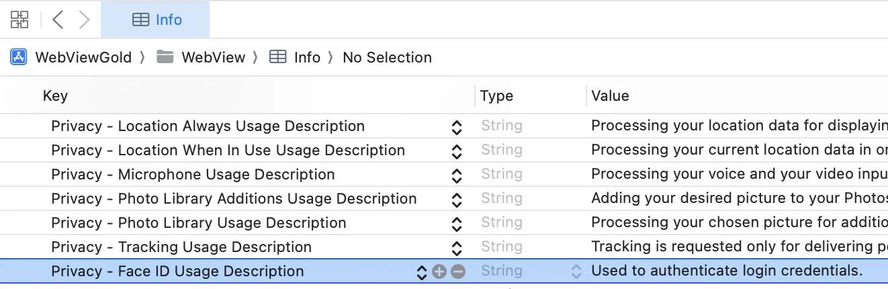

# 生物识别认证 API（Face ID / Touch ID） – WebViewGold for iOS

> **摘要：** 使用 Face ID 或 Touch ID 保护您的 iOS 应用，并从您的网页应用对用户进行生物识别验证。

[文档](../README.md) › [WebViewGold for iOS](README.md) › 生物识别认证 API

**平台：** iOS · **类别：** API 与功能 · **在线版本：** [www.webviewgold.com/zh/docs/iOS/biometric-authentication/](https://www.webviewgold.com/zh/docs/iOS/biometric-authentication/)

---

**这是我们基于 Config.swift 的简单 *enableBioMetricAuth* 选项的一种独立、更强大但更复杂的替代方案。**此 API 允许您在应用中使用生物识别身份验证，并通过 JavaScript 将结果返回到您的网站。生物识别身份验证包括 Face ID（较新款 iPhone）和 Touch ID（较旧款 iPhone），以密码作为回退。通过调用 "bioauth://" URL 命令，您可以在应用中原生触发生物识别身份验证。流程完成后，WebViewGold 会通过调用以下函数之一将结果回调至您的 Web 应用：

- **onBioAuthSuccess()**
  - 身份验证过程成功时调用。
- **onBioAuthFailure(errorCode, errorMessage)**
  - 身份验证过程失败时调用，并提供错误信息。
- **onBioAuthUnavailable()**
  - 当检测到设备不支持生物识别身份验证时调用。

要使用此 API，您必须首先在 **Info.plist** 文件中添加 Face ID 生物识别身份验证的隐私键。方法是打开 **Info.plist**，将鼠标悬停在现有键上，点击 (+) 符号在下方添加新键，然后选择「**Privacy - Face ID Usage Description**」键选项。若缺少此键，应用将不支持 Face ID。此键的值是一段描述，当应用首次尝试使用 Face ID 时会向用户显示。此描述应清楚说明为何应用需要使用 Face ID。请参见下方此键的示例描述：

\
接下来，您必须在 Web 应用中定义以下（JavaScript）函数以处理生物识别身份验证的结果：

```html
<script>

function onBioAuthSuccess() {
    alert("Bio Authentication Succeeded");
}

function onBioAuthFailure(errorCode, errorMessage) {
    // errorCode = Int, errorMessage = String
    alert(`Bio Authentication Failed, ${errorMessage} (code ${errorCode})`);
}

function onBioAuthUnavailable() {
    alert("Bio Authentication Unavailable");
}

</script>
```

然后加载以下 URL 以在 Web 应用中触发生物识别身份验证过程：

```html
<script>

window.location.href = "bioauth://";

</script>
```

**安全提示：**请注意，恶意用户可能在未完成身份验证过程的情况下让 onBioAuthSuccess() 函数被调用。由于身份验证是一个敏感过程，建议在您的 Web 应用中添加额外的安全层，例如 Cookie 或地理位置校验，以帮助确保身份验证的完整性。请咨询您网站的网络安全专家，以获得针对您 Web 应用需求的定制化建议。

---

## 继续阅读

- ← 上一页： [通讯录 API](contacts.md)
- 下一页 →： [触觉反馈 API](haptic-feedback.md)
- 其他平台上的相同功能： [Android – Biometric Auth API](../android/biometric-auth.md)
- 语言： [🇺🇸 English](../../ios/biometric-authentication.md) · [🇩🇪 Deutsch](../../de/ios/biometric-authentication.md) · [🇫🇷 Français](../../fr/ios/biometric-authentication.md) · [🇪🇸 Español](../../es/ios/biometric-authentication.md) · **🇨🇳 中文**

> [!TIP]
> **太忙了？我们替您搭建应用。** 我们的团队为您配置、构建并提交 WebViewGold 应用——全程代劳、交付迅速、德国制造。 [让我们搭建应用 →](https://www.WeSetupYourWebViewApp.com?ref=webviewgold_ios_doc_online)
>
> **在浏览器中构建：** 无需 Mac、无需 IDE：**WebViewGold Cloud Builder** 在线为您配置、构建并上传应用。 [了解 Cloud Builder →](https://www.webviewgold.com/cloud-builder?ref=ios_docs)
