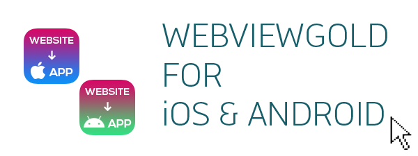
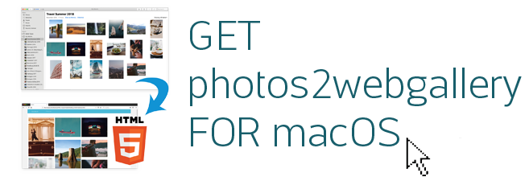

# WebViewGold for iOS 与 Android – WebViewGold for macOS

> **摘要：** 在移动端复用您的 Web 应用：获取 WebViewGold for iOS 和 Android——以及 photos2webgallery for macOS。

[文档](../README.md) › [WebViewGold for macOS](README.md) › 继续查看 iOS 与 Android

**平台：** macOS · **类别：** 更多 · **在线版本：** [www.webviewgold.com/zh/docs/mac/#ios](https://www.webviewgold.com/zh/docs/mac/#ios)

---

## photos2webgallery for macOS

---

## 继续阅读

- ← 上一页： [为 WebViewGold 评分](rate.md)
- 下一页 →： [联系我们](support.md)
- 其他平台上的相同功能： [iOS – Android 和 macOS 版本](../ios/more-platforms.md) · [Android – iOS 与 macOS 版本](../android/more-platforms.md)
- 语言： [🇺🇸 English](../../macos/more-platforms.md) · [🇩🇪 Deutsch](../../de/macos/more-platforms.md) · [🇫🇷 Français](../../fr/macos/more-platforms.md) · [🇪🇸 Español](../../es/macos/more-platforms.md) · **🇨🇳 中文**

